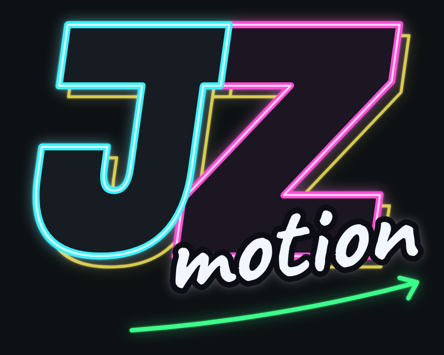
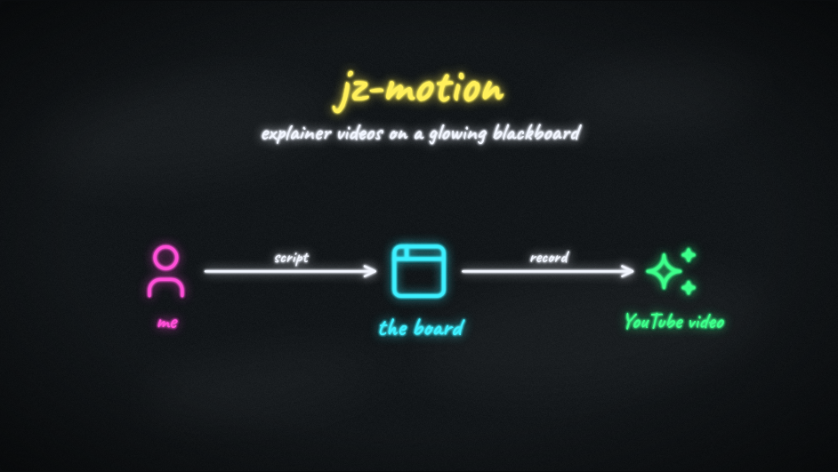

# jz-motion



A personal studio for technical explainer videos and presentations. Everything is drawn on a dark board in glowing marker colours (icons, logos, clipart, text, charts, isometric 3D, screenshots) and animated beat by beat, with arrows, flows, spotlights and camera moves. Models write most of it; you adjust it like a whiteboard, record your narration with a teleprompter, and export an MP4.



## Run it

```sh
npm install
npx playwright install chromium   # once: video export and snapshots use it
npm run dev                       # then open http://localhost:5173
```

Video export also needs [FFmpeg](https://ffmpeg.org) (`brew install ffmpeg`), or set `FFMPEG_PATH` / `FFPROBE_PATH`.

**Models.** If Claude Code is installed and logged in on your computer, **⚙ Settings** offers **Add Opus, Sonnet and Haiku**: the app then uses your Claude subscription, with no API key. Every model menu recommends the model that is enough for its job (Haiku for an icon, Opus for a whole presentation from a script). Otherwise add an OpenRouter key or any OpenAI-compatible endpoint. Details, and which model to use for what: [docs/models.md](docs/models.md).

New here? Open the example **jz-motion: explainers, fast (about this app)** from the home screen: ten scenes on what the app does and how, with its voice-over script in [docs/explainer-script.md](docs/explainer-script.md). **LLM Lab: choosing AI models on our own terms** is a second one, built around screenshots of another app ([script](docs/llm-lab-script.md)).

## Making a presentation

- **In the app.** The home screen has one prompt box: choose **Topic** (say what to explain), **Script** (paste what you will say) or **Recording** (attach a video or audio file; it is transcribed and the beats are timed to your words), pick the model, send. Refine the draft in the chat beside its preview, then create it. Or start blank, or from an example.
- **With Claude Code.** In this folder, ask Claude Code to "make a presentation about …". The skills in `.claude/skills/` tell it the format, the style and how to check and preview its work (see [CLAUDE.md](CLAUDE.md)). The file appears on the home screen.
- **By hand.** A presentation is one JSON file in `presentations/`; the format is in [docs/format.md](docs/format.md). The editor's **JSON** tab shows the open scene or the whole file.

Presentations, your library and your pictures are plain files (`presentations/`, `library/`, `images/`), so you can keep them in git.

## The editor

| Do | How |
|---|---|
| Add | Left panel: **Text**, **Box**, **Chart**, **Arrow** (click it, then the start element, then the end), **Image**, **Area**, and any icon, logo, clipart or 3D model. **⤢** opens the whole library. |
| Select, move, resize | Click and drag; corner handles resize. Shift+click selects several. |
| Edit text in place | Double-click a text, label or chart title (or select it and press Enter). Enter keeps it, Esc cancels. Code text takes several lines: Ctrl+Enter keeps it. |
| Properties | Right panel: position and size like a drawing program (drag a label such as **W** sideways to change it), colours as marker tips, styles as pictures (text: marker, bold, code; lines: solid, dashed, dotted; thickness; arrowheads; chart types). Hover **?** for help. Ids and rarely needed fields are under *Advanced*. |
| Beats | The strip under the board: one card per click, left to right, each with its actions on a small timeline. **+ beat** draws the selected elements; **+ action** adds draw, fade, pop, pulse, circle, spotlight, camera, move, flow, erase or a pause. Drag actions to reorder them or move them to another beat. |
| Scenes | Left panel: **+ New scene**, **✦ New scene with AI** (describe it, talk it over, add it after the open scene). |
| Pan, zoom | Drag the empty board, scroll. **Reset view** (0) returns to the scene's start view, **Fit all** (Shift+0) shows everything. |
| Undo, delete, duplicate | Ctrl+Z / Ctrl+Shift+Z, Delete, Ctrl+D |

**Fixed on screen.** Tick **fixed on screen** on any element (a title, an explanation) and it stays in place and size while the camera moves, above spotlights too; it stays exactly where it looks when you tick it.

**Screenshots.** Paste one (Ctrl+V), drop it on the board, or click **Image**. Animated ones (APNG, GIF, animated WebP: a short screen recording, for example) show their first frame until a **Play** action starts them; another **Play** with *on* off pauses, *from* jumps, *speed* changes the pace, and the picture's **loop** repeats it. Its properties offer a **frame**: a browser window drawn in marker, with your own address. Pictures sit under the drawing, so you can draw on them. To point at a part, select the picture and click **Area**, fit the dashed area over the part, and use the area's one-click beats: spotlight and circle it, spotlight it, circle it, zoom to it. A **spotlight** darkens or fades everything else until it is turned off; anything drawn meanwhile stays bright.

## AI while editing

- **Ask about this scene** (the bar above the beats): "split the second beat in two", "zoom into the database first". Only that scene changes; Ctrl+Z undoes it.
- **AI tab**: a chat about the whole presentation that can change it, or **Compare** several models on one request.
- **New with AI** (library window, left panel): an icon, clipart or 3D model made in a conversation. Every reply is a version with a preview; ask for changes until you like one, then save it to your library. **Refine with AI** continues from one of your items, **Make a variation** from a built-in one.

Every model reply is checked against the format and the drawing rules, and sent back with the problems when it breaks them.

**You can see what happens.** While a model works, its steps appear live under the message: what was sent (with the full text: **view**), what came back, what the check found. With **Claude Code (my subscription)** the app runs Claude Code *in this project* with its skills, the way Claude Desktop or a terminal would: it reads the rules and examples, writes a draft, checks it and looks at snapshots, and you see each step (reading a file, running the check, looking at a snapshot). The command to continue the same session in a terminal is shown underneath.

## Narration, timing and video

**Timing** (top bar) times the presentation to your voice:

- **● Record narration**: the script (each beat's speaker notes) shows large, as a teleprompter. Read, and press → or Space as you start each next line: that places the beat at that moment. ← takes back an early press, Esc stops. You get the voice-over and the timing in one go.
- **Load a voice-over…**: use a narration recorded elsewhere. Then drag the beats onto the waveform, or **Tap to place**: play and press T as each line starts.
- The board plays in sync, with the current and next line beside it. **Prompter** shows the script large at any time.
- **Make a take for export** turns it into a take with your voice as its sound.

Or present live: **Play** mode → **● Record** (tick *camera* to film yourself); your voice, camera and clicks become a take.

Then the **Video** tab: pick the take, add a friend's recording (with **Auto-sync**), choose where the camera goes per beat or scene (`layout`: board, pip, pip-left, camera, side), and **Export MP4** (1080p or 4K, 30 or 60 fps) into `exports/`. Without a take, the video uses even pauses between beats.

**Play mode keys:** → / Space / Page Down / click: next beat (finishes a running one first) · ← / Page Up: previous · F: full screen.

## Commands

| Command | Does |
|---|---|
| `npm run dev` | The app, with its local server (files, model calls, transcription, export) |
| `npm run check -- <file.json>` | Checks a presentation or library item against the app's rules; `--library` lists everything that can be drawn |
| `npm run snapshot -- <file.json>` | PNG of each scene fully drawn (`--beats`: after every beat) in `snapshots/` |
| `npm run export -- <file.json>` | Renders to MP4 (`--take <id>`, `--4k`, `--fps 60`, `--gap 1.5`, `--out file.mp4`) |
| `npm test` · `npm run typecheck` · `npm run build` | Unit tests · TypeScript · production build |
| `npm run mock-llm` | A fake model on port 5199, for trying AI flows without a key |
| `npm run icons` | Rebuilds the built-in icon library and `docs/library.md` |
| `npm run logo` | Rebuilds the logo files |

## Docs

- [CLAUDE.md](CLAUDE.md): orientation for Claude Code (and for you): skills, folders, conventions
- [Style guide](docs/style.md): how presentations should look; every model follows it
- [Presentation format](docs/format.md): the JSON reference
- [Library](docs/library.md): built-in icons, logos, clipart and 3D models
- [Models](docs/models.md): providers, your Claude subscription, which model for what
- [Design](docs/design.md): architecture, decisions and code map
- [How we built it](docs/journey.md): the project, step by step, with screenshots

Clipart from [Tabler Icons](https://tabler.io/icons) (MIT), logos from [Simple Icons](https://simpleicons.org) (CC0). Logos are trademarks of their owners.
