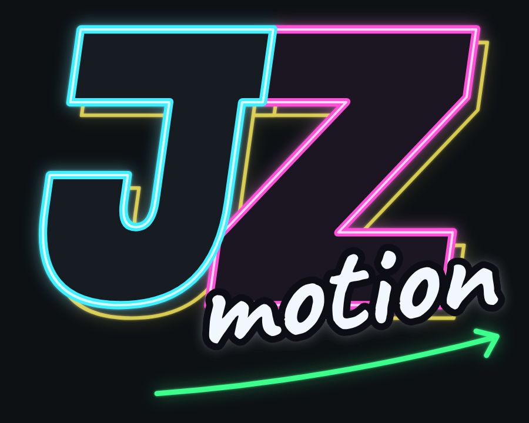
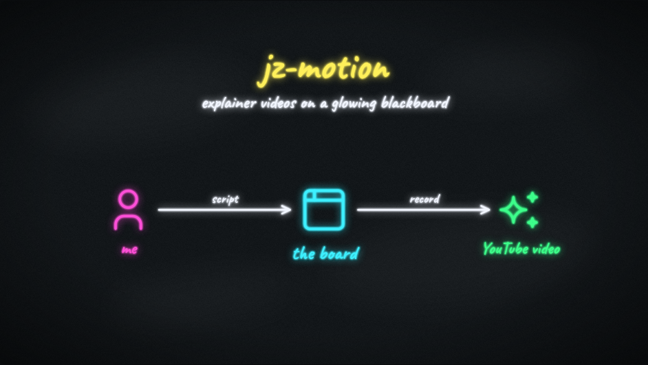

# jz-motion



A personal studio for technical explainer videos and presentations. Everything is drawn on a dark board in glowing marker colours (icons, logos, clipart, text, charts, isometric 3D, screenshots) and animated beat by beat, with arrows, flows, spotlights and camera moves. Models write most of it; you adjust it like a whiteboard, record your narration with a teleprompter, and export an MP4.



## Run it

```sh
brew install git-lfs && git lfs install   # once per computer: media/ is stored with Git LFS
git lfs pull                     # if you cloned before installing it: fetches the pictures and recordings
npm install
npx playwright install chromium   # once: video export and snapshots use it
npm run dev                       # then open http://localhost:5173
```

The app needs [FFmpeg](https://ffmpeg.org) (with its `ffprobe`) for the media library, transcription and video export: `brew install ffmpeg` on a Mac, `winget install Gyan.FFmpeg` on Windows, then open a new terminal. Or set `FFMPEG_PATH` to `ffmpeg` (`ffprobe` is taken from the same folder; `FFPROBE_PATH` overrides it).

**Models.** If Claude Code is installed and logged in on your computer, **⚙ Settings** offers **Add Opus, Sonnet and Haiku**: the app then uses your Claude subscription, with no API key. Every model menu recommends the model that is enough for its job (Haiku for an icon, Opus for a whole presentation from a script). Otherwise add an OpenRouter key or any OpenAI-compatible endpoint. Details, and which model to use for what: [docs/models.md](docs/models.md).

New here? Open the example **jz-motion: explainers, fast (about this app)** from the home screen: ten scenes on what the app does and how, with its voice-over script in [docs/explainer-script.md](docs/explainer-script.md). **LLM Lab: choosing AI models on our own terms** is a second one, built around screenshots of another app ([script](docs/llm-lab-script.md)).

## Making a presentation

- **In the app.** The home screen has one prompt box: choose **Topic** (say what to explain), **Script** (paste what you will say) or **Recording** (attach a video or audio file; it is transcribed and the beats are timed to your words), pick the model, send. Refine the draft in the chat beside its preview, then create it. Or start blank, or from an example.
- **With Claude Code.** In this folder, ask Claude Code to "make a presentation about …". The skills in `.claude/skills/` tell it the format, the style and how to check and preview its work (see [CLAUDE.md](CLAUDE.md)). The file appears on the home screen.
- **By hand.** A presentation is one JSON file in `presentations/`; the format is in [docs/format.md](docs/format.md). The editor's **JSON** tab shows the open scene or the whole file.

Presentations, your library and your pictures, recordings and sounds are plain files (`presentations/`, `library/`, `media/`, and the older `images/`), so you can keep them in git.

## The editor

| Do | How |
|---|---|
| Add | Left panel: **Text**, **Box**, **Chart**, **Arrow** (click it, then the start element, then the end), **Image**, **Area**, and any icon, logo, clipart or 3D model (fold a section away by clicking its heading; searching shows every match). **⤢** opens the whole library, including **Media**: your pictures, recordings and sounds, ready to put on the board. |
| Select, move, resize | Click and drag; corner handles resize. Shift+click selects several. |
| Edit text in place | Double-click a text, label or chart title (or select it and press Enter). Enter keeps it, Esc cancels. Code text takes several lines: Ctrl+Enter keeps it. |
| Properties | Right panel: position and size like a drawing program (drag a label such as **W** sideways to change it), colours as marker tips, styles as pictures (text: marker, bold, code; lines: solid, dashed, dotted; thickness; arrowheads; chart types). Hover **?** for help. Ids and rarely needed fields are under *Advanced*. |
| Beats | The strip under the board: one card per click, left to right, each with its actions on a small timeline. **+ beat** draws the selected elements; **+ action** lists every action, grouped (bring in, take away, point at, view, move and play, data and timing) with a line on what each does; ones that don't fit what is selected are greyed out with the reason. Click an action to see what it does and when it runs: after or with the previous one, a wait first, and how long it takes. Drag actions to reorder them or move them to another beat. |
| Scenes | Left panel: **+ New scene**, **✦ New scene with AI** (describe it, talk it over, add it after the open scene). Right-click a scene for a new scene before or after it (empty or with AI), moving it up or down, or deleting it. A scene that continues from the one before stays attached to it: a new scene goes before or after the whole chain. |
| Pan, zoom | Drag the empty board, scroll. **Reset view** (0) returns to the scene's start view, **Fit all** (Shift+0) shows everything. |
| Undo, delete, duplicate | Ctrl+Z / Ctrl+Shift+Z, Delete, Ctrl+D |

**Fixed on screen.** Tick **fixed on screen** on any element (a title, an explanation) and it stays in place and size while the camera moves, above spotlights too; it stays exactly where it looks when you tick it.

**Screenshots.** Paste one (Ctrl+V), drop it on the board, or click **Image**. It goes into the media library, made smaller on the way in (a pasted PNG becomes WebP, an APNG or GIF recording becomes WebM video). A recording shows its first frame until a **Play** action starts it; another **Play** with *on* off pauses, *from* jumps, *speed* changes the pace, and the picture's **loop** repeats it. **Select a recording** to step through its frames under it (◀ frame 4 / 27 ▶): **Go to frame 4** (tick *fade* for a cross-fade) or **Play to frame 4** adds that to a beat, so a step-by-step demo moves one picture at a time. Both are also in **+ action** (*Move and play*) and read as "Go to frame 4, fading" or "Play to frame 9" in the beats. Its properties offer a **frame**: a browser window drawn in marker, with your own address. Pictures sit under the drawing, so you can draw on them. To point at a part, select the picture and click **Area**, fit the dashed area over the part, and use the area's one-click beats: spotlight and circle it, spotlight it, circle it, zoom to it. A **spotlight** darkens or fades everything else until it is turned off; anything drawn meanwhile stays bright.

**Media.** The library window's **Media** section shows every picture, screen recording and sound in `media/`: a preview (recordings play while you hover), the size, length or dimensions, and an *unused* badge when no presentation refers to it. Filter by kind or *Unused*, search by name. Select one to rename it, see what it was converted from and which presentations use it (click one to open it), copy its reference (`/media/…`), put a picture or recording on the board, or delete it (if presentations use it, you are told which first). **● Record screen** records a window, a browser tab or the whole screen (the browser asks which), after a 3-second countdown, until you press Stop; then trim the start and end, name it and **Keep** it: it is converted and added like an import (pictures only; the narration is recorded in Timing). **Import…** (or dropping files there) adds pictures, recordings (APNG, GIF, MP4, MOV, WebM) and sounds, each converted and shown with its new size next to the old one. **Clean up** removes everything nothing uses, after one confirmation that says how much it frees.

## AI while editing

- **Ask about this scene** (the bar above the beats): "split the second beat in two", "zoom into the database first", or "make a new scene for the part about …" (it is added right after, with that part of the script moved into it, and opened). It says plainly what changed ("Added scene 2 … · changed scene 1"), or that nothing did and why; Ctrl+Z undoes it.
- **AI log:** every AI request and what came of it (the model, what was asked, the reply, the steps an agent took, what changed or the error) is kept in `logs/ai.jsonl` (not in git), to see afterwards what went wrong.
- **AI tab**: a chat about the whole presentation that can change it, or **Compare** several models on one request.
- **New with AI** (library window, left panel): an icon, clipart or 3D model made in a conversation. Every reply is a version with a preview; ask for changes until you like one, then save it to your library. **Refine with AI** continues from one of your items, **Make a variation** from a built-in one.

Every model reply is checked against the format and the drawing rules, and sent back with the problems when it breaks them.

**You can see what happens.** While a model works, its steps appear live under the message: what was sent (with the full text: **view**), what came back, what the check found. With **Claude Code (my subscription)** the app runs Claude Code *in this project* with its skills, the way Claude Desktop or a terminal would: it reads the rules and examples, writes a draft, checks it and looks at snapshots, and you see each step (reading a file, running the check, looking at a snapshot). The command to continue the same session in a terminal is shown underneath.

## Narration, timing and video

**Script** (top bar) shows the whole narration on one page: every scene's beats with their speaker notes, editable in place, and how long each sentence takes to say (estimated, or measured once a voice has been generated).

**Timing** (top bar) times the presentation to your voice. Its timeline has two lanes of voice clips above the beats:

- **● Record narration**: records from the playhead onward as a new clip, with the script large as a teleprompter. Read, and press → as you start each next line: that places the beat at that moment. Space holds the prompter, ← takes back an early press, Esc stops. Record again later to redo part of it: the new clip goes on a free lane.
- **Load a voice-over…**: use a narration recorded elsewhere (any audio or video file). Then drag the beats onto the waveform, or **Tap to place**: play and press T as each line starts.
- **Clips** can be dragged along the timeline or to the other lane, trimmed from either end, split at the playhead (**✂ Split** or S) and removed. Trimming and splitting never change the recorded file. A clip whose recording isn't on this computer (recordings stay where they were made) is striped red and marked *missing*; **Remove N missing clips** in the header clears them all.
- **Right-click** a clip to play from there, **clean up the voice** (removes background noise such as a fan, hum or room sound, on this computer with RNNoise; a ✨ marks a cleaned clip, and *Back to the original recording* undoes it), split it there, move it to the other lane or remove it; right-click a beat to edit it, play from it, or let it follow the one before (forget where it was placed). **Double-click a beat** to close Timing and edit it in the editor.
- **Double-click a clip** for its window: its sound wave with the beats that start in it, **Play this clip** (only that clip, at its volume; click the wave to go to a moment, Space plays or pauses; drag to select a part and **loop** it, or **remove** it, closing the gap or keeping the timing; **↶ Undo** takes it back), drawn with how loud you are moment by moment, your average and the level the video aims for; how loud it is next to the level of the video (too quiet, about right, too loud) and a volume for it (**Even it out** sets it for you, without distorting), play it in the timeline, clean up the voice, transcribe or remove it (moving it to the other lane stays in the right-click menu, or drag it), **Check the microphone** (pick the input, watch the meter while you turn the gain until your peaks sit in the green, record five seconds and listen), and **Record it again** with its lines as a prompter (→ when you start each next line). Keep the new take and, if it is longer or shorter, everything after it moves by the difference; the beats inside follow your → presses or spread over the new length. Or **✨ Generate again**: its lines are spoken by the voice in Settings (your own clone when you have set one) as a new clip in its place, levelled to the video's volume, with the beats where their lines start; **new reading of every line** (on) asks for a fresh reading, off keeps the lines that didn't change. **↶ Undo** brings the old clip back. **My avatar** makes a video of your avatar photo saying the clip (Kling AI Avatar on fal.ai, about 6¢ a second, a few minutes; key in Settings → My avatar), and makes it again after **Generate again**; the video shows it wherever a scene's or beat's *layout* shows the camera (pip in a corner, camera full screen), and so does Timing's board, in step with the playhead.
- **Which lane is heard:** the clip under the playhead glows, and the Now card (also in the prompter) says which lane is speaking; while you record, the new narration grows live on the lane it goes to.
- **Drag a beat** (its label, or anywhere near its line in the beats area) to move it; it stops at the next beat with its own time, so nothing else is pulled along. **Shift + drag** moves it and every beat after it together, either way (to open or close a pause); **Ctrl + drag** also moves the voice clips that start after it. A hint shows where it goes and which keys are held. **Deleting a scene** in a timed presentation takes its time out too: later beats move earlier and the narration recorded over it is cut out, so no hole is left (Undo brings it back).
- **Click a beat** on the timeline to open its options in a drawer: title, speaker notes, play automatically, start time, video layout, and its actions (click one to change it). A taller timeline (drag its top edge) spreads beat labels over more rows so none overlap.
- **Getting around:** the mouse wheel scrolls the timeline, Ctrl/⌘ + wheel zooms around the pointer, and the **minimap** above it shows the whole timeline (clips, beats, playhead and the part in view): click or drag it to go there, **Fit** to see everything.
- **Generate voice** (needs a text-to-speech key in Settings → Voice generation: OpenAI, or OpenRouter with ElevenLabs, Microsoft, Gemini, MiniMax or Voxtral, with the voices each one has; **your own voice**: **🎙 My voice** (on the home screen, in Timing, or Settings; kept with the project in `voice/my-voice.json`) records a sample reading a suggested text, and a cloning model copies it; hear a sentence in it before using it; *how to speak* gives a style to the models that take one) makes a short clip for every sentence of the notes, so the prompter can show how long each line should take; regenerated only when a sentence changes.
- The board plays in sync, with the current and next line beside it (and, dimmed above, the end of the beat before, so you can pick up where you left off; lines already read fade), and the notes can be edited right there (**✎ Edit**), at the same size as shown. Timing always shows the script large, as a prompter, and opens at the start of the scene you were looking at; closing it shows the scene at the playhead in the editor. Space plays and pauses, ←/→ move two seconds.
- **Transcript** (header, or right-click a clip → *Transcribe…*) turns what you recorded into text, laid out under the beats you said it over (uses the speech-to-text service from Settings; kept next to the recording, so it opens instantly next time). **Copy all** or **Copy** one beat to paste anywhere, **Use as speaker notes** to put a beat's words straight into the prompter, or click a sentence to go there.
- **Make a take for export** turns it into a take with all clips mixed as its sound.

Or present live: **Play** mode → **● Record** (tick *camera* to film yourself); your voice, camera and clicks become a take.

Then the **Video** tab: pick the take, add a friend's recording (with **Auto-sync**), choose where the camera goes per beat or scene (`layout`: board, pip, pip-left, camera, side), and **Export MP4** (1080p or 4K, 30 or 60 fps) into `exports/`. *Even out volume* (on by default) brings the sound to the standard loudness of online video, so a quiet recording comes up and a loud one doesn't clip. Without a take, the video uses even pauses between beats.

**In Play mode** the storyboard stays under the board and follows the playback: the running beat is lit, each action glows while it runs (with a playhead) and gets a tick when done, and what it animates is outlined on the board (not in full screen). Click an action or beat to change it in Properties while you watch; ⏮ on a beat goes to just before it.

**⛶** (top bar) puts the whole app full screen, and back; **Present** still shows the board alone, and leaving it returns to the full-screen app.

**Leave a scene out of the video** (right-click it in the scene list, or its properties): Timing, Play all, presenting and the export pass over it, so you can keep two versions of a scene side by side and switch which one plays.

**Edit / Play** sits just above the beats: beside the AI box in Edit mode, beside the play controls in Play mode. **P** switches between them (not while typing or with a window like Timing open); Esc in Play goes back to Edit.

**Play mode keys:** → / Space / Page Down / click: next beat (finishes a running one first) · ← / Page Up: previous · F: full screen.

## Commands

| Command | Does |
|---|---|
| `npm run dev` | The app, with its local server (files, model calls, transcription, export) |
| `npm run check -- <file.json>` | Checks a presentation or library item against the app's rules; `--library` lists everything that can be drawn |
| `npm run snapshot -- <file.json>` | PNG of each scene fully drawn (`--beats`: after every beat) in `snapshots/` |
| `npm run snap -- <url> <name>` | Screenshots a web page (or one element, `--selector`) into the media library, sharp enough for camera zooms (2560×1600 at 125 % zoom by default; `--size`, `--zoom`, `--scale`) |
| `npm run record -- <url> <name> <scenario.mjs>` | Records an interaction scripted in `scripts/scenarios/` into the media library as video, at the same sharpness as `snap` |
| `npm run media -- import <file…>` | Adds pictures, recordings or sounds to the media library, converted (WebP, WebM, Opus); `migrate` moves older `images/` files in; `frames <file>` lists a recording's frames |
| `npm run assets` | Lists pictures, recordings and voice-overs with their size and the presentations that use them; `--unused` lists what nothing uses (deletes nothing) |
| `npm run export -- <file.json>` | Renders to MP4 (`--take <id>`, `--4k`, `--fps 60`, `--gap 1.5`, `--out file.mp4`) |
| `npm test` · `npm run typecheck` · `npm run build` | Unit tests · TypeScript · production build |
| `npm run mock-llm` | A fake model on port 5199, for trying AI flows without a key |
| `npm run icons` | Rebuilds the built-in icon library and `docs/library.md` |
| `npm run logo` | Rebuilds the logo files |

## Docs

- [CLAUDE.md](CLAUDE.md): orientation for Claude Code (and for you): skills, folders, conventions
- [Style guide](docs/style.md): how presentations should look; every model follows it
- [Presentation format](docs/format.md): the JSON reference
- [Library](docs/library.md): built-in icons, logos, clipart and 3D models
- [Models](docs/models.md): providers, your Claude subscription, which model for what
- [Design](docs/design.md): architecture, decisions and code map
- [Media plan](docs/media-plan.md): where pictures, recordings and voice live today, and the proposed media library
- [How we built it](docs/journey.md): the project, step by step, with screenshots

Clipart from [Tabler Icons](https://tabler.io/icons) (MIT), logos from [Simple Icons](https://simpleicons.org) (CC0). Logos are trademarks of their owners.
