# How we built jz-motion

A running log of how this project is made: a person (Jakub) and an AI coding agent (Claude Code, in a cloud session) working in a chat. Each step records what was asked, what was decided, what was built, how it was checked, and what was approved. It is kept up to date as we go, as material for the video about making this project.

## How we work

The loop we settled into:

1. **Talk first.** Jakub describes the goal in plain words. Claude proposes an approach and asks only the questions that change what gets built.
2. **Decide.** Jakub answers; decisions go into [design.md](design.md).
3. **Build in small steps** on a branch, with unit tests for the logic.
4. **Look at it.** Claude runs the app in a headless browser and takes screenshots of real frames. Several bugs were caught this way that tests did not catch.
5. **Approve.** Screenshots are sent to Jakub for each visible change; he approves or asks for changes.
6. **Commit and push**, then log the step here.

## Step 1: The idea (planning chat)

**Ask:** a desktop app, maybe Electron, for making technical explainer YouTube videos: blackboard-style animations (chalk or saturated markers) that are easy to edit, camera video of himself and a friend (picture in picture, side by side), and switchable AI models (OpenRouter, RunPod) to generate the animations. The first video should be about this project itself.

**Claude's proposal:**
- The key decision: the AI should write **editable scene data**, not pixels or video, so changing a word is a form field, not a regeneration. A small library of drawable components; scenes as JSON; the model fills in the JSON.
- Record each person as a separate track so layouts can change afterwards; sync tracks by audio.
- Models through OpenAI-compatible endpoints, so OpenRouter, RunPod and a self-hosted gateway are one code path, with a side-by-side compare mode.
- Phases: scene engine first, then AI, then camera and timeline.

## Step 2: Looking at the competition

Jakub pointed to an inspiration video (YouTube was blocked from the cloud environment, so Claude could not watch it), then to **Claude Motion** (Anthropic's animation feature for teams) and **HyperFrames** (HeyGen's open-source HTML-to-video renderer). Claude researched both:

- Both confirm the approach: an AI writes code or data that draws the video; no generated footage.
- HyperFrames uses HTML + GSAP timelines rendered frame by frame with a headless browser and FFmpeg. So we chose **GSAP** for animation, which keeps HyperFrames export open for later.

## Step 3: The pivot to a web app

**Ask:** start instead with a **web app**: a blackboard with **luminous markers**, multiple slides, animated hand-drawn clipart (apps, users, infrastructure, equipment), animated arrows, charts, zoom in and out, camera moves, flow animations. A reusable element library. Good documentation so an LLM can write slides later. Focus: app and AI development topics.

**Claude's plan:** presentation → scenes → elements + camera + **beats** (one beat = one presenter click; in video mode beats play back to back). Arrows and camera targets refer to element **ids**, not coordinates. SVG for sharp zooms, GSAP for seekable timelines, a zod schema as the single source of truth for the format and its docs.

**Decisions** (Jakub's answers):
1. One board per scene, with an option to carry elements over from the previous scene.
2. Marker colors: green, pink, yellow, cyan, orange, white.
3. Clipart made together as needed; no hand drawing for now.
4. Build in the `jz-motion` repo.

## Step 4: Phase 0, the engine

Built: the JSON format, a compiler that validates it and turns beats into a timed plan (with readable errors like `scenes.0.beats.2.actions.1: unknown element "db"`), an SVG + GSAP renderer (stroke-by-stroke drawing, handwriting reveal, neon glow, board texture, dots flowing along arrows, camera framing by id), and a player with a live JSON editor and full-screen present mode. 18 icons imported from Tabler by a script. An example presentation about the project itself.

**Checked by:** unit tests, then screenshots of real frames in a headless browser. The screenshots caught three bugs the tests could not see: arrowheads appearing before the line finished drawing, slanted arrows from labelled icons, and loose highlight circles. Also checked: stepping back to a beat gives a pixel-identical frame to arriving fresh.

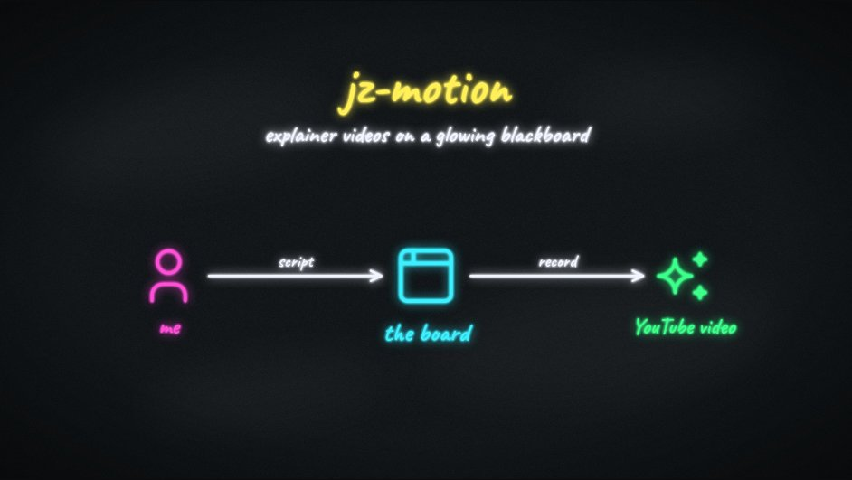

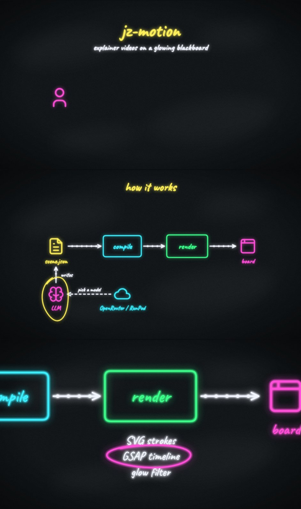

Jakub asked for animated previews; Claude rendered the timeline frame by frame (not a screen recording, so motion is smooth) and encoded APNGs and GIFs:

## Step 5: Feedback round: glow, logos, hardware, 3D

**Ask:** saturated colors but not so much glow that text is unreadable; logos of the main LLM labs (Anthropic, OpenAI, Google, Qwen, DeepSeek); hardware (GPU, Mac, DGX Spark); stretch goal: isometric 3D with three.js in the same style. And: **send screenshots of everything new for approval.**

- **Glow:** tight inner glow + dimmed halo with the crisp stroke on top; bolder handwriting.

  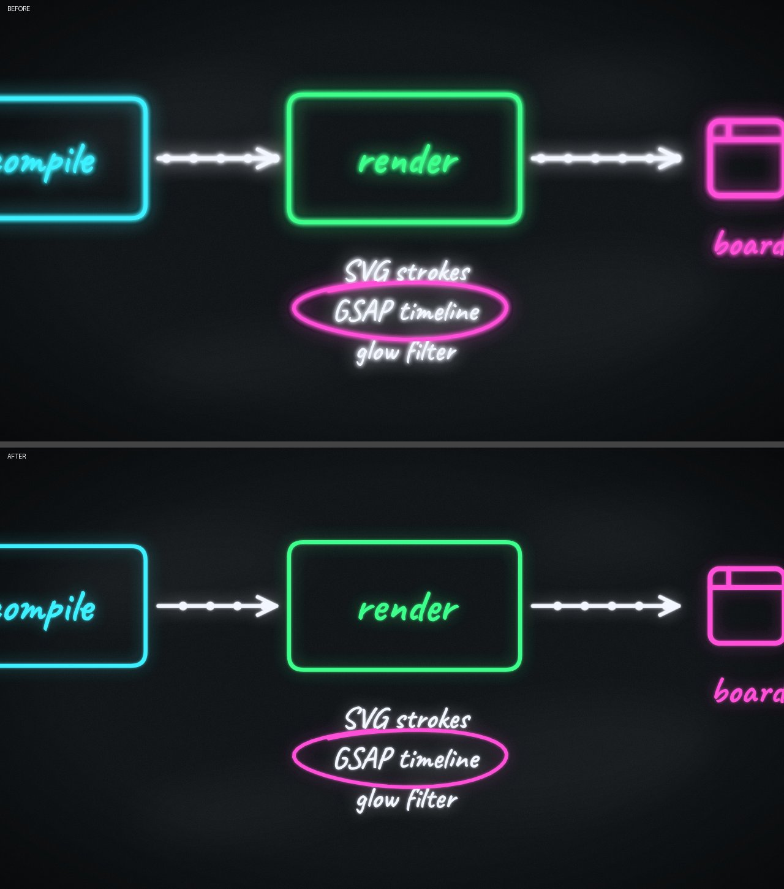

- **Logos:** from Simple Icons (CC0), drawn as a neon outline with a faint fill. OpenAI's logo is not in that set, so Claude drew it: six rounded links rotated around a center, with an over-under weave computed by hiding each link where the next one crosses it. Four variants were rendered; the cyclic weave was picked.

  

- **Hardware:** hand-drawn GPU, Mac Studio, Mac mini and DGX Spark in a slight 3D box style. The first versions were too small next to the other icons and the Spark's foam front clumped into a solid block, so they were redrawn (dot grille for the foam).

  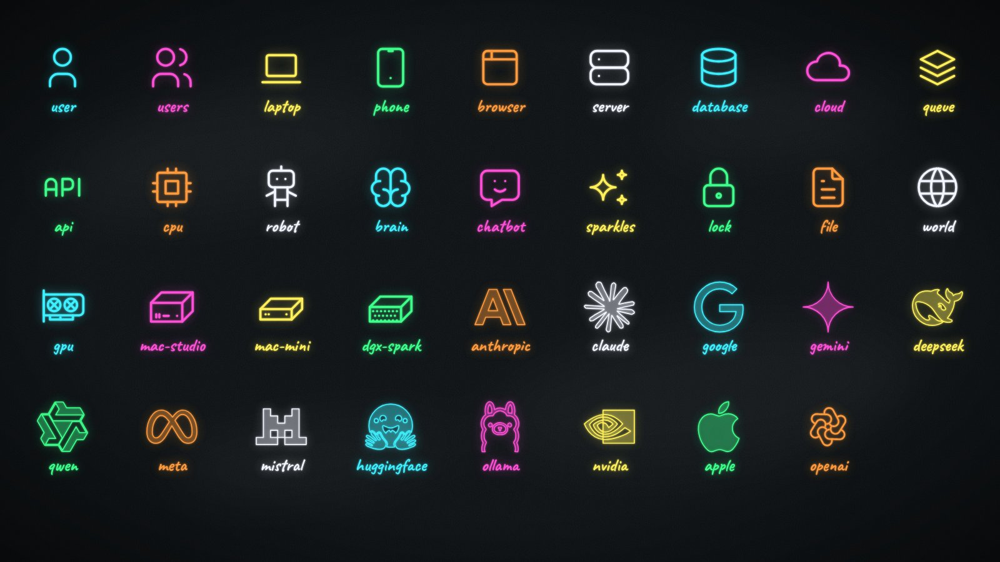

- **Examples:** "Who builds the models" and "Where do models run". A screenshot showed dashed boxes cut off at the top-left (the default SVG mask region was too small), fixed.

  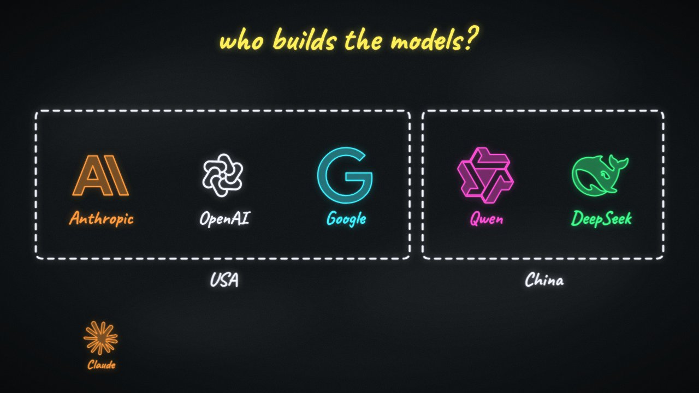
  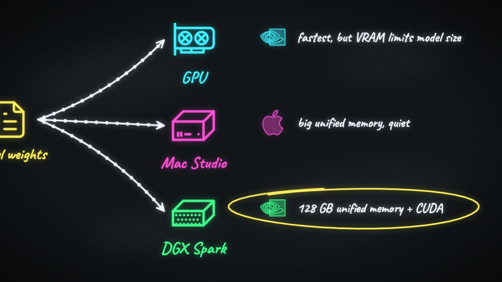

- **3D:** three.js does the 3D math and the isometric projection; the faces are drawn as SVG paths filled with the board color, so 3D objects glow, draw on and zoom exactly like everything else. New actions: rotate, spin, explode. A screenshot of an exploded GPU cluster showed cubes hidden under their base plate (sorting by center depth fails for big flat parts), fixed with a proper isometric paint order and a test for it.

  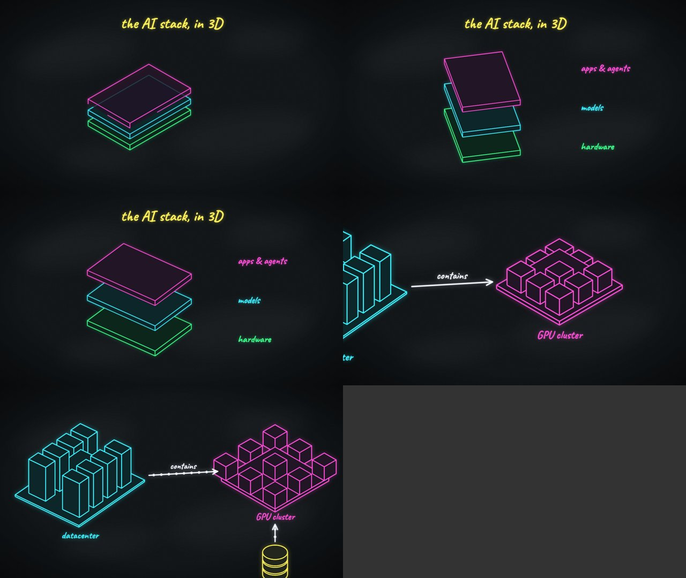
  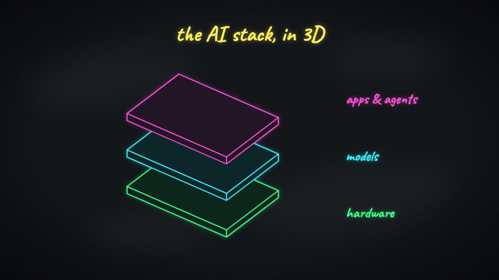
  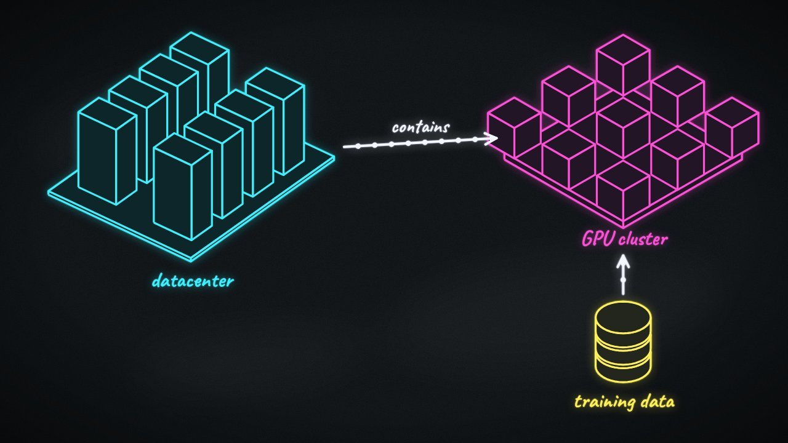

**Approved:** glow level, the hand-drawn OpenAI logo, the hardware drawings, the 3D look.

## Step 6: Into `main`, and this log

Jakub asked to put everything on `main` (pull request #1, merged), to keep this log of the steps, and to build next: (1) a visual editor, (2) LLM generation with switchable models, (3) charts.

## Step 7: The editor

Built an **Edit** mode next to **Play**:
- The board shows every element of a scene fully drawn. Click to select, shift+click for several, drag to move, scroll to zoom, drag the empty board to pan.
- A library palette (searchable icons with previews, text, box, 3D models); "Arrow" connects two selected elements.
- Beats as cards under the board: add, reorder, delete beats and actions; clicking an action highlights its targets on the board.
- A properties panel **generated from the schema** (zod → JSON Schema), so new fields and element types appear in the editor without extra work. Renaming an element updates every reference to it; deleting one also removes its arrows and its mentions in beats.
- Undo/redo for every change. The JSON stays the single source of truth, so the JSON tab and the visual editor are always in sync.

**Checked by:** unit tests for the edit operations (rename, delete, unique ids), and a browser script that selects, drags, adds a GPU, connects it with an arrow, adds a beat, undoes three times and switches to Play. The first screenshot showed an empty, mis-framed board: in development React mounts components twice, and the discarded board finished loading later and stored a bogus camera. Fixed by ignoring results from a board that is no longer current.

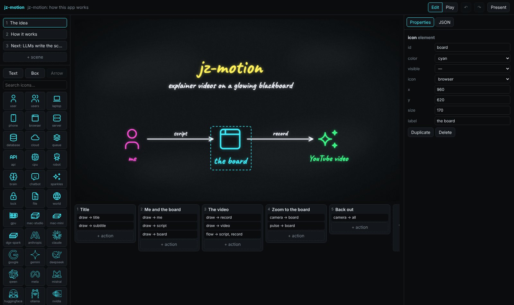
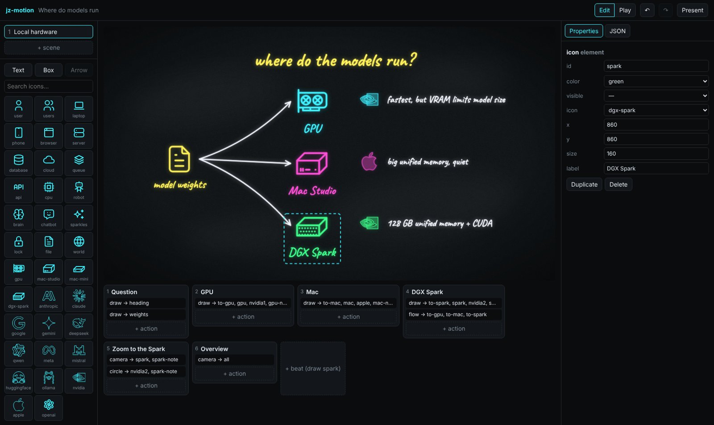

## Step 8: Generating scenes with LLMs

Built an **AI** tab:
- **Models** are any OpenAI-compatible endpoint: presets for OpenRouter and RunPod (vLLM), plus custom. Tick several to compare them on the same request.
- **The prompt is our own docs**: `docs/format.md` and the generated `docs/library.md` go into the system prompt, so keeping the docs accurate is what keeps generation accurate.
- **Repair loop:** the reply is compiled; if it does not load, the compiler's readable errors go back to the model, up to two times.
- **Results** show a live preview, time, tries, tokens and cost (OpenRouter reports cost); "Use this" replaces the presentation, and undo brings the old one back.
- Requests go through a small proxy in the local dev server (browsers can't call most model APIs directly), so API keys stay in the browser and on this machine.

**Checked by:** unit tests with a fake model (repair loop, giving up, edit mode, failures) and an end-to-end browser run against a **mock model server** (`npm run mock-llm`, also useful for trying the flow without keys). The unit tests found a real bug: an arrow pointing at an invalid element made the compiler throw instead of listing the error, which would have sent the model a confusing message. The compiler now never throws.

No real model has been tried yet: there are no API keys in the cloud environment. That is the next thing for Jakub to try.

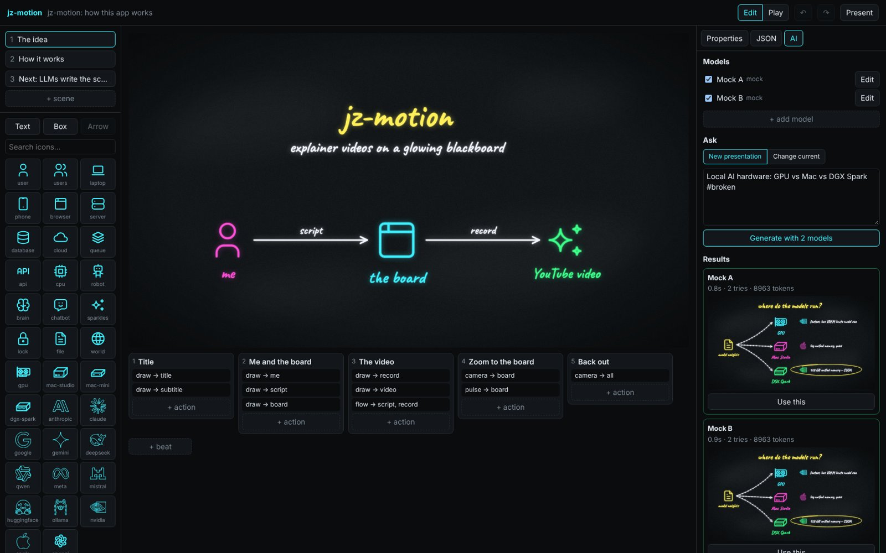

## Step 9: Charts

Added a `chart` element (bar, line, donut pie) and a `set-values` action:
- `draw` writes the title, draws the axes, then grows the bars, traces the line or sweeps the slices while the values count up.
- `set-values` animates to new numbers, for "before / after" moments. The compiler sizes the value axis to fit every value the chart shows in the scene, so bars never overflow.
- Like the 3D objects, charts are redrawn every frame from a few animated numbers, so scrubbing and stepping back stay exact.
- The editor got a "Chart" button; data is edited in the properties panel (switching bar → line is one dropdown).

**Checked by:** tests for the value animation, axis rounding and errors (wrong number of values, set-values on a non-chart), and screenshots of each chart while drawing and after a change.

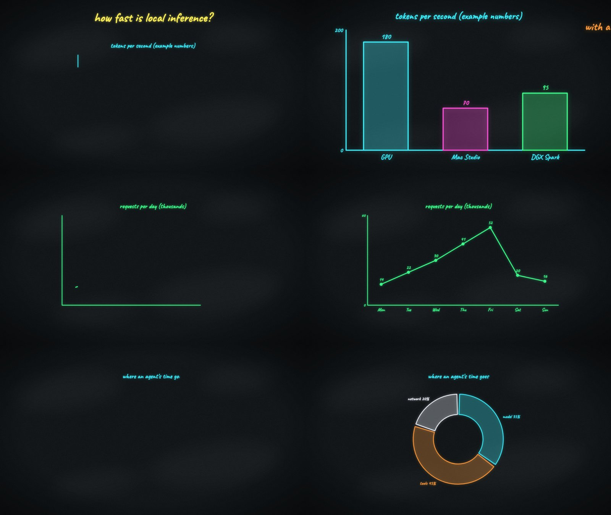

## Step 10: Into `main` again

The editor, LLM generation and charts went to `main` as pull request #2. Next for Jakub: try the AI tab with real models (OpenRouter or RunPod keys), and decide what the first real video covers.

## Step 11: Videos: export, recording, camera layouts

Jakub asked for the three pieces that turn a presentation into a YouTube video.

- **A performance** is the list of moments when a beat started (and what it played), recorded from the presenter's clicks or generated with even pauses. Given one, every frame of the video is fully determined, so exporting is exact and repeatable.
- **Export:** a hidden render page (`/?render`) draws any moment of a presentation. Playwright steps it frame by frame and pipes JPEGs into FFmpeg, which encodes H.264, lays out camera tracks and mixes the audio. There's a button in the new **Video** tab and `npm run export` on the command line.
- **Recording:** **● Record** in Play mode saves microphone, camera and every click as a *take* on disk, with a live camera preview while presenting.
- **Layouts per beat or scene:** board, pip, pip-left, camera (board small), side (two people). A friend's recording is added to a take and lined up by matching the sound of the two tracks.

**Checked by:** tests for timing, layouts over time, the FFmpeg command and the sound matching; a full run in a browser with Chromium's fake camera and microphone (record, add a "friend" track, export, check a frame of each layout); auto-sync found a 2.00 s offset as 1.97 s.

**What the measurements changed:** the first export took 8× real time. Timing it showed that drawing a frame takes 3 ms but taking the screenshot 170 ms, and most of that was the board's static texture (noise and a large blur) being re-filtered every frame. The texture is now painted once into a bitmap (same look, also lighter for live playback), and frames render in parallel browser pages: 34 s of video went from 273 s to 112 s on the 4-core cloud machine.

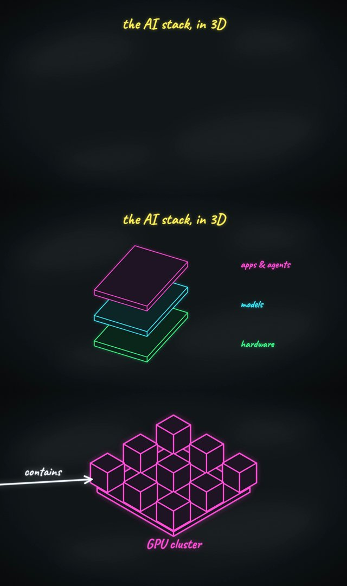
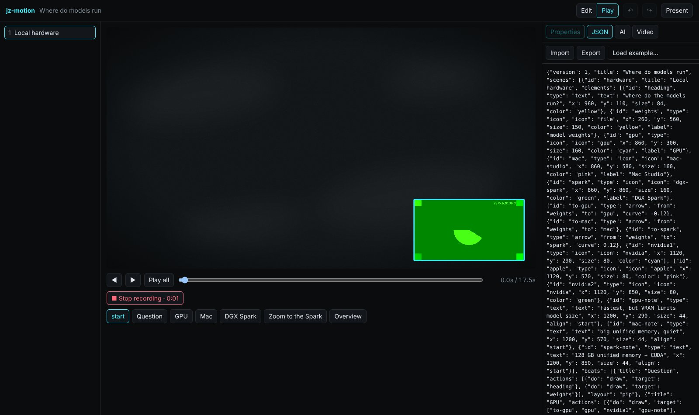
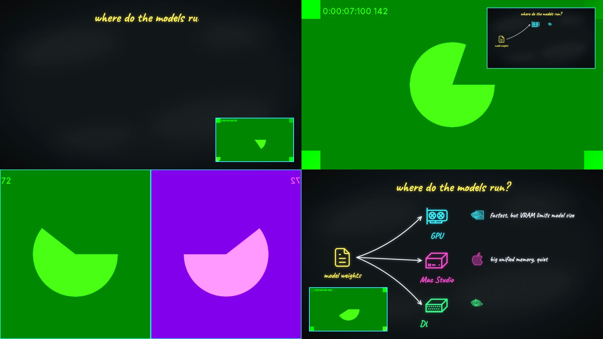

## Step 12: A logo

Jakub asked for a more fun logo. Three design rounds, each a sheet of options rendered in the board's own style:

1. Four directions: JZ with an orbiting swoosh, a hand-drawn play button, a marker drawing a squiggle, JZ as a node diagram.

   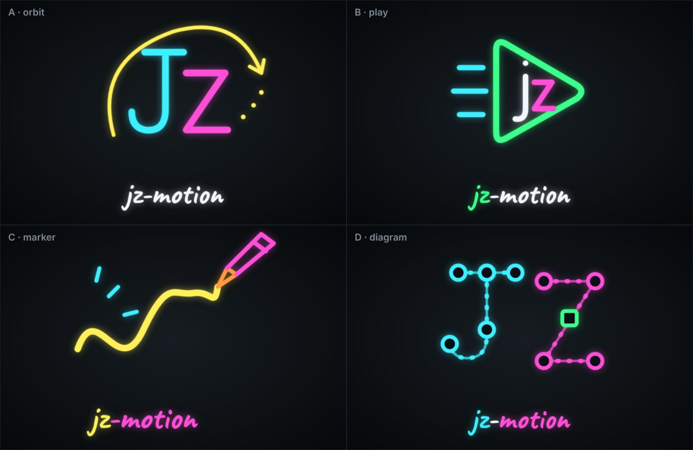

2. Jakub: big outlined JZ with a smaller handwritten "motion". Three placements of "motion": a signature underneath, written across, side by side.

   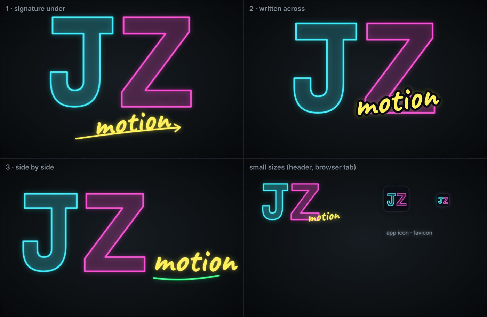

3. Jakub: between the first two placements, letters bolder and closer, "motion" bigger and overlapping. Chunky slanted letters with the J overlapping the Z, in three treatments: neon tube, 3D shadow, both.

   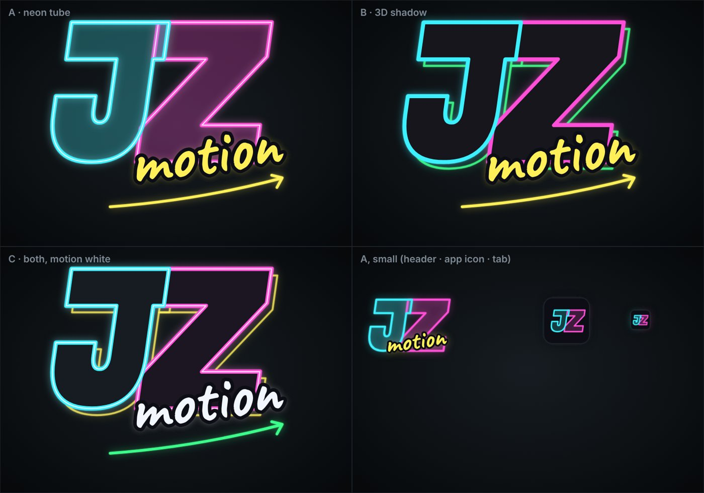

Jakub picked **C** (neon tube + shadow, white "motion", green arrow). `npm run logo` now builds every size from one script: the full logo and JZ mark as SVG ("motion" converted from the Caveat font to outlines, so it needs no fonts), app icons, and favicons that drop the shadow and glow at 16 to 48 px so they stay crisp. The app header and browser tab use it.

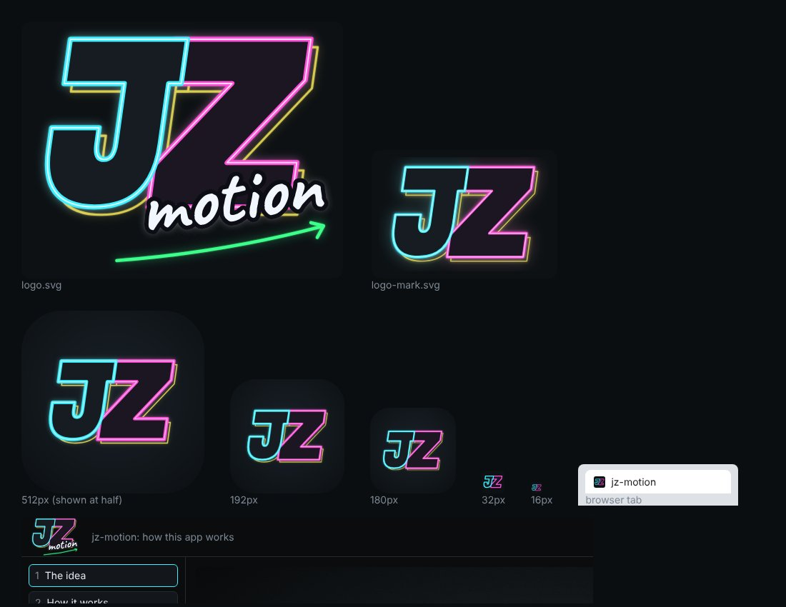

## Step 13: Presentations, and editor fixes from real use

Jakub tried the app and asked for:
- **Presentations as the top level.** A home screen of cards with a live preview of each presentation; new (blank or from an example), open, rename, duplicate, delete. Presentations are JSON files in `presentations/`, saved half a second after each edit (browser storage when there is no local server). The address (`#/p/<id>`) keeps a presentation open across reloads, takes remember which presentation they belong to, and the old single browser draft became the first presentation.
- **Colors as a palette**: swatches instead of a dropdown.
- **"I can't add an arrow."** The button only worked after a hidden shift+click on two elements. It is now a tool: click Arrow, click the start, click the end.
- **Resize handles**: corner handles on the selected element; icons, text and 3D models keep their proportions, boxes and charts stretch (Shift keeps proportions).

**Checked by:** browser scripts for each (resize an icon and a box, pick a swatch, connect two elements, create / rename / duplicate / delete presentations and check the files on disk). The first resize and arrow run failed while the same checks passed afterwards; logging every pointer event showed the code was right and the page had loaded mid-change, so the checks were repeated twice more to rule out flakiness.

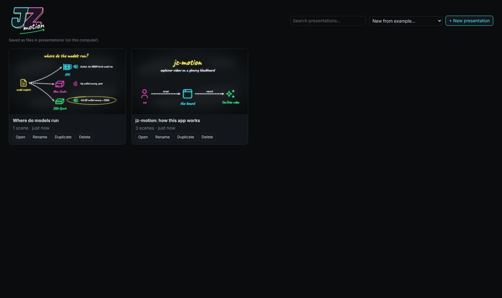
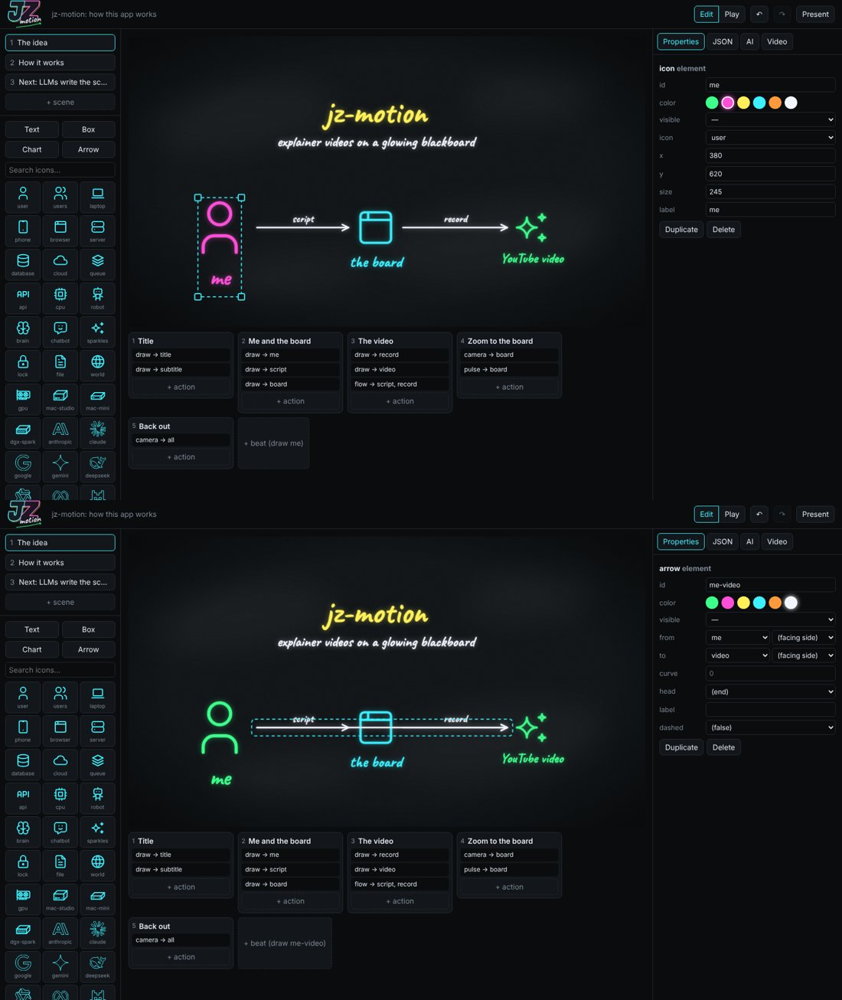

## Step 14: Markers instead of dots

Jakub liked the palette but wanted the actual marker tips instead of circles. Colors are now a tray of markers (chisel tip, collar, a colour band on the body): the chosen one stands up out of the tray and glows in its ink, and a marker lifts halfway when hovered. One detail found by the screenshots: the tray hides the markers' lower halves, and a hidden-overflow box can still be scrolled (the test tool scrolled it while hovering), which shifted every marker; `overflow: clip` can't be scrolled.

## Step 15: JSON editor, clipart, and working with LLMs everywhere

Jakub's next list: a nicer JSON view (full screen, folding, colours, this scene or the whole file), presentations from a script and from a recording, clipart including the jz-motion logo, chart types as icons, creating icons and clipart by describing them to a model (with the rules shown), and chatting with a model inside the editor.

- **JSON editor:** CodeMirror with the board's colours, folding, search and syntax errors marked inline; a switch between the open scene and the whole file (a scene's edits apply as soon as they are valid); full screen.
- **Pictures instead of names** for chart types, camera layouts, text alignment and arrowheads.
- **Clipart:** library items can now be multi-coloured drawings (`parts`, each with its own marker colour, width and fill). The logo build script also writes the jz-motion logo as clipart, so the board version always matches the real logo.
- **Making icons and clipart with AI:** describe it; the rules sent to the model are shown (grid, stroke-only, drawing order, allowed colours); the reply is checked against them and sent back if it breaks them; compare drawings from several models and save one to `library/`. Saved items work on the board, in exports, and are listed to models writing presentations.
- **Chat in the editor:** the AI tab is now a conversation that changes the open presentation (undoable) or answers questions; comparing several models stays as a second mode.
- **From a script / from a recording** on the home screen: a chat that builds a draft presentation with a live preview. Recordings are transcribed through any OpenAI-compatible speech-to-text service; the model gives each beat a `cue` from the timestamps, and the recording becomes the presentation's first take, timed to the speech.
- Every AI feature goes through one loop: ask for JSON, check it, send the problems back.

**Bugs found on the way:**
- Drawing the logo showed two old bugs: a dot at the start of every line before it is drawn (the dash pattern was one unit short), and paths made of several pieces (letters of a word, logos) drawing all their pieces at once (a dash pattern restarts on every piece). Paths are now split into pieces drawn in turn; tested.
- The home dialogs crashed in the browser: `scrollTo()` returns a promise in current Chrome, and a one-line React effect returned it as if it were a cleanup function.

**Checked by:** 45 unit tests, and a browser run of every new flow against an extended mock model (chat, icons, clipart, transcription), including undoing a chat change and checking the files in `library/` and the take's cue timing.

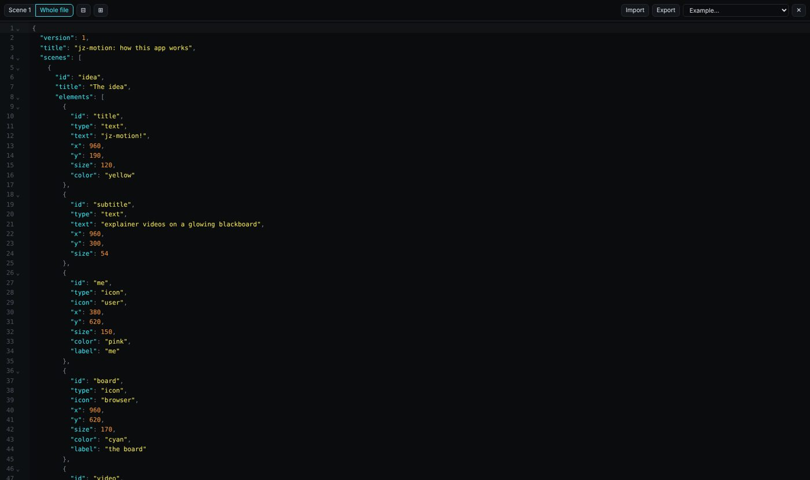
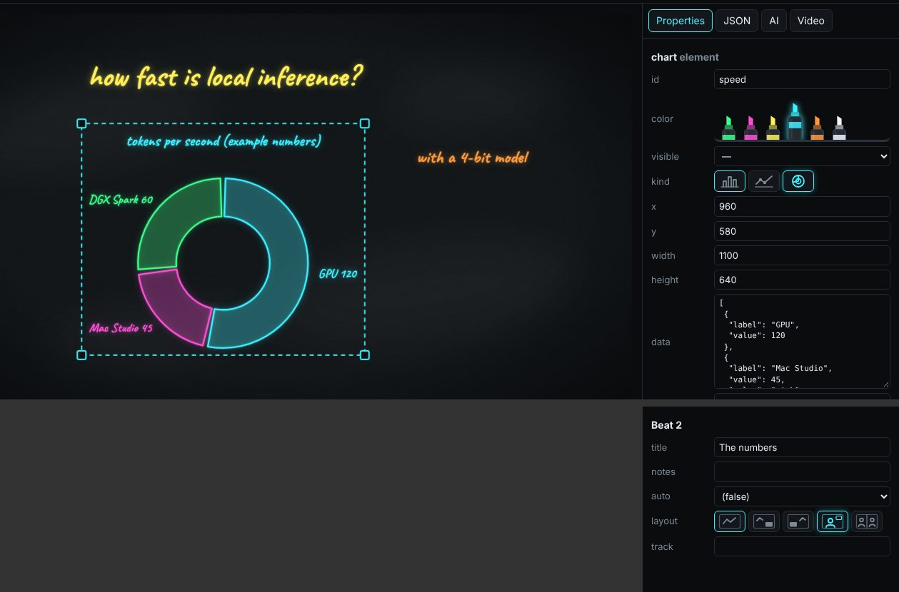
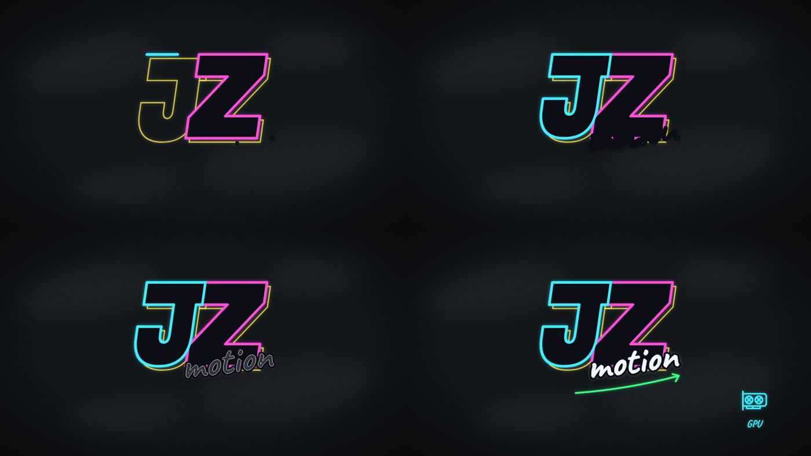
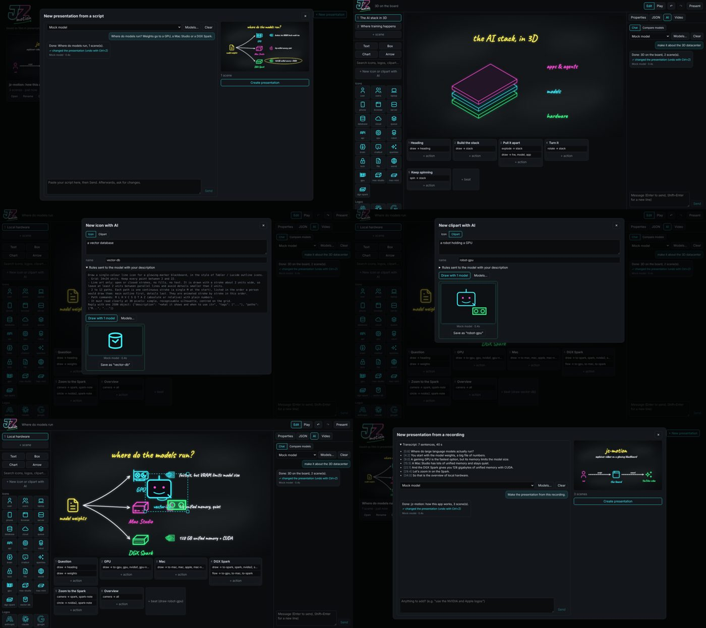

## Step 16: Editing text on the board

Jakub wanted to edit text and labels where they are. Double-clicking a text, a label (icon, box, arrow, 3D) or a chart title (or pressing Enter with the element selected) opens a text box exactly over it, in the same handwriting, colour and size, following the zoom; Enter keeps it, Esc cancels, clicking away keeps it. An element without a label gets one; clearing a label removes it. The renderer now marks which piece of text belongs to which field, so the editor knows where each one is on screen.

**Checked by:** a browser run that edits a title, edits a label while zoomed in, cancels with Esc, removes and re-adds a label with the keyboard, and checks the saved file after each step.

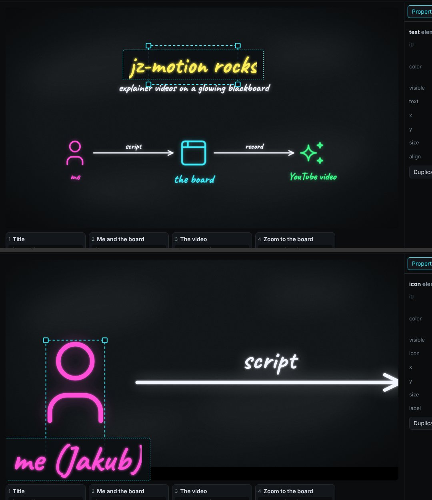

## Step 17: A prompt box home, settings, and AI inside each scene

Jakub's next list: a home screen like Gemini or Lovable (one chat box in the middle that switches between a topic, a script and a recording, with a model chosen per kind), a place for API keys (and the question whether a Claude subscription could be used), a smoother first animation for bar and line charts, clearer scene properties, adding scenes, clipart and 3D models with AI, and asking AI to change the open scene.

- **Home:** "What do you want to explain?" over one prompt box with Topic / Script / Recording chips, an attach button for recordings and a model picker that remembers its choice per kind. Sending opens the draft chat with the request already sent (or the recording already transcribing). Presentations are listed below with a search box.
- **Settings** (gear on home and in the editor): models and their API keys, the default model per kind of start, the speech-to-text service. On the subscription question: a claude.ai subscription can't be used as an API key by another app; use an Anthropic API key or OpenRouter.
- **Chart intro:** the title, axes and labels used to take most of the draw time, so the bars appeared in a rush at the end, one strictly after another. Now the growing gets about 60% of the time, bars overlap and ease out, and the line is traced smoothly with its dots popping in as the line reaches them.
- **Clearer properties:** every field has a plain name and a **?** with help ("continue from previous scene" instead of `inherit`, "start view" with *Use current view* / *Whole board* instead of camera numbers, "play automatically", "speaker notes"); video settings are grouped under *Video export* with a track picker (me / friend / other); ids and rarely needed fields are under *Advanced*.
- **Creating with AI** is now one dialog for a scene, an icon, clipart or a 3D model: the rules are shown, the reply is checked and repaired, previewed, then kept. A new scene goes after the open one (after any scenes that continue from it, so they don't lose their elements) and opens. 3D models are saved to the library like icons and listed to models writing presentations.
- **Ask about this scene:** a bar above the beats sends "change only scene N" with the whole presentation; the change is undoable and the editor stays on the scene.

**Bugs found on the way:** a new scene inserted between a scene and one that continues from it broke the second one ("unknown element"); fixed and tested. After adding a scene the editor reopened the old one; it now opens the new one.

**Checked by:** 47 unit tests and browser runs of every flow against the mock model: home topic/script/recording with the remembered models, settings, *Use current view*, scene ask with undo, a scene and a 3D model made with AI.

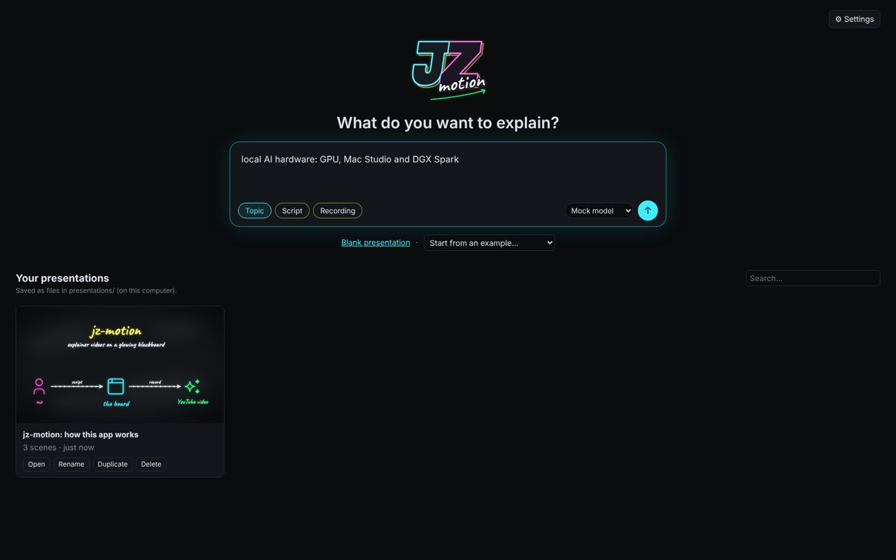
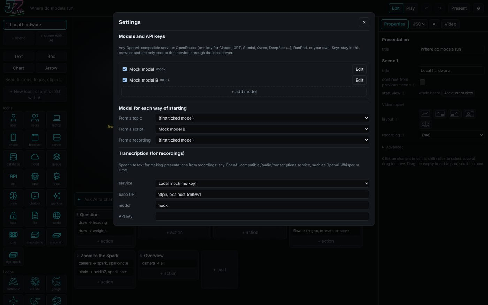
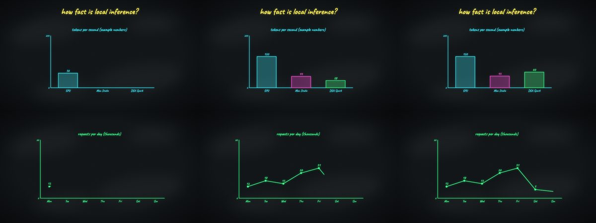
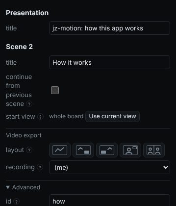
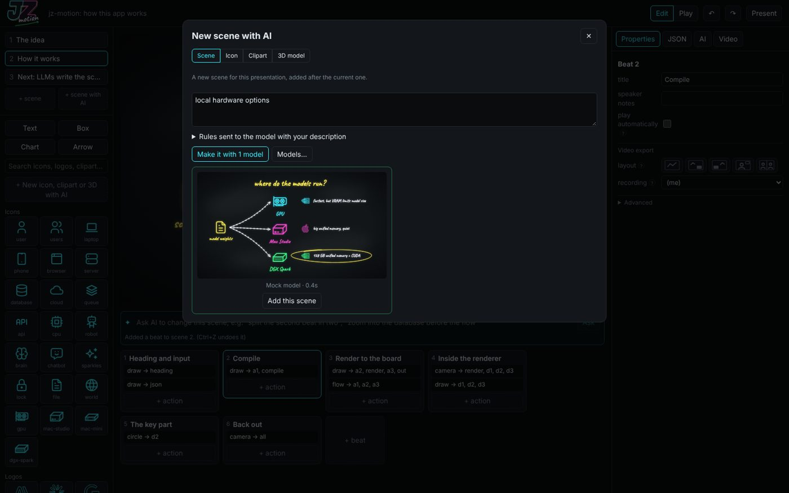
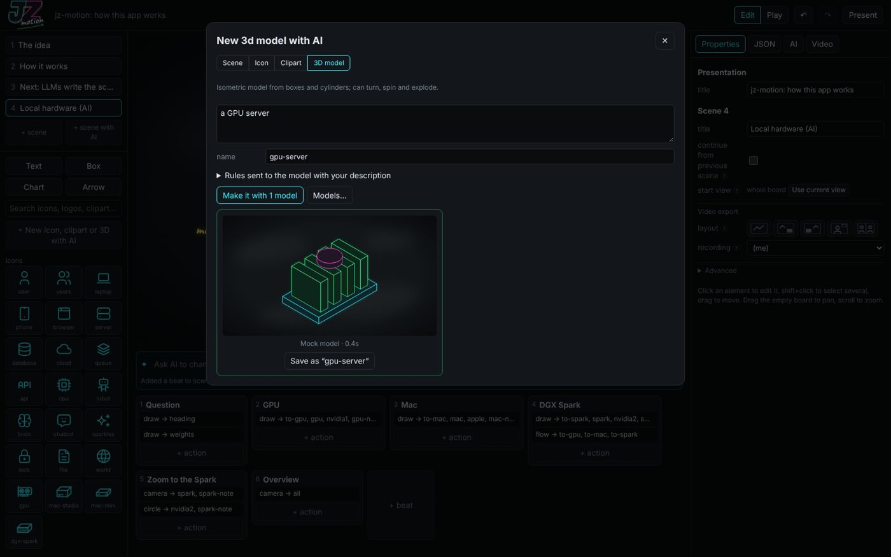
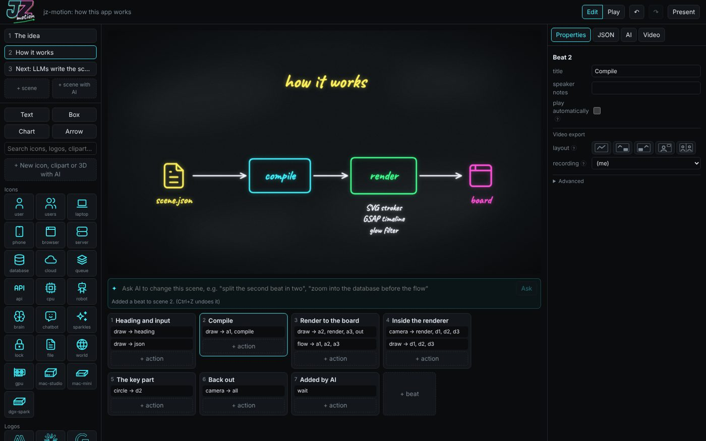

## Step 18: Safer deleting, a beats storyboard, and a library window

Jakub found that deleting the open scene blanked the whole app, that confirmations used the browser's own dialog, that beats and actions were hard to read, and asked for a proper place to manage icons, clipart and 3D models.

- **The blank screen:** after deleting the last scene the editor still pointed at a scene number that no longer existed, and the first panel to read it crashed React. The open scene is now always kept within the scenes that exist, and deleting moves to the scene before.
- **In-app confirmations:** one small dialog (title, what goes with it, Cancel / a red Delete; Enter and Esc work) replaces every browser `confirm()`: scenes, presentations, takes, recordings, replacing with an example, and the library.
- **Beats as a storyboard:** beats run left to right with how each starts (on click or auto) and how long it takes. Each action shows a coloured verb (green reveals, pink hides, yellow draws attention, cyan moves, orange camera), chips for the elements it acts on in their own marker colours, and a small bar showing when it runs inside the beat, so "together with the previous one" is visible at a glance. The compiler now reports each action's start and end for this. **+ action** opens a menu of the common actions for the selected elements, and actions can be dragged to reorder them or to another beat.
- **Library window** (⤢ next to the library search, and **Library** on the home screen): everything by group with counts (icons, logos, clipart, 3D models, made by me), search, large tiles, and a side panel that draws the selected item in on a small board (click to replay, try marker colours), its description and tags, and the JSON to use it. Things you made can be renamed, re-described and deleted there, and "New with AI" makes icons, clipart and 3D models without leaving it.

**Checked by:** 48 unit tests (new: action timing) and browser runs: deleting the open last scene (cancel, delete, undo), adding actions from the menu and dragging one to another beat, and in the library making a 3D model with AI, renaming it, deleting it, and double-clicking a built-in model onto the board.

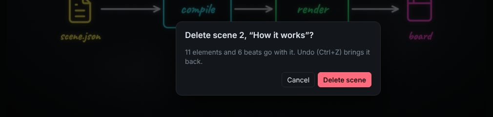
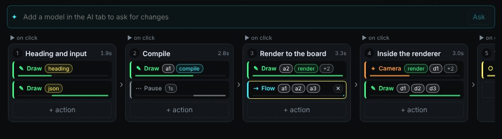
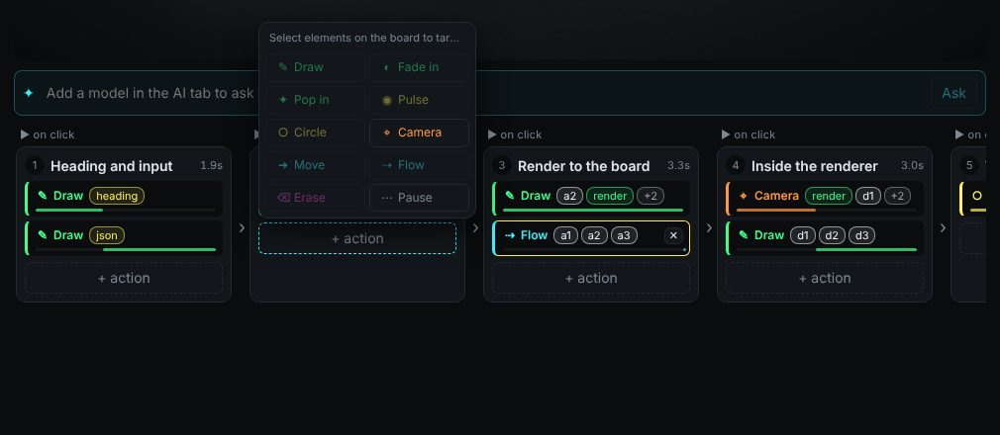
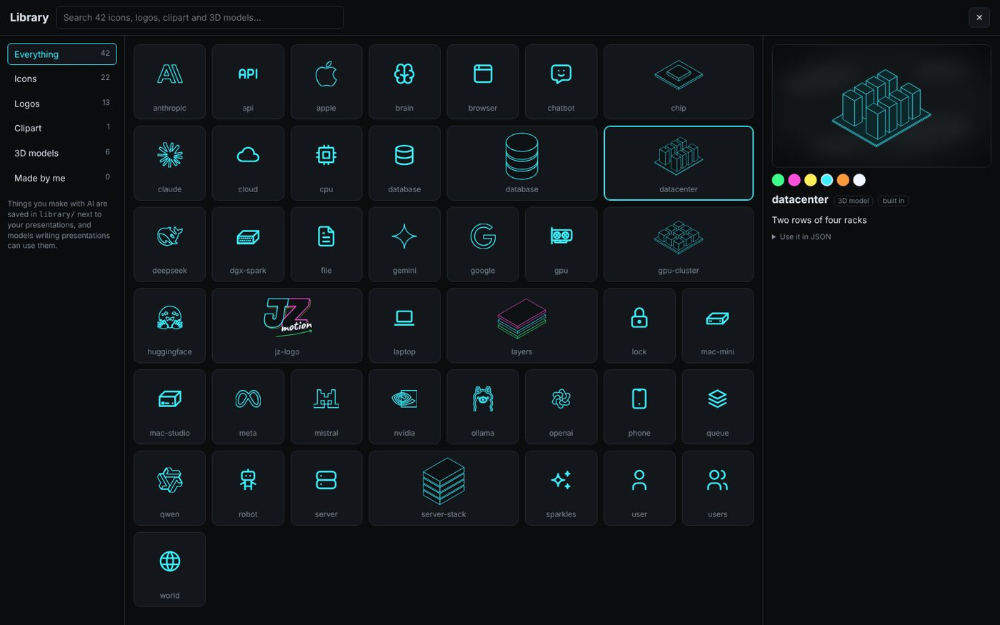
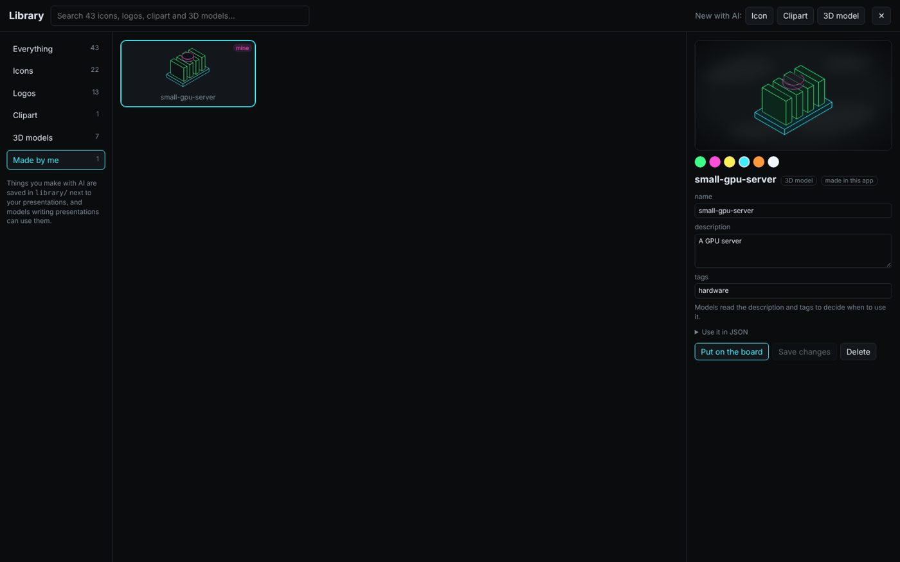

## Step 19: Talking an item over until it's right

Jakub wanted to create items from the library too, and to chat about an element until he's happy with it before it goes into the library.

- **Making something with AI is now a conversation.** Describe it and send; the reply appears as *Version 1* with a preview. Then ask for changes ("make the body pink", "add a fan on top"); each reply is the next version. Click any version to look at it large, and save the one you like under a name. You can switch models between replies, and a reply that breaks the rules even after the automatic repairs says so and you just ask again.
- Under the hood, every follow-up sends the first request, then each version and the change asked of it, and the model replies with the whole item again under the same rules, so every version is checked the same way (tested).
- **From the library window, everywhere:** "New with AI" (icon, clipart, 3D model) now works from the home screen's library too. **Refine with AI** on your own items starts the conversation from the saved version and saves over it; **Make a variation with AI** on a built-in item starts from it and saves a new one (named `my-<original>`).
- Scenes made with AI ("+ scene with AI" in the editor) use the same conversation.

**Checked by:** 49 unit tests and browser runs against the mock model: a clipart made in three versions with a model switch, saving an earlier version; refining it from the library; a variation of a built-in 3D model; a scene refined once and added.

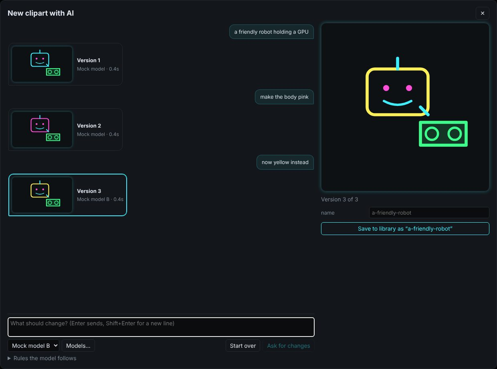
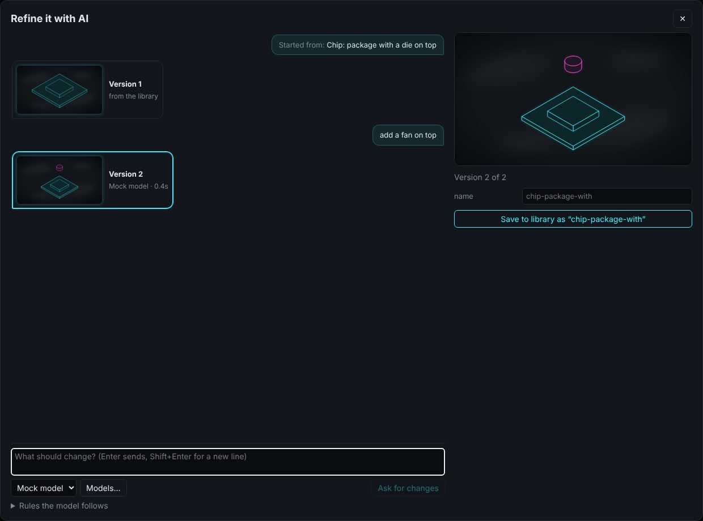
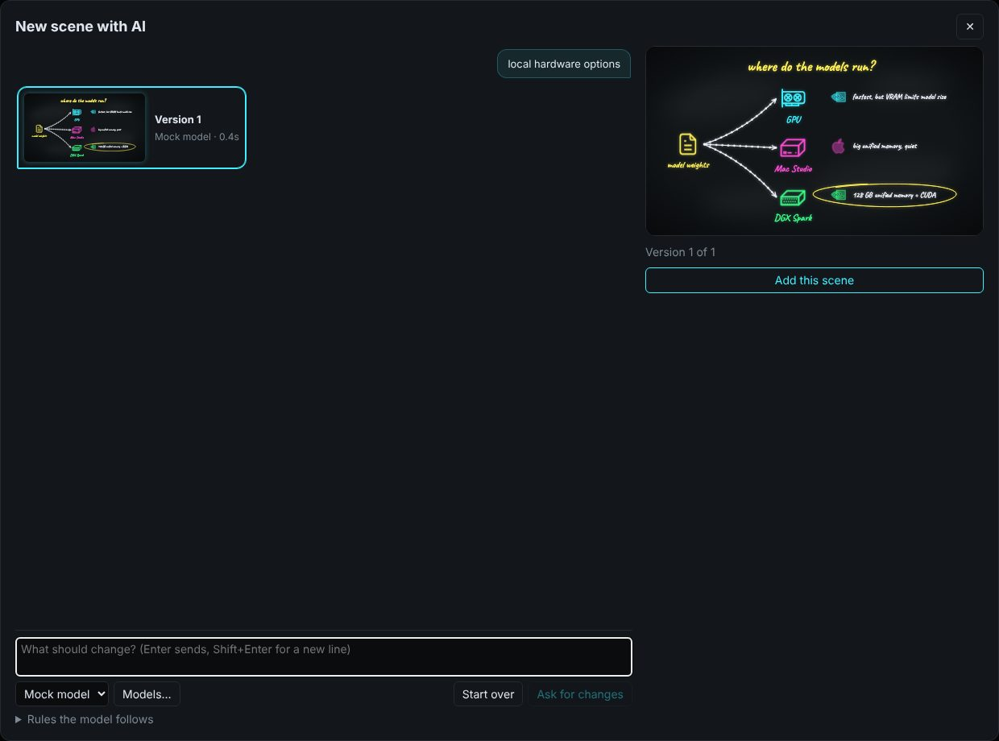

## Step 20: Drawing-program polish

Jakub's notes: scrollbars too big, position and size fields that don't look like a drawing program, text getting selected while moving a box, and a more graphical choice of border and arrow styles (with dotted, and a big arrow).

- **Scrollbars** are thin (6 px) and nearly invisible until hovered, everywhere.
- **Position and size** sit at the top of an element's properties as a compact grid: X, Y, W, H, a size or scale field, rotation and corner radius, each with a small letter or picture inside the field. Dragging a label sideways changes the number (Shift for steps of 10); a drag is one undo step.
- **No more selecting text while dragging:** the board can't start a text selection, and nothing on the page gets selected while something is being moved.
- **Line styles:** boxes and arrows take `line` (solid, dashed, dotted) and `weight` (normal, bold; a bold arrow also gets a bigger head), picked from pictures. Dots are zero-length dashes with round ends, drawn in through the same mask as dashes. Older files with `"dashed": true` still work, and choosing a style tidies that away.

**Checked by:** 49 unit tests and a browser run that drags a box across the board (checking nothing gets selected), sets a box to dotted and bold, drags its W label, and makes an arrow dashed and bold, checking the saved file each time.

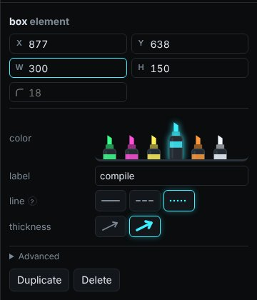
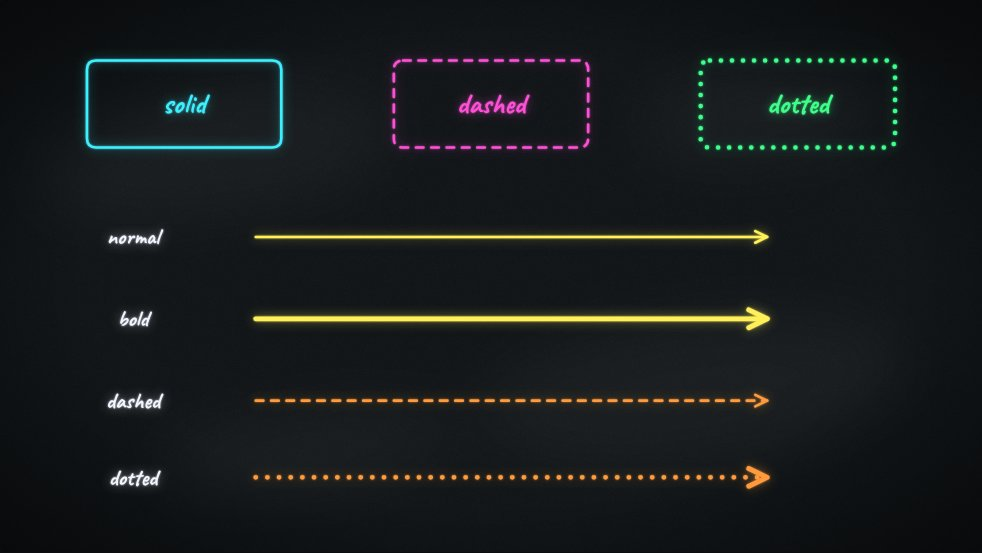

## Step 21: Tidier left panel

"+ New scene" and "✦ New scene with AI" now sit on their own lines under the scenes, and the Icons / Logos / Clipart / 3D headings have a little space above and below so they read as headings over their pictures.

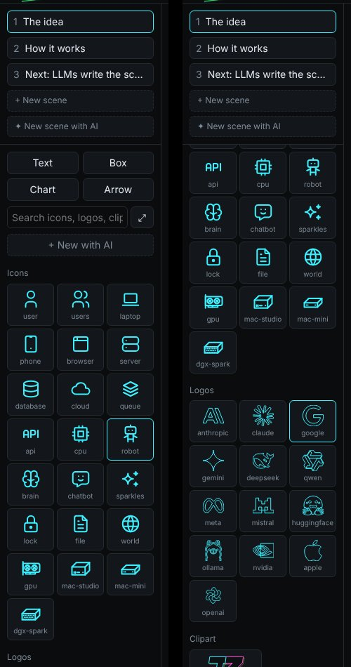

## Step 22: Screenshots, areas and a spotlight

For explainer videos Jakub wanted to paste a screenshot of an interface and draw on it, optionally framed as a browser window in the app's style, circle part of it, and darken or fade everything else to focus attention.

- **`image` element:** paste a screenshot (Ctrl+V), drop a picture on the board, or click **Image**. The local server keeps pictures in `images/`, named by their content, so pasting the same one twice stores it once; with no server the picture is kept inside the presentation. The picture fits the current view and resizes keeping its proportions.
- **Browser frame:** `"frame": "browser"` draws a window around the picture in marker: rounded outline, bar, three dots and an address field with your text. It draws in stroke by stroke, then the screenshot is revealed left to right. The next picture remembers the frame you chose.
- **Pictures stay crisp under the drawing.** The glow filter works on the whole drawing layer, and a blurred halo around a screenshot looked wrong, so pictures live in their own layer underneath; every frame each picture copies its element's position, scale and opacity, so moving, popping, fading and erasing work as for anything else.
- **`area` element:** an invisible rectangle or ellipse marking part of a screenshot (a dashed outline while editing). Select a picture and click **Area** to put one over its middle. Its properties offer one-click beats: spotlight and circle it, spotlight it, circle it, zoom to it.
- **`spotlight` action:** everything outside the target goes darker (`dark`) or fades into the board (`fade`), by `amount`, in the area's shape; it stays on between beats, a new spotlight slides the light to new targets, and `"on": false` turns it off. Anything drawn while it is on (the circle, a note, an arrow) is kept above the dimming, so annotations stay bright.
- Exports wait for every picture to load before the first frame.

**Checked by:** 52 unit tests (new: spotlight on/move/off and what stays above it, a spotlight without a target, framing a framed screenshot) and browser runs: pasting a screenshot, choosing the browser frame and address, adding an area over it and a spotlight-and-circle beat, and playing a scene through draw, spotlight (dark and fade) and lights back on.

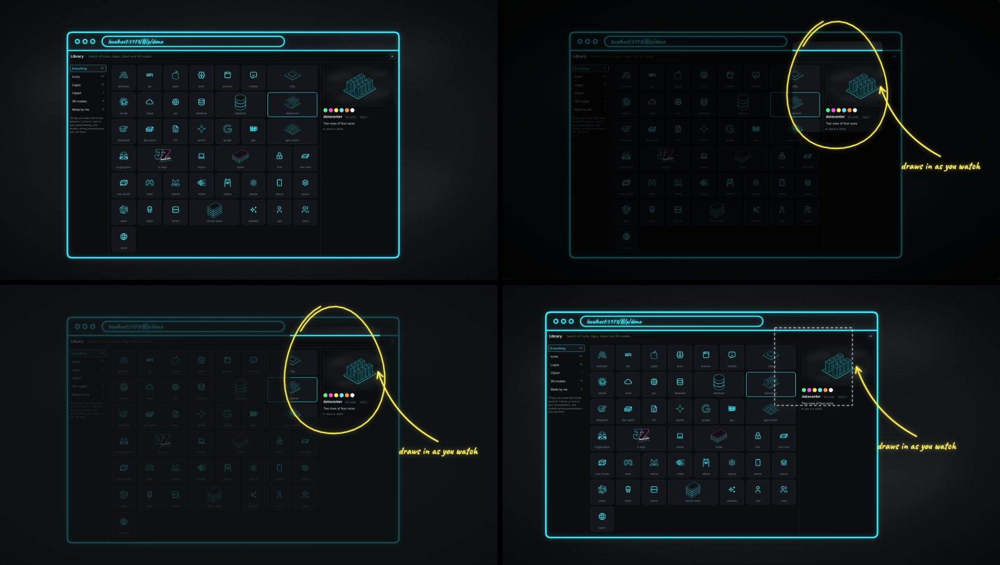
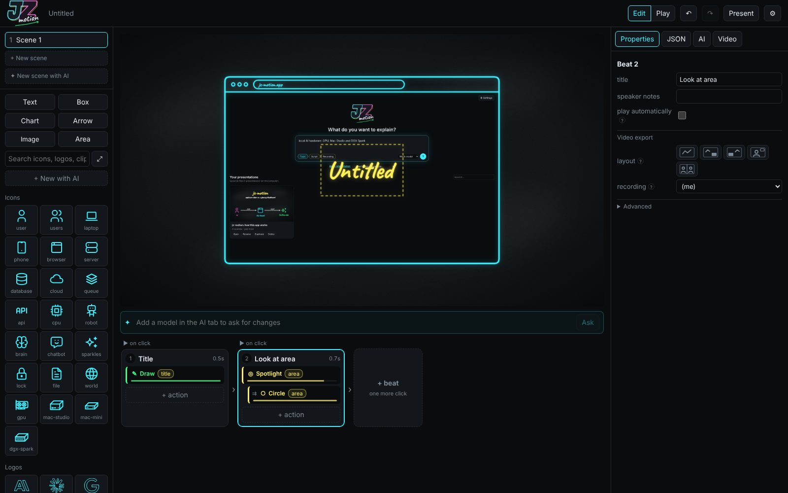
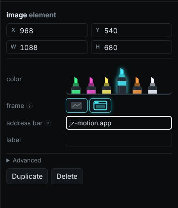

## Step 23: Reset view, text styles, colourful tools

- **Reset view:** panning and zooming can lose the board, so the board has **Reset view** (back to the scene's start view, key 0) and **Fit all** (everything on it, Shift+0) in its corner.
- **Text styles:** `marker` (the handwriting so far), `bold` (chunky outlined capitals with an offset echo, in the spirit of the JZ in the logo; Bungee font) and `code` (JetBrains Mono). Text can now have several lines; code keeps its indentation and its lines line up on the left wherever the block is placed. Code is edited in place in a box that takes new lines (Ctrl+Enter keeps it), and in the properties in a monospace box where Tab indents. Exports load the new fonts before the first frame.
- **Tools with colour:** Text, Box, Chart, Arrow, Image and Area each have a small line picture in their own marker colour, with a faint tint and glow; "New scene with AI" and "New with AI" have a pink sparkle.

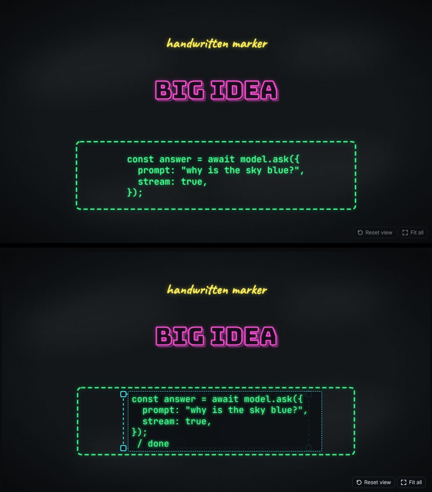
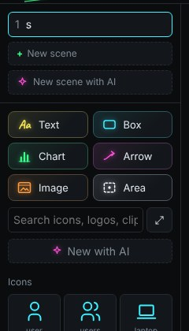

## Step 24: An explainer about jz-motion, made in jz-motion

Jakub asked for a template that explains the app itself (features, screenshots, architecture, why it is LLM first) and a script to read over it. The pitch: he built it to make explainers and presentations quickly because he never has time to publish; it is designed so cheaper models (Claude Haiku) and specialised ones (image models via fal.ai) can take over parts of the work; and a library that grows with every explainer lowers the cost of the next one. Everything is LLM first, with every generation held to one style. Inspiration: IBM Technology's lightboard explainers.

- **The example** `src/examples/about-jz-motion.json`, ten scenes and 46 beats: title; why (ideas that never become videos, the IBM inspiration); starting from a sentence (home screenshot, spotlighting the prompt, the three ways in and the model picker); the editor (storyboard, ask bar, properties); LLM first (format and library in, JSON out, check and repair loop, then the board, and a zoom into the JSON); one style for everything (icon, clipart, 3D, chart in the same markers, then the AI creator conversation); the library and a falling cost per explainer; architecture (browser, local server, swappable models, fal.ai next); the right model for each job; recording and publishing.
- It uses this round's features throughout: screenshots in browser frames with areas, spotlights and circles; bold headlines; code text; camera moves; flows; set-values.
- **Screenshots** of the current app were captured with Playwright (against the mock model) and ship in `public/examples/about/`, so the example works anywhere, exports included.
- **The script** is the beats' speaker notes (about 840 words, 6 to 7 minutes), collected in `docs/explainer-script.md` with recording steps and a ready title, description and chapter list for publishing.
- **Bug found by it:** a line chart's last point and value never appeared: points popped in only after the line had passed them, and the line never passes its last point. Points now pop in as the line arrives.

## Step 25: Timing to a voice-over

Jakub wanted more control over timing, so a presentation can follow a voice-over. Beats could already carry a `cue` (seconds into a recording), but only presentations made from a recording had them, and there was no way to see or change them.

- **Timing window** (top bar): the narration's waveform with a time ruler, and every click of the presentation (a beat plus the auto beats after it) as a marker in its scene's colour, with a bar showing how long its animation runs. Solid markers sit on their cue; dashed ones have none and follow the click before; red ones have a cue earlier than the previous click finishes.
- **Placing clicks:** drag a marker (snaps to 0.05 s), double-click it to clear its cue, or switch on **Tap to place**, play, and press T as each line starts: each tap places the next click. Everything goes through undo.
- **Reading along:** the board plays in sync with the audio, and beside it the current beat's speaker notes (the script line) and the next one with its time.
- **Voice-over** is any audio or video file, stored by the local server (`uploads/`, served with range requests so the player can seek) and named in the presentation's new `voiceover` field. Without one, the same timeline runs on a silent clock for rehearsing.
- **Make a take for export** builds a take from the cues, with the voice-over (copied, so the presentation keeps it) as its sound, and opens it in the Video tab.
- The cue logic moved into one function (`cueClicks`) that both the export and the window use, so what you see is what exports.

**Checked by:** unit tests (which clicks sit on a cue, which come too early) and a browser run on the about template with a generated 60-second voice-over: loading it, dragging a click to 20.5 s, tapping three clicks while it plays, and making a take that opens in the Video tab.

## Step 26: My Claude subscription, skills for fresh conversations, and a teleprompter

Jakub builds jz-motion for himself and wants to run it locally on his Claude subscription; to have documentation and skills good enough that a fresh Claude conversation can work with the project without any history; and to use the Timing window as a teleprompter. He was also unsure whether screen recordings would make the project too complicated.

- **Claude Code as a model provider.** The local server can answer model requests by running the `claude` command on the same computer (`claude -p`, JSON output, tools, settings and plugins off), with the person's own login: no API key. Conversations are passed as a transcript and the reply goes through the same checks as any model. Settings finds Claude Code and offers **Add Sonnet and Haiku** in one click. It is meant for personal local use only. Checked for real: Haiku through the subscription drafted a four-scene CDN explainer from one sentence in 18 seconds, in the house style.
- **One style guide.** The rules the app sent to models lived in a code string; they are now `docs/style.md`, which the app's prompts and the Claude Code skills both read (plus a new rule after the CDN test: when a scene continues from the previous one, don't put new things on top of old ones).
- **Skills and CLAUDE.md.** `.claude/skills/` has `new-presentation`, `edit-presentation`, `library-item` and `voiceover-and-video`; `CLAUDE.md` explains the project, the folders and the conventions. Two new commands give a model something to verify with: `npm run check` (validates a presentation or library item with the app's own rules; `--library` lists everything that can be drawn) and `npm run snapshot` (PNGs of every scene, so it can look at what it made). Tested with a fresh Claude Code conversation with no context: asked for an HTTP caching explainer, it found the skill, read the rules, wrote the file, checked it, looked at the snapshots, fixed a crowded scene and handed over the link.
- **Docs rewritten** to match the app: README (setup with the subscription, three ways to make a presentation, editor, AI, screenshots, narration and video, commands), `docs/models.md` (providers, which model for which job, transcription), `docs/design.md` (decisions, code map, phases), `docs/format.md` (cues).
- **Teleprompter and narration recording.** The Timing window can record the narration itself: the script (speaker notes) shows large, you read, and press → or Space as you start each next line, which places that beat at that moment; ← takes back an early press, Esc stops. One read-through gives the voice-over and the timing. **Prompter** shows the script large at any time.
- **Early cues.** Pressing → before the previous animation had finished used to be ignored. Now an early cue starts its beat on time and the previous animation jumps to its end, like an early click when presenting live.

**Checked by:** 55 unit tests (new: early cues), the real Claude Code calls above, a narration recording with a simulated microphone (placing, taking back and re-placing lines, then saving the voice-over), and the Settings offer in the browser.

## Step 27: Which action, when

Jakub asked whether the docs tell models *when* to use things like a circle. Barely: `format.md` says what each action does, and the style guide had three one-line hints. Models used actions correctly but rarely chose between them, so most beats were plain `draw`.

- `docs/style.md` gained **Which action, when**: a table from what the viewer should do (watch something being built, notice one thing, ignore the rest, follow data moving, see a change of state, see numbers change, look inside a 3D object, look at a detail, clear space, pause) to the action for it (`draw`, `pop`, `circle`, `pulse`, `spotlight` dark or fade, `flow`, `recolor`, `move`, `set-values`, `explode`, `rotate`, `camera`, `erase`, `fade-out`, `wait`) and what to avoid. Plus **pacing**: one emphasis per beat, `start: "with"` and `auto` beats for things that belong together, one to three spoken sentences of notes per beat, build up then focus, and end a scene by pulling back.
- Because the app's models and the Claude Code skills both read the style guide, both get the guidance.

**Checked by:** the same request as in step 26 (a two-scene HTTP caching explainer) to a fresh Claude Code conversation. Before: twelve draws, one circle, one flow, one recolor, two fade-outs. After: requests shown moving with `flow` while they are talked about and switched off when moving on, one point per beat, and the "or a new file" ending as a `pop`. It still drew rather than `recolor`ed the copy going stale, so the guide helps but doesn't do the director's job for it.

## Step 28: Which model for which job

Jakub asked whether Opus should be available, and then for the model menus to recommend a model that is sufficient for the job at hand, for example when drawing a logo.

- **Recommendations everywhere a model is picked.** Each menu knows its job (an icon, clipart, a 3D model, a change to one scene, a new scene, chat about the whole presentation, a presentation from a topic, a script or a recording) and the size of model it needs. Models are sorted into small, medium and large, guessed from their names (haiku, mini, flash; sonnet; opus, gpt-5, gemini pro) or set in Settings. The menu marks the smallest one that is enough as **★ recommended**, the others as *enough*, *works, smaller than ideal*, *may struggle* or *more than needed*, and a line under it says why ("A small, fast model is enough for an icon: a few strokes, and the rules and checks keep it on style").
- **Defaults follow the recommendation** until you choose: Haiku for icons, 3D models and scene edits, Sonnet for clipart, new scenes, chat and presentations from a topic, Opus for presentations from a script or a recording. A choice you make is remembered for that job. Settings' "model for each way of starting" shows the recommendation as its default.
- **Opus**: the subscription offer now adds Opus, Sonnet and Haiku (Opus unticked so Compare doesn't use it unasked), with a **+ Claude Opus** button for anyone who added the other two before. Models show a size badge in Settings and can be given a size by hand.
- The logic lives in one place (`src/ai/recommend.ts`) with tests (sizes from names, the smallest model that fits, falling back to the biggest there is and saying so, remembered choices).
- Found on the way: "gemini" contains "mini", so Gemini Pro was first guessed as a small model.

**Checked by:** 59 unit tests and a browser run with Opus, Sonnet and Haiku through the subscription: the home box (topic → Sonnet, script → Opus), New with AI (icon and 3D → Haiku, clipart → Sonnet, a choice of Opus for icons remembered), and Settings.

## Step 29: An LLM Lab explainer, from a script

Jakub gave a five-minute script for a video about LLM Lab, his prototype for choosing AI models with the team's own data and rules, and asked for a template made from it, with the screenshots, icons and animations it needs. He also asked to expand on RAG and on why the lab tests the models it does: only models that are worth fine-tuning.

- **The example** `src/examples/llm-lab.json`, 17 scenes and 78 beats, the script's lines as speaker notes: opening (a new "#1" every week, three questions, the title); how models get chosen (leaderboard, sales deck, first team's pick); someone else's test (a chart whose bars swap from English to Polish tickets, two points for thirty times the price, nobody re-checks); our data, our criteria, our decision, then each one in detail; **new:** where the four kinds of model sit in RAG (documents → chunking → embedding → index; question → classification → embedding → top 50 → reranking → top 5 → answer); **new:** why these four (big general models are prompted, not tuned; narrow, high-volume building blocks are worth fine-tuning, so they are worth testing, with the ModernBERT cost numbers); then the walkthrough on screenshots (the four categories in the sidebar, three numbers and four answers, quality vs cost and the quality bar, the ModernBERT row, intents only, ties and ± ranges, test and training sets); why it matters; close.
- **RAG in 3D** (asked for after the first version): an isometric scene of the three retrieval models at work. A document stack explodes into pieces as the chunking model cuts it; the chunks go through a spinning embedding chip into a 3D vector index, which turns to show its points; the question takes the same embedding model to the index; four result cards pop up, the reranking chip scores them, and the best one turns green and swaps places to the front before the top five go to the answer. Each model gets a yellow "we test:" note (does each piece stand alone? is the right chunk in the top 10? is the best one first?). Two new 3D models for it: `document-stack` and `vector-index`.
- **Screenshots** of LLM Lab in its dark theme, taken with Playwright from the addresses in the script's recording notes, ship in `public/examples/llm-lab/`. Areas over them drive the spotlights and circles.
- **Thirteen new built-in drawings**, all in `src/engine/icons.custom.json` and `iso-models.json` so the bundled example works anywhere: `trophy`, `coin`, `stopwatch`, `balance-scale`, `scissors`, `tag`, `magnifier`, `rerank-list`, `flask`, `target`, `id-card`, `checklist`, `vector-space`, and the 3D models `podium`, `document-stack` and `vector-index`.
- **The script** with recording notes is in `docs/llm-lab-script.md` (about 1,180 words, generated from the speaker notes).
- **Bug found by it:** `npm run snapshot` never loaded `library/`, and only ignored "unknown icon" errors, so a presentation using your own icon in an arrow or a beat failed with "unknown element". It now loads the library before checking, like `npm run check` and the page do.

**Checked by:** `npm run check` and snapshots of every scene and beat (fixed on the way: spotlights on sidebar rows lit two rows until the padding was cut, a circle around the whole quality line, cost values rounded to 0.0 until shown in cents, a podium that read best turned by −30°), 60 unit tests (including every bundled example compiling), and opening the example from the home screen in the browser with no errors.

## Step 30: Keeping the audience's eyes in the right place

Jakub asked for another pass on the LLM Lab template so that camera moves, areas and circles keep attention where the narration is. The first version mostly drew things at full-board size and lit screenshots with spotlights, which left the screenshots' text too small to read in a video.

- **The camera follows the explanation.** Diagrams are taken one part at a time: the benchmark chart, then each column of *our data / criteria / decision*, each row of the RAG pipeline, and each stage of the 3D scene (the document and chunker, the embedder and index, a close-up of the index as it turns, the reranker and its cards). Each scene pulls back to the full board at the end.
- **Screenshots are read up close.** On the Recommendations page the camera zooms into one card's three numbers, then into the row of four answers. On Classification it zooms into the chart while the "better" arrow is drawn and the quality bar label is circled. On the ModernBERT row it takes the row, then its price with the note, then the personal-data warning with its note. On intents it shows the tab with its note, then the cards. On embedding it shows the ± scores, then the circled tie. On training sets it shows the overlap column. Notes that would sit off-screen during a zoom are written when the camera pulls back, as a summary.
- **One emphasis per beat.** Circles now mark the one thing you'll keep talking about (the price claim, "nobody checks", the classifier at the front door, the quality bar, the personal-data minimum, the tie). Each circle is erased before the next one when they would compete.

**Checked by:** snapshots of all 78 beats (a frame that went past the board's right edge was replaced by the full view), `npm run check`, 60 unit tests, typecheck and build.

## Step 31: The app's AI works like Claude Desktop, shows its steps; fixed-on-screen elements; animated screenshots

After making a template with Claude Desktop (the whole repository as context), Jakub noticed it gave much better results than the AI inside the app, that the app gave no feedback while a model worked beyond "thinking", that explanation text should stay visible while the camera zooms into a screenshot, and asked whether animated screenshots (APNG) could be played and stopped on cue.

- **Why the difference:** the app sent a model one request (the style guide, the format and the library) and asked for JSON in one go. Claude Desktop reads the examples, writes the file, runs the check, looks at snapshots and fixes what looks wrong.
- **Agent mode** for **Claude Code (my subscription)**: the app now runs Claude Code in the repository (`claude -p`, streaming), with the project's skills, on a draft copy of the presentation in `presentations/.drafts/`. It may read files, write files, use skills and run `npm run check` and `npm run snapshot`; nothing else. When it finishes, the app loads the draft, checks it again and applies it (undoable). A conversation keeps its session, and the command to continue it in a terminal is shown. Tested for real: Sonnet made a vector-database explainer in 38 seconds, reading the style guide, the format and an example, checking and looking at its snapshot. The first run tried shell commands it isn't allowed and had to retry; telling it its tools up front fixed that. Per model it can be switched off for the quick one-request mode.
- **Seeing what happens:** every AI request (draft chat, AI tab, scene ask bar) shows its steps live (for agents: using a skill, reading a file, writing the draft, running the check, looking at a snapshot; for one-request models: what was sent, what came back, what the check found), each with a **view** of the full text, so prompts and skills can be tuned.
- **One-request models** now also get a finished example presentation with the rules (the hardware scene, which gained speaker notes).
- **Fixed on screen** (`pinned`): any element can be drawn in a screen layer outside the camera, so it keeps its place and size while the camera zooms, and stays above spotlights. Ticking it keeps the element exactly where it looks at that moment (its position and size are converted through the current view). The camera can't zoom to a pinned element, and an arrow can't join something pinned to something on the board; the check says so in plain words.
- **Animated pictures** (APNG, GIF, animated WebP) are decoded frame by frame with the browser's own decoder into a canvas. A new **play** action starts, pauses (`"on": false`), jumps (`from`) and speeds up (`speed`); a picture's `loop` repeats it; without `play` it shows its first frame. It keeps playing between beats, driven by the same clock as flows, so exports are exact; the exporter waits for each frame to be drawn.
- **Bugs found:** an instant switch (flow, spin, play) that ended a beat sat exactly where the timeline stopped, so it never switched; such switches now take 2 ms. A pause first reset the animation to its start: only a play with `from` jumps now.

**Checked by:** 63 unit tests (new: pinned elements, play), real agent-mode runs through the subscription, a scene where the camera zooms into a screenshot under a pinned title and note, an APNG test pattern (a running counter) rendered frame by frame through the export page (still at 0 before play, 1 s when paused, 1.5 s after jumping to 0.5 s at double speed), and the same picture playing live in Play mode.

## Step 32: A pause to tidy up: smaller files, current docs, and a plan for media

With the app grown a lot (including Jakub's own work on voice clips, generated voice, the Script page and capture scripts), he asked for a review: some UI files had become too big to work with cheaply, the documentation needed to be current, and managing APNGs, GIFs and recordings was hard and heavy on disk.

- **Files split by responsibility**, with no change in behaviour, each new file starting with a comment on what it does:
  - `render.ts` 1,303 → 74 lines plus ten engine modules (`player.ts`, `buildElement.ts`, `drawing.ts`, `timelineOps.ts`, `sceneState.ts`, `stageNodes.ts`, `animatedPictures.ts`, `spotlight.ts`, `boardBackground.ts`, `editing.ts`), the largest 352 lines.
  - `Timing.tsx` 995 → `src/app/timing/`: a 201-line shell, hooks (clock, board following it, waveforms, clip editing, cue dragging, notes, generated voice, narration recording, voice-over file and take, keys) and components, none over 151 lines.
  - `App.tsx` 959 → 350 lines plus `src/app/editor/` parts (board pointer, shortcuts, edit actions, paste and drop, in-place text, element helpers, scene list, top bar, play controls, right panel, windows).
  - `compile.ts` 560 → 217, with the per-action rules in `compileAction.ts` and the plan's types in `compileTypes.ts`.
  - `Fields.tsx` 466 → 185, with inputs, pickers and the position grid in `editor/fields/`.
  - `styles.css` 627 lines → eight files by area in `src/app/styles/`, imported in the same order.
  The three biggest splits ran in parallel, each in its own copy of the repository, and were merged back.
- **Checked the same, not just compiling**: snapshots of four examples (every beat, 69 pictures) identical before and after the renderer split; the compiled plan of every example and presentation identical before and after the compiler split; the built CSS byte-identical; browser runs of the editor (21 steps: select, drag, resize, delete and undo, in-place text, add, scenes, windows, Play) and of the Timing window (loading a voice-over, playing, cues, tapping, splitting and moving clips, notes, recording narration) before and after; and a run on the merged result through paste, the Script page, Settings, New with AI and Timing. 63 unit tests throughout.
- **Docs**: the code map in `docs/design.md` rewritten area by area, with a new **where to change what** table so a fresh conversation goes straight to the right file; `CLAUDE.md` points to it and adds the rule to keep files under about 350 lines. README, format, models and the voice-over skill now cover voice clips on two lanes, generated voice, the Script page, and the snap, record and assets commands.
- **Media**: a new read-only `npm run assets` lists every picture, recording and voice-over with its size and the presentations that use it, and what is referenced but missing. It found 39 of 46 files in `images/` (11 MB) unused, 18 voice clips that only exist on one computer (`uploads/` is not in git), and 4 UnDraw pictures never added. Measured: the APNG screen recordings are 3.5–6× smaller as WebM video, screenshots 3–6× smaller as WebP. `docs/media-plan.md` proposes one media library with conversion on import, video on the board, a Media tab with "used in" and clean-up, recording the screen from the app, and Git LFS; it ends with the decisions needed.
- **Housekeeping**: the TypeScript build cache is no longer tracked, and tests no longer pick up the parallel working copies.
- **Found on the way** (not fixed yet): `npm run snapshot` can render the first picture slightly differently between runs; a narration recording can be placed over a clip already on the second lane.

## Step 33: One media library, and recordings as video

Following the plan in `docs/media-plan.md`, the first half is built: pictures and recordings now live in one library, converted to small files on the way in, and screen recordings play on the board as video.

- **The media library** (`media/`, `server/mediaStore.ts`): every file is named by its content (the same file added twice is stored once) and listed in `media/index.json` with a readable name, kind, size, dimensions and length. On the way in, screenshots become WebP, screen recordings (APNG, GIF, MOV, MP4, WebM) become WebM video with a still for a poster, sounds become Opus. Served with range requests, so videos can seek.
- **Getting files in:** pasting or dropping a picture in the editor, the new `npm run media -- import <file…>`, and `npm run snap` / `npm run record`, which now keep the raw capture in `scratch/captures/` and put the converted copy in the library.
- **The Media tab** in the Library window: previews (recordings play on hover), filters, size and length, **used in** (which presentations, clickable), rename, copy reference, delete (refused while something uses it, with the list), **Clean up** for what nothing uses, and **Put on the board** for pictures and recordings.
- **Recordings on the board:** an `image` whose file is a video plays in a muted `<video>` with the same `play` action as animated pictures (on/off, `from`, `speed`, `loop`). Live, it plays natively and is nudged back in step if it drifts; in an export, each frame seeks to the exact time and waits until that frame is shown. Until the video is ready the poster shows.
- **Migration:** `npm run media -- migrate --apply` converted the 7 files presentations use (2.9 MB → 0.75 MB; the two APNG recordings 821 KB → 150 KB and 463 KB → 154 KB), rewrote "about this app, with edit demo" to use them, and moved all 46 old files out of `images/` into `scratch/images/` (not in git, nothing deleted). `npm run check` now knows `/media/…` pictures.
- **Bugs fixed on the way:** a narration recording could land over a clip already on the other lane (the lane is now chosen when recording stops, where it overlaps nothing); `npm run snapshot` could render the first picture differently between runs (the flattened background now waits until it is decoded and shown).

**Checked by:** 68 unit tests (new: the video clock); a test video showing its own time rendered through the export page (still before play, the right time while playing, held when paused, correct after a jump at double speed and when looping, byte-identical between runs) and exported to MP4; the same video live in Play mode; the two migrated recordings rendered through the export page every half second (advancing in real time from their play beat and holding their last frame); a recording put on the board from the Media tab in the browser.

**Still open:** Git LFS for `media/`, moving voice clips into the library so presentations carry their sound, recording the screen from inside the app, and the 4 UnDraw pictures the Sandbox refers to but were never added.

## Step 34: Record the screen from the app

The usability half of the media plan: recording a demo is now one action in the app instead of a scripted capture.

- **Library → Media → ● Record screen** opens the browser's own picker (a window, a browser tab or the whole screen), counts down 3 seconds so you can switch to it, and records until you press **Stop**, press Esc, or click **Stop sharing** in the browser's bar. While it records, the tab's title shows "● Recording 0:12", since you are usually looking at another window.
- **Before keeping it:** a preview with **Start** and **End** sliders to cut off the fumbling at either end, a name, and **Keep**, **Record again** or **Discard**. The recording goes to the server as it is; the server cuts it while converting it to WebM like any import, so there is one conversion, not two. It then appears selected in the Media view, ready for **Put on the board**.
- **Pictures only, no sound**: narration is recorded in the Timing window, and videos on the board are muted anyway.
- **On the way:** browser recordings have no steady frame rate, and FFmpeg was about to fill one in with duplicated frames; video conversion now keeps the frames as they are (`-fps_mode vfr`). The demo-interactions skill still said `snap` and `record` write into `images/`; it now describes the media library, and tells the app's AI to look for Jakub's own recordings there.

**Checked by:** a browser run in Chromium with a stand-in "screen" showing a running clock (headless Chromium has no screen to pick): the countdown, the title while recording, Stop, trimming 1.5 s off the start, naming and keeping. The kept file starts at exactly the clock time where recording began plus 1.5 s, is 1440×900, and went from 273 KB to 75 KB. The real picker and **Stop sharing** need a desktop browser to try.

## Step 35: Git LFS for the media library

Git keeps every version of every file in every clone, so each re-captured screenshot or recording would grow the repository for good. Jakub chose Git LFS for `media/`.

- `.gitattributes` sends everything in `media/` through Git LFS, except `media/index.json`, which stays a readable text file that diffs and merges normally.
- Day to day nothing changes: `git add`, `commit`, `push` and `pull` as before. Each computer needs `git lfs install` once (README "Run it"); a clone made without it has small pointer files instead of pictures until `git lfs pull`.
- **The 9 files already in `media/` are converted once on Jakub's computer** (`git add --renormalize media`, commit, push): the cloud session can push to GitHub but GitHub's LFS storage refused its uploads, so it set up the rules and docs only. Until then git shows those 9 files as changed on a computer with LFS installed; that is the conversion waiting to be committed.
- `docs/journey/` and the older history stay in plain git; the old screenshots already in history are not rewritten.

**Checked by:** with the rules in place, `git lfs ls-files` lists the 9 media files and not the index after a renormalize; the push of those LFS files from the cloud session was refused (403), so that step moved to Jakub's computer.

## Step 36: Every action in the menu, clearer action settings, and beats you can edit while watching

Jakub couldn't find **Fade out** under **+ action**, found that fade-outs sometimes did nothing, wanted the action controls easier to understand, and wanted to change beats in Play mode while seeing each element as its action fires.

- **+ action** offered 12 of the 18 actions (fade out, recolour, rotate, spin, explode and new values were missing). It now lists all of them in groups (bring in, take away, point at, view, move and play, data and timing), each with a line on what it does. Ones that don't fit what is selected are greyed out with the reason ("Only for 3D models", "Select something on the board first"). New ones start with values that work (recolour to yellow, rotate by 90°, a chart's new values from its current ones). Everything about the actions lives in one place, `editor/actionInfo.ts`.
- **Why fade-out "didn't work":** in "Edit text, change colour", a beat circles the headline area and a later beat fades out that area. The area is invisible on the board and the circle is a separate drawing, so the circle stayed. Fading out or erasing something now takes the circles drawn around it too. Fading out something that is already off the board did briefly flash it at full brightness first; it now does nothing, and the action's properties say so in plain words.
- **An action's properties** start with what it does ("Fade out: makes it disappear gently"), then **When**: *after the previous* or *with the previous* (*on the click* for a beat's first action), *wait first*, and *takes* (empty shows the length it gets anyway), with when it actually runs after the click. Below: *acts on*, *one after another* and the action's own settings, with friendlier names.
- **Play mode** keeps the storyboard under the board, and it follows the playback: finished beats dim, the running beat is lit, each action glows while it runs with a playhead moving through it and gets a tick when done, and what it animates is outlined on the board (not in full screen, so presenting stays clean). Click an action or beat to change it in Properties, which now works in Play mode too; ⏮ on a beat goes to just before it. The old list of beat names under the controls is gone; the storyboard does its job.

**Checked by:** 70 unit tests (new: circles leave with what they circle, nothing flashes when it is already gone); the real scene compiled again (the headline's circle now fades with it at 5.0 s); a browser run on a copy of "about this app, with edit demo": picking the screenshot area, the grouped menu, adding a fade-out, its properties, then Play mode caught mid-beat (beat 2 lit, its circle action running with the playhead, beat 1 ticked off, the area outlined on the board), and selecting an action while in Play mode.

## Step 37: Scenes before and after, getting around a zoomed timeline, and clips with no recording

Jakub wanted to add a scene before or after any scene (empty or with AI) from the scene list, an easy way to move around the Timing timeline once zoomed in, and to be able to delete a voice clip whose recording is missing.

- **Right-click a scene** for a menu: new scene before, new scene after, the same two with AI (the model is told where it goes, including "at the very start"), move up, move down, delete. An empty scene opens straight away. A scene that continues from the one before it (`inherit`) stays attached: "before" goes before the start of the chain, "after" after its end, so nothing loses the board it builds on.
- **Getting around Timing:** a **minimap** above the timeline shows the whole of it (clips on their lanes, beats in their scene colours, the playhead, and a box for the part in view); click or drag it to go there, **Fit** shows everything. The mouse wheel now scrolls the timeline sideways, Ctrl/⌘ + wheel zooms around the pointer, and the zoom slider keeps the playhead (or the middle) still instead of jumping.
- **Clips with no recording:** recordings live in `uploads/`, which stays on the computer that made them, so clips can point at files that aren't there. Such clips are now striped red and say *missing*, and **Remove N missing clips** in the header clears them. The clip that couldn't be deleted was a 0.06-second recording drawn 6 pixels wide, with its × out of reach; clips are now always wide enough to grab and delete.
- **Found on the way:** the timeline first opened showing only part of the presentation (it was sized before its full length was known); it now keeps showing all of it until you zoom.

**Checked by:** in the browser, on copies of "about this app, with edit demo": the scene menu (a new scene before scene 3 landed third and opened; "after, with AI" opened the AI window); in Timing, all 17 clips flagged missing and removed with one click, Ctrl + wheel zooming around the pointer (the moment under it stayed put), the wheel scrolling, a click on the minimap moving the view to 4:02–5:02, and Fit showing 0:00–5:40.

## Step 38: Folding the sidebar library, right-click in Timing, and jumping from a beat to the editor

Jakub wanted to fold away parts of the library in the sidebar, a right-click menu for voice clips (to delete them and more), and double-clicking a beat in Timing to go and edit it.

- **Sidebar library:** Icons, Logos, Clipart and 3D models each fold away by clicking their heading (with a count); the choice is kept in this browser. While searching every section opens, so no match is hidden.
- **Right-click in Timing:** on a clip: play from here, split here (just that clip, where you clicked), move to the other lane, remove clip; on a beat: edit this beat, play from here, let it follow the one before. Right-clicking no longer starts a drag or moves the playhead.
- **Double-click a beat** closes Timing and opens its scene in the editor with that beat selected in Properties. Double-click used to mean "let it follow the one before"; that is in the beat's right-click menu now.
- The scene list's menu became a shared `ContextMenu`, used by all three.
- **Bug found:** Esc on an open menu also closed the Timing window (its key handler runs first); Timing's keys now wait while a menu is open.

**Checked by:** in the browser, on a copy of "about this app, with edit demo": folding Icons and Logos (still folded after a reload, all open while searching "cloud"), splitting a clip from its menu (17 → 18 clips) and removing one, the beat menu, Esc closing only the menu, and double-clicking beat 2.4, which opened "Why I built it" with Beat 4 selected.

## Step 39: Transcripts of recorded narration, the line before in the prompter, and editing without the text jumping

Jakub wanted to transcribe recorded voice easily and copy the transcript to paste back into the prompter, to see the previous text in the prompter, and noticed text changes size a little when editing it, in the prompter and on the board.

- **Transcript** in the Timing header (all clips whose recording is here) or right-click a clip → *Transcribe…*. The recording goes to the speech-to-text service from Settings (the setup appears in the window if none is ready), and the words come back laid out under the beats they were said over, using where each clip sits and how it is trimmed. **Copy all** (with beat names), **Copy** per beat, **Use as speaker notes** (asks before replacing notes that are there), or click a sentence to jump to it. Transcripts are kept next to the recording (`uploads/<file>.transcript.json`), so the next time it opens instantly; **Transcribe again** asks the service again. The server gained a way to transcribe a recording that is already in `uploads/`.
- **The prompter** shows the end of the previous beat above Now, dimmed (click it to edit), and lines of the current beat already read fade, so after a pause you can see where you were.
- **No jump when editing:** the prompter's edit box used the page's font size (and a smaller size in prompter mode) instead of the lines' own; it now matches them exactly (32 px in the prompter test, before and while editing). On the board, bold text is an outline around a dark fill, but its edit box showed solid letters, which looked like a size change; the edit box now copies the text's fill and outline.
- **Bug found:** two transcriptions of the same recording at once (React starts effects twice in development, or a double click) shared a temporary file and one removed it under the other; each now has its own, and the window won't start twice.

**Checked by:** in the browser with the mock speech-to-text service and a 40-second test recording on a copy of "about this app, with edit demo": the transcript grouped under five beats, Copy all put it on the clipboard with beat names, *Use as speaker notes* replaced beat 1.2's notes after confirming, Esc closed only the transcript, the prompter showed 1.2's new words as "Before", and the prompter text stayed 32 px while editing; screenshots of the bold headline before and while editing match.

## Step 40: OpenRouter for transcription

Jakub asked what transcription costs (cents per narration: about $0.006 a minute for OpenAI's whisper-1, less on Groq) and whether his ChatGPT subscription covers it (no: the API is billed separately). He chose OpenRouter, which has an OpenAI-compatible transcription endpoint, so it is now a ready-made choice in **Settings → Transcription** (`https://openrouter.ai/api/v1`, model `openai/whisper-1`). `docs/models.md` explains the choices and costs.

**Checked by:** typecheck, tests and build. Not tried against OpenRouter itself (no key here); whether it returns per-sentence timings decides if a transcript is split across beats or comes back as one block per clip.

## Step 41: A clearer message when FFmpeg is missing

On Jakub's Windows computer transcription failed with "ffprobe could not start … Install FFmpeg or set FFMPEG_PATH", but setting `FFMPEG_PATH` didn't help `ffprobe`. Now `ffprobe` is taken from the same folder as `FFMPEG_PATH` when only that is set, and the message names the program, how to install FFmpeg on Windows and on a Mac, and to open a new terminal afterwards. The README's setup says FFmpeg is needed for the media library and transcription too, not only export.

**Checked by:** typecheck, tests, build; the message with a missing `ffprobe`, and `FFMPEG_PATH=…/ffmpeg.exe` giving `…/ffprobe.exe`.

## Step 42: Exports know the icons you made

Exporting "about this app, with edit demo" failed with "unknown icon i-would-like / lightbulb / web-search / designer". Those are in `library/` (made in the app), and the editor and the page that renders each frame load them, but the exporter checked the presentation on the server first without them. A shared `registerLibrary()` (`server/library.ts`) now loads `library/` into the engine; the exporter calls it before checking (re-reading it each time, so something just made is included), and `npm run snapshot` uses it instead of its own copy.

**Checked by:** the presentation compiled on the server: 16 errors without the library, none with its 60 items; a real export of its "Why I built it" scene (21 s, 633 frames) with the custom clipart in the video; typecheck, tests, build.

## Step 43: Speaker notes keep their line breaks wherever they are edited

Jakub found that prompter text sometimes lost its line breaks after editing. Editing in the prompter (Timing) and on the Script page kept them; the beat's **speaker notes** in Properties was a one-line text box, and browsers drop line breaks from those, so typing anything there saved the notes as one line. Since double-clicking a beat in Timing now opens exactly that field, it happened more often. Speaker notes now get a multi-line box there that grows with the text (Enter is a new line, Ctrl+Enter or clicking away keeps it).

- Also: two or more blank lines in a row left an empty line at the top of the next prompter line; and the prompter's "Before" box now keeps line breaks too.
- How notes become prompter lines is unchanged: each sentence gets its own line; a single line break stays inside the sentence; a blank line starts a new one.

**Checked by:** 3 new unit tests for how notes are split into lines (73 in all); in the browser, typing with Enter into the prompter, and into the notes in Properties on a copy of "about this app, with edit demo" (the blank lines already there were kept and the two typed lines added on their own lines); typecheck and build.

## Step 44: The timeline map only when there is somewhere to scroll

Jakub asked for the minimap above the Timing timeline to be hidden while the whole timeline is in view. It now only appears once you zoom in (with Fit to zoom back out, which hides it again).

- **Found on the way:** the zoom couldn't go out far enough for a longer presentation (it stopped at 4 pixels per second; "about this app, with edit demo" is now 6½ minutes, wider than a 1600-pixel window at that zoom), so it never fully fit. It now goes down to half a pixel per second, the slider included. Ruler labels past the end, the last beat labels and very short clips poked a few pixels past the end, which made a fitted timeline scroll slightly; the timeline is now cut at its end.

**Checked by:** in the browser on a copy of that presentation: no minimap when it opens (the timeline exactly as wide as the window, no scrolling), the minimap after zooming in with Ctrl + wheel, gone again after Fit; typecheck, tests, build.

## Step 45: One format for recordings, and playing them frame by frame

Jakub wanted to click through the frames of an animated recording in edit mode, and beat actions that play to frame 5 or go to frame 5 with a fade. He was happy to settle on one format; it is **WebM**: the media library, Record screen and `npm run record` already produce it, it is 3 to 6 times smaller than APNG, and it already plays frame-exactly in export. Nothing in the presentations, examples or library used APNG or GIF any more, so the separate APNG/GIF player (WebCodecs `ImageDecoder`) is gone; dropped or pasted APNG/GIF become WebM in the media library as before.

- **Frames are the distinct pictures.** A converted APNG holds each picture for several video frames (the edit demo's 12-ish pictures were 117 video frames), and a screen recording stands still between changes, so the server lists the moments the picture changes (FFmpeg `mpdecimate`): 27 frames for the edit recording, 11 for the other. It is worked out once per recording (straight after import), kept in `scratch/frames/`, and served at `/api/media/<file>/frames`.
- **`play` learned frames**: `goto: 5` jumps to frame 5 and holds it; with `"fade": true` it cross-fades from what was showing over `duration` (0.5 s); `until: 9` plays on to frame 9 and holds it, and with `duration` gets there in exactly that time (the beat lasts that long). It is called `goto` because pictures already have a `frame` (the browser window). `docs/format.md`, the style guide and the demo-interactions skill explain it, so the models use it too.
- **How it plays**: plays are scheduled in order on the timeline, working out where the recording is at each one, so a cross-fade knows which picture it starts from; a second video shows that picture on top, fading out by the timeline's time (so it scrubs and exports exactly). Stopping at a frame works live (the video is paused and put back on the frame) and in export.
- **In edit mode**, selecting a recording shows a frame stepper under it (above it, or along the board's bottom when there is no room): ◀ frame 4 / 27 ▶ and a slider, showing that frame on the board; **Go to frame 4** (with *fade*) or **Play to frame 4** adds the action to a new beat or a chosen one.
- **Bugs found on the way**: the stepper's second row was cut off by the board's edge (it now measures itself); a fade's overlay appeared while standing exactly at its start between beats (it now starts just after).

**Checked by:** 3 new compile tests (76 in all); the export page stepped through a test scene on the edit recording every 0.05 s: frame 4 at 2.965 s, a 1-second cross-fade to frame 10 (overlay at 75% and 25%), "until 15 in 2 s" passing 9.39 and 11.29 and holding at 13.412; the same live in Play mode; the frame stepper on a copy of "about this app, with edit demo" (27 frames, frame 4 shown on the board, "Go to frame 4" with fade added as beat 6); the two existing recordings still play exactly as before; typecheck, build, `npm run check`.

## Step 46: Smooth clipart in exports, even volume, and a roomier Timing

Jakub found that slightly moving cliparts shook in the MP4, his recording came out too quiet, and asked for Timing to show which audio lane is active, to use a taller timeline better (more rows for beats), and to change a beat's options right there.

- **Shaking clipart:** imported UnDraw clipart has a gentle idle sway. It ran on a GSAP tween on the wall clock with random timing, so the exporter, which draws frames at its own pace, caught it at arbitrary points: in the video it jumped back and forth. The sway now runs on the board's clock (like flows and spins, advanced exactly one frame per exported frame), with its pace and phase from the element's id, so it is smooth and the same in every export.
- **Even volume:** export brings the sound to -16 LUFS (EBU R128, the usual level for online video; peaks under -1.5 dB) with FFmpeg's `loudnorm`, after mixing the tracks. On by default; *even out volume* in the Video tab (or `npm run export -- … --raw-audio`) turns it off.
- **Which lane is heard:** the clip under the playhead glows, and the Now card (also in the prompter) says "lane 1 · narration …"; while recording, the new narration grows live as a red block on the lane it goes to, and the card says "● Recording on lane 1".
- **A taller timeline** spreads beat labels over as many rows as fit, each in the lowest row where it doesn't run into the label before it (two rows when short, as before).
- **The beat drawer:** a plain click on a beat (it still moves the playhead) opens its options over the right of Timing: title, speaker notes, play automatically, start time, video layout and recording, and its actions with their timing; click an action to change it with the same editor as in Properties. "Open in editor" (or double-click) goes to the editor; Esc closes just the drawer.

**Checked by:** 30 export frames of a scene with UnDraw clipart, twice (the second with uneven pauses between frames): the sway moves smoothly (largest step 0.19 units, one turn at its peak) and is identical in both runs; a quiet test sound at -60 LUFS came out at -16.0 LUFS through the export's filter; a test for the filter switch (77 tests); in the browser on a copy of "about this app, with edit demo" with a test voice clip: 73 beat labels in 11 rows with none overlapping on a 420-pixel timeline, the lane tag and glowing clip, a recording with the fake microphone growing on lane 1, and the drawer (renaming a beat saved, an action opened in the action editor, Esc closed only the drawer).

## Step 47: Faster MP4 export

Jakub found exporting slow and asked whether writing MKV first and converting would help. Measured on the "Why I built it" scene: drawing a frame takes 2 ms, photographing it 217 ms, while FFmpeg encodes 69 frames a second (15 times faster than one page supplies them). So the container and the encoder are not the problem, and MKV-then-convert would not help. The time is Chromium painting the glowing board without a graphics card: without the glow a frame takes 36 ms instead of 158 ms, and a frame where nothing moved costs as much as one where everything did (202 ms).

- **Frames where nothing moves are reused.** The export page now says whether anything can have changed since the frame before: a tween touching that span, a flow or spin that is on, swaying clipart, a recording playing (until it has stood at its stop or end since before the previous frame) or cross-fading, or a new scene. If not, the exporter sends the previous picture again without drawing or photographing it. It errs towards "it moved".
- **More pages in parallel:** one per processor core minus one, up to 8 (4 for 4K) instead of at most 4; `JZM_EXPORT_WORKERS` still overrides.
- The command line says how many frames were reused.
- Not done: using the graphics card for the glow. Headless Chromium can, but it depends on the computer and couldn't be tested here.

**Checked by:** every frame of two scenes drawn and photographed in order as a reference, then the export's way with 4 pages: of the frames called still (273 of 415 in the go-to/fade/until test, 83 of 824 in "Edit text, change colour", which plays its recording most of the time), none differed from the frame before. A real export of "Why I built it": 74 s instead of 128 s on this 4-core machine (259 of 633 frames reused), and the video matches the earlier one (PSNR 65 dB; the only difference is the clipart sway, now steady). Typecheck, tests, build.

## Step 48: Clean up voice

Jakub asked whether a model could clean a whole recording; of the options (Adobe Podcast Enhance, Auphonic, ElevenLabs' Voice Isolator, DeepFilterNet, FFmpeg's RNNoise) he chose **RNNoise**: local, free and private, and built into the FFmpeg the app already needs.

- **Right-click a clip in Timing → ✨ Clean up voice.** The server (`server/cleanVoice.ts`) makes a copy with a gentle low cut (rumble under 70 Hz) and FFmpeg's `arnndn` filter with an RNNoise model trained for recorded speech ("somnolent-hogwash" from GregorR/rnnoise-models, not subject to copyright; in `server/models/`). The clip switches to the copy with its place and trims unchanged and remembers the original (`cleanedFrom`, in format.md); its name gets a ✨, and **Back to the original recording** undoes it. Cleaning a recording twice reuses the copy.
- It pairs with *even out volume* on export: clean first, then level.

**Checked by:** a spoken test sentence (FFmpeg's own speech synthesizer) mixed with pink noise and 50 Hz hum: after cleaning, the speech kept its level (-18.7 → -19.0 dB overall, loudest moment -11.4 → -11.8 dB) while the background between words dropped from -42.7 to -59.0 dB. (A plain tone is removed almost entirely: RNNoise keeps speech, not any sound.) In the browser on a copy of "about this app, with edit demo": the menu item, the clip switching to the cleaned copy (saved with `cleanedFrom`, the ✨ shown) and back to the original. Typecheck, tests, build.

## Step 49: No hole when a scene goes, and beats that move the same way both ways

Jakub found that deleting a scene left a hole in the timing, and that dragging a beat right moved all the beats after it while dragging left moved only that one.

- **Why dragging was lopsided:** a beat's cue only counts if it comes after the previous beat's cue. Dragging a beat right past later beats made their cues "go backwards", so they were dropped and those beats followed the dragged one: they were pulled along. Dragging left never crossed anything.
- **Now:** a plain drag moves just that beat and stops before the next beat that has its own cue (beats without one simply follow it); **Shift + drag** moves it and every later beat with a cue by the same amount, in either direction, with all of them shown moving while you drag.
- **Deleting a scene of a timed presentation** (one whose later beats have cues) takes its stretch of timeline out too, like a ripple delete in a video editor: later cues move earlier by the scene's length, and the narration recorded over it is cut out of the voice clips (trimmed, split, or removed; later clips move earlier), so the words still meet their beats. The confirmation says how many seconds go; Undo brings everything back. The logic is in `src/app/editor/closeGap.ts`, with tests.

**Checked by:** 2 new tests (79 in all); in the browser on a copy of "about this app, with edit demo" with a 400-second test narration: dragging beat 2.2 far right stopped it at 31.35 s, just before 2.3 (nothing else changed); dragging it left 1.5 s moved only it; Shift + drag right 2 s moved it and the 55 later cued beats by the same 2.05 s; deleting "Inspiration" (14.5 s) moved the next scene's first cue from 68.45 to 53.95 and split the narration around the cut. Typecheck, build.

## Step 50: The scene bar can make a new scene, says what happened, and every AI request is logged

Jakub asked the scene bar to turn part of scene 1's script ("No Photoshop, After Effects or Premiere — just me, Claude Code and my app") into a new scene with the logos crossed off. Nothing changed (the branch he pushed showed only a nudged cue), the feedback didn't say what to do, and there was no log to find out why.

- **Why:** every request from the scene bar was sent starting with "Change only scene 1 … Keep every other scene exactly as it is", so a request for a new scene contradicted its own instructions and the model could not do it.
- **Now:** the bar's instruction is "This is about scene 1; change it as asked; if the request asks for a new scene, add it right after and move that part of the speaker notes into it". The edit-presentation skill (what Claude Code follows) has a rule for exactly this: a new scene after it, the narration moved (said once), the tools drawn and crossed out, a library item made if needed, new beats without a cue in a timed presentation.
- **Plain feedback:** after an answer the bar says what changed, scene by scene ("Added scene 2 “No Photoshop needed” · changed scene 1"), and opens a new scene. If nothing changed it says "Nothing was changed" with the model's explanation; if the result doesn't load it says it was not applied and why. (`src/ai/changes.ts`, tested.)
- **The AI log**, `logs/ai.jsonl` (not in git): the server records every agent run (the model, the prompt, each step it took, problems, the reply, whether it changed the draft, its session id, how long it took) and every one-request call (service, model, the request, the reply, the status); the scene bar adds what it did with the answer (applied, no change, not applied and why). `GET /api/ai-log` shows the last ones.

**Checked by:** 2 new tests (81 in all); in the browser with the test model on a copy of "about this app, with edit demo": asking for a new scene added "No Photoshop needed" as scene 2, said so and opened it; a request the model declined said "Nothing was changed" with its reason; the log had both model calls and both outcomes. Typecheck, build.

## Step 51: Library items an AI makes are known straight away

Jakub's full test branch showed more: the AI had understood the request and drawn four logos into the library (Photoshop, After Effects, Premiere, Illustrator; all valid), and presumably used them in the new scene, yet nothing was applied. The app loads the library once, when it starts, so in the open page the logos made a minute earlier were unknown: the checked answer failed with "unknown icon …" and was thrown away, with a message that gave nothing to act on. (The "change only scene 1" wording, fixed in step 50, made it worse.)

- When a Claude Code run finishes, the app now reloads the library before checking the answer (`runAgent` in `src/ai/agent.ts`), so icons, logos and 3D models it made count. This covers the scene bar, the AI tab and "New with AI".
- The sidebar library shows newly registered items without reloading the page (an event from `userLibrary.ts`).

**Checked by:** in the browser: a logo written into `library/` while the page was open (as the AI does) made a presentation using it fail the app's check with "unknown icon"; after the reload agent runs now do, it loaded and the logo appeared in the sidebar. Typecheck, tests, build.

## Step 52: The four logos the AI drew, in the library

The logos Claude Code drew while answering Jakub's "No Photoshop" request (step 51) were only on his test branch: `logo-photoshop`, `logo-after-effects`, `logo-premiere` and `logo-illustrator`, app tiles in the board's colours. They are now in `library/` on main, so the scene request can use them.

**Checked by:** `npm run check` on each, and a snapshot of the four side by side.

## Step 53: Beats easier to grab, a hint while dragging, and Ctrl to bring the voice along

Jakub found it hard to put the mouse exactly on a beat to move it, and asked for a hint once he presses a beat: hold Ctrl to also move the voice clips, only those that start after the beat.

- **Easier to grab:** each beat's 2-pixel line has an invisible 16-pixel strip along it in the beats area (not over the voice clips, which stay easy to grab).
- **A hint as soon as a beat is pressed**, staying in view while the timeline scrolls: where it goes ("2.2 → 0:28.4, +2.00 s"), and the keys, lit while held: **Shift** later beats too, **Ctrl** voice clips that start after it too. Pressing or letting go of a key mid-drag changes it at once, without moving the mouse.
- **Ctrl + drag** moves the voice clips that start at or after the beat's old place by the same amount (shown moving while dragging); clips that start earlier stay. They can't be moved before 0. Shift and Ctrl combine.
- **Bug found:** the clips and the beat's cue were saved as two edits built from the same, older copy of the presentation, so the second undid the first. The editor now always builds an edit on the very latest version (`update` keeps it, and Timing's handlers use it), which also makes other quick edits in a row safe.

**Checked by:** in the browser on a copy of "about this app, with edit demo" with three voice clips (starting 0 s, 30 s, 100 s): grabbing 6 pixels beside beat 2.2's line worked; the hint showed on press and while dragging with Ctrl lit; Ctrl + drag 2 s moved the beat 26.35 → 28.35 and the clips at 30 s and 100 s to 32 s and 102 s, left the clip at 0 s and beat 2.3 where they were, and both changes were saved. Typecheck, tests, build.

## Step 54: "Go to frame" and "Play to frame" as actions of their own

Jakub wanted "go to frame" to be an action in the beat, not only a setting hidden inside Play.

- **+ action → Move and play** now has **Go to frame** and **Play to frame** next to Play (for recordings). They are still a `play` with `goto` or `until` underneath, so the format and the models are unchanged; the app shows them as what they do: "Go to frame 4, fading", "Play to frame 9", in the storyboard, the beat drawer and the action's properties (which can also change one into the other).
- Each shows only its own settings: Go to frame the frame and the fade; Play to frame the frame to stop on (and an optional one to start from) and speed; Play on/off, jump to and speed.
- **Bug found:** whole-number settings ("go to frame", "until", Pulse's "how many times") were shown as raw JSON boxes; they get number boxes now.

**Checked by:** in the browser on a copy of "about this app, with edit demo": with the recording selected, + action listed Go to frame and Play to frame; choosing Go to frame added "Go to frame 1"; its properties showed only acts on, go to frame and fade; setting 4 with fade read "Go to frame 4, fading" and saved `{"do":"play","target":"clip","goto":4,"fade":true}`. Typecheck, tests, build.

## Step 55: Skills and docs agree on how recordings come in

Jakub asked to verify that the skills reflect how screen recordings must be brought in. A sweep of every skill, the format, style and library docs, the app's own prompts and the capture scripts found the recording parts right (WebM from the media library, frames, `goto` / `until` / `fade`) but several places still pointing at the old `images/` folder, which would have led a model to copy a file there instead of importing it:

- **`docs/format.md`** (what the app's models read): the picture example and rule said `/images/<file>`; now `/media/<file>`, how files get into the media library, `media/index.json` to see what's there, and never to copy into `images/`.
- **`new-presentation`**: "copy screenshots to `images/`" → `npm run media -- import <file> --name …`, which converts and prints the src.
- **`demo-interactions`**: its main examples and the rule "`src` must be in `images/`" now use the media library; a new section, *Recordings the user brings* (any video, or APNG/GIF: import, never reference the original); frames via `npm run media -- frames <file>`, and Go to frame / Play to frame as they appear in the app.
- **`external-clipart`**: the restyle scripts wrote into `images/`; they now write working files to `scratch/clipart/`, and the skill imports the variant it uses into the media library (an SVG stays a drawing).
- **The app's agent** could only run `check` and `snapshot`, so it could not import a recording the user named: it may now run `npm run media -- import` and the new **`npm run media -- frames <file>`** (lists a recording's frames and when each starts), and its instructions say so and point at `media/index.json`.
- Capture script and scenario comments no longer describe APNG playback.

**Checked by:** a 4-second MP4 holding each of 4 pictures for a second, imported with `npm run media -- import`: WebM with a poster and an index entry, and `frames` listed exactly 4 frames (its pictures, not its 120 video frames); the clipart pipeline restyled 56 SVGs into `scratch/clipart/` and an import gave a `/media/…svg` drawing (both test imports removed afterwards); typecheck, tests (including the format doc's example), build.

## Step 56: Edit / Play above the beats, P to switch, Timing opens where you are

Jakub asked for the Edit / Play buttons to sit just above the beats (in the AI row in Edit mode, with the play controls in Play mode), a key to toggle between them, Timing to open at the start of the scene being looked at, and Timing to drop its non-prompter layout, since he only uses the prompter.

- **`ModeSwitch`** (new) leaves the top bar: in Edit mode it sits left of the scene's AI box, in Play mode first in the play controls row.
- **P** toggles Edit / Play (`useEditorKeys`); ignored while typing or while Timing, Script, the Library or a dialog is open. **Esc** in Play mode (not full screen) goes back to Edit.
- **Timing opens at the scene** you were on: the playhead goes to that scene's first click and the timeline scrolls to it (the first scene starts at 0:00).
- **Timing is always the prompter**: the Prompter button, its state and the narrow-script layout are gone; one script width is remembered.

**Checked by:** Playwright on a copy of a presentation: P → Play, Esc → Edit, P P → Edit; typing "p" in the AI box stays in the box; opening Timing from scene 3 put the playhead at 0:54.0, no Prompter button, and P inside Timing did nothing; no page errors. Typecheck, tests, build.

## Step 57: Closing Timing goes to the scene you were on

Jakub asked that closing Timing should land on the scene being looked at there. Closing (Esc or ✕) now tells the editor which scene the playhead is in, and the editor switches to it; the scene list scrolls so the current scene is always in view (it could be off the bottom of the list).

**Checked by:** Playwright on a copy of a presentation: opened Timing from scene 3, moved the playhead to 3:59 and pressed Esc → scene 10; reopened, moved to 5:32 and clicked ✕ → scene 14; reopened (at 5:22, scene 14's start) and closed without moving → stays on 14; no page errors. Typecheck, tests, build.

## Step 58: Sharper screenshots and recordings, made for camera zooms

Jakub noticed that camera moves into screenshots pixelate the interface, and asked for captures in a higher resolution with the text zoomed in a bit.

- **`snap` and `record` capture at 2× pixel density with the page at 125 % zoom** (new `scripts/capturePage.mjs`): the page lays out like a 1280×800 window with bigger text, and the picture is 2560×1600. `--zoom` and `--scale` change it (`--size` is still the window).
- **Recording had to change to keep up**: a 2560×1600 screenshot takes about 350 ms here, so the old loop managed 6 frames in 3 seconds, and holding them all as one APNG in memory would not fit long clips. The browser now renders at the capture's density from the start and the recorder keeps the frames Chrome's screencast sends whenever the page repaints (at most `--fps` a second), writing them to disk; FFmpeg joins them, each held for as long as it was on screen, into a lossless video that the media library turns into WebM. `upng-js` is no longer needed.
- The media library keeps pictures and recordings up to 3840 px wide (was 2560), for `--scale 3`.
- The `demo-interactions` skill explains the defaults and when to change them.

**Checked by:** `snap` of a presentation: 2560×1600 PNG, 183 KB as WebP. `record` of a scenario switching scenes twice: 20 frames over 3.2 s at 2560×1600, 351 KB as WebM, `frames` lists its 6 distinct pictures, and a frame from it is as sharp as a still screenshot. The test captures were removed from the media library afterwards. Typecheck, tests, build.

## Step 59: Full screen for the whole app

Jakub asked for a full screen button in the top bar. **⛶** (next to Settings) puts the whole app full screen and is lit while it is; click it (or Esc) to leave. **Present** still makes the board alone full screen, on top of the full-screen app, and leaving it comes back to the app still full screen. The places that asked "is anything full screen?" to mean "is the board being presented?" (Present's toggle, Esc in Play, the outline of what is animating) now ask exactly that (`src/app/fullscreen.ts`), so the app's full screen doesn't hide the outline or stop Present from starting.

**Checked by:** Playwright: ⛶ → the app is full screen and the button pressed; Present → the board is full screen; leaving it → back to the full-screen app; ⛶ → out of full screen, button released; no page errors. Typecheck, tests, build.

## Step 60: Version B of five scenes, from real recordings, timed with a generated voice

Jakub asked for a second version of scenes 6, 7, 8, 16 and 17 of his presentation (Start with a sentence, Edit like a whiteboard, Edit text and change colour, Timing, AI helpers), made with the new ways of capturing and managing recordings, with a more thoughtful script, and checked for timing with speech generated through his OpenRouter account. Each B scene sits right after its original.

- **Five new recordings of the app**, each a scripted scenario in `scripts/scenarios/` against a copy made for the demo (never his own files), at 3200×2000 with text at 125 %, so the camera can zoom in: the home screen from one sentence to a first draft (with the mock model), a tour of the editor (select, beats, the library, P to play), editing and recolouring a headline on a clean board, Timing opening on its scene with the prompter and the clip menu, and the AI in four places (home, the scene bar making a "No Photoshop" scene, the AI chat, New with AI in the library).
- **Each scene moves through its recording a step per beat** (`play` with `goto` and a fade, or `until` over a set time), with a camera zoom and a dark spotlight on the part being talked about, and one short caption under the picture. The scenarios note when each step happened and where things were on screen (`jzm-helpers.mjs`), so frames and areas match the recording exactly.
- **The script**: one idea per beat, said the way he talks, leading into the next scene; what the viewer sees is what the sentence names.
- **Recording tool fixes found on the way**: a scenario's `setup(page)` now runs before recording starts (no white frames while a page loads), and the helpers wait at most a second for something that isn't there (a 30-second wait had padded a recording with a minute of nothing).
- **Voice generation through OpenRouter**: a Settings preset for Voxtral (`mistralai/voxtral-mini-tts-2603`, voice `en_paul_neutral`, about 2¢ per 1,000 characters). OpenRouter's speech endpoint is OpenAI-compatible, so nothing else changed. In the cloud session the key came through the session's credential store; the dev server needs `NODE_USE_ENV_PROXY=1` there to reach it.
- **Timing check**: every sentence of the B scenes was generated (about 4 cents) and compared with each beat's animation. In every beat the words outlast the animation, so the board settles while the sentence finishes; the scenes run 33–39 s in the generated voice (Jakub speaks about 40 % faster). A preview MP4 of the five scenes with the generated voice was exported from a take built from those clips.

**Checked by:** `npm run check` on the presentation (only the five scenes added; everything else byte-for-byte the same); beat snapshots of each B scene; an export of 6B–8B and the narrated preview, looked at frame by frame; the Voxtral preset in Settings with Playwright; typecheck, tests, build. The B scenes have no cues: they play after the scene before, and the original scenes' cues after them no longer line up until one version of each is kept and the narration is re-recorded.

## Step 61: Leave a scene out of the video; the B versions with their generated voice

Jakub didn't see the generated voice, and the timing was off. Both were right: the generated narration had only been used in this cloud session (uploads/ and tts/ aren't in git), and inserting five B scenes without cues pushed everything after scene 6 later: Timing ignored 47 of his cues (an original scene's cue came before the B scene before it had started).

- **"Leave out of the video"** (`"skip": true` on a scene; right-click a scene, or its properties): Timing, Play all, presenting and the export pass over it and its beats take no time; it stays in the editor, dimmed with a "left out" tag. The five B scenes are left out in his presentation, and every original beat plays at exactly the time it did before (compared click by click: identical, 0 cues ignored).
- **"JZ-motion (B versions)"** (`presentations/9df1df97-b.json`): a copy where each B scene plays instead of its original. On the timeline, the stretch of his narration that belonged to the original scene is cut out of his clips, the B scene's generated voice goes in its place (one clip per scene), and everything after moves on by the difference (17–22 s per scene); the B scenes' beats are cued where their sentences start. 0 cues ignored.
- **Generated narration travels with the repository**: `uploads/generated-*` is kept in git (with LFS), while his own recordings in `uploads/` stay on his computer.

**Checked by:** a new test (left-out scenes take no clicks, and the first event is the first scene that plays); the click times of his presentation before and after (identical); Timing on the copy opening at the first B scene with its generated voice under the playhead; Play mode stepping from scene 6 straight to "Edit like a whiteboard"; typecheck, tests, build.

## Step 62: Both versions on one timeline

Jakub wanted to see the timeline with both A and B, the B scenes with their generated voice, not a separate copy. In his presentation each B scene now plays right after its original (no longer left out): the timeline opens a gap where the next scene started, the B scene's generated narration goes there (lane 1), its beats are cued where its sentences start, and every later clip and cue moves on by the gap (37–43 s per B scene). His clips that ran across a cut are split there. The "B versions" copy is gone.

**Checked by:** 0 cues ignored; each original scene's beats keep their spacing (e.g. Edit like a whiteboard: 5.4, 2.2, 1.5, 1.5 s apart, as before); no clips overlap on either lane; `npm run check`.

## Step 63: The skills now say how to do it next time

Jakub asked to update the skills so that next time it is done exactly this way. What had been one-off scripts became a command, and the skills say when to use it:

- **`npm run voice -- time <presentation> [--scenes …]`**: per beat, how long the animation runs and how long its words take in generated speech (cached per sentence in `tts/`, shared with the app's Generate voice).
- **`npm run voice -- place <presentation> --scenes …`**: gives new scenes in a timed presentation their generated voice on the timeline: one clip per scene (`uploads/generated-<scene>.webm`, in git), a gap opened where the scene plays, its beats cued to its sentences, later clips and cues moved on (`src/video/makeRoom.ts`, tested). The speech service comes from `OPENROUTER_API_KEY`, `OPENAI_API_KEY` or `TTS_*` variables.
- **edit-presentation**: new scenes in a timed presentation are never left without cues (that is what pushed everything late); a second version of a scene goes right after the original, both play one after the other with their own voice, compared on one timeline, not in a copy; "leave out of the video" for choosing; how to write the script.
- **voiceover-and-video**: the voice command and its services.
- **demo-interactions**: record against copies made for the demo, at 1600×1000 for the editor and Timing; requests that match what the mock model returns; look at a recording's frames and check scenes in an export (snapshots can lag a recording by a frame); only remove takes you made; the layout that worked (picture, title, one caption, zoom plus spotlight per beat, frames and areas from the scenario's notes).
- The app's own AI (agent mode) may run `npm run voice` too.

**Checked by:** `place` run on his presentation as it was before step 62 gives the same clips and cues as the version built by hand (to the hundredth of a second); `time` on a scene, and without a key (says what to set); a test for making room on the timeline; typecheck, tests, build.

## Step 64: A window for each voice clip: volume, microphone, record it again

Jakub asked that double-clicking a voice clip open its details: whether it is too loud or too quiet, recording it again there (with the timing following a longer take), testing the microphone while turning the dials on the device, and every other option.

- **Volume**: the clip's loudness over the part it plays (FFmpeg loudnorm in analysis mode, `/api/uploads/<file>/loudness`) against the −16 LUFS the export evens the video to, its loudest moment, and a verdict (quiet, about right, loud). A clip now has a **volume** (`gain`, dB, in the format): the Timing mixer plays it and the export applies it (`volume=…dB` per track, carried by the take). **Even it out** sets it to the video's level, held back so the loudest moment stays under −1 dB.
- **Everything else**: play, clean up voice (or back to the original), transcribe, move lane, rename, remove; the right-click menu also opens the window.
- **Check the microphone**: choose the input (kept in this browser, and now used by every recording: narration, Play mode recording, re-takes), a live meter with zones (peaks between −18 and −6 dBFS are good, red near 0 and a warning when it distorts), what to do in words ("turn the gain up a little"), and a five-second test to listen to.
- **Record it again**: the lines of the beats inside the clip as a prompter, the meter while recording, → marks the next line; listen, then **Use this take** or **Discard**. The new take replaces the clip; later clips and cues move by the difference; beats inside go where → was pressed, and unmarked ones are spread between the marks (first try spread them over the whole take, so a beat after a mark could come before it: fixed, tested).

**Checked by:** Playwright with Chromium's stand-in microphone on a copy: a generated clip measured at −27.5 LUFS ("12 dB under"), Even it out → +8.9 dB, −18.6 LUFS; the microphone check showed the stand-in's full-scale tone as distorting; a 5 s re-take of a 42.6 s clip with one → moved the next scene from 136.5 s to 99.2 s, the beats inside in order, other lanes untouched; tests for the export's volume and for fitting a take; typecheck, tests, build.

## Step 65: Your own voice, and better voices, through OpenRouter

Jakub chose OpenRouter for cloning his voice, and better models for generated speech.

- **Your voice**: in a clip's window, **Use as my voice** takes up to 30 s of it as the voice sample (and switches to a cloning model if needed). The server cuts that part to MP3 (kept in `tts/samples/`), adds what is said in it when the clip has been transcribed, and sends it with each sentence as OpenRouter's `input_references`, instead of a voice name. Fish Audio S2.1 Pro and HeyGen Voice 1 clone (about 1.5¢ per 1,000 characters). `npm run voice` takes it as `TTS_SAMPLE=<upload>@start-end`.
- **Better voices**: presets for ElevenLabs v4 (the most natural), Microsoft MAI-Voice 2.1, Gemini 3.8 Flash TTS (follows a style), MiniMax Speech 2.8 HD and Voxtral; the voice field lists the voices the chosen model takes (OpenRouter's models list), and **how to speak** gives a style to the models that use one (`TTS_INSTRUCTIONS` on the command line).
- Generated clips are kept apart by what made them (voice or sample, and style), so changing the voice never mixes lines up; Timing and Script pick up a new voice at once.
- **Found while testing every preset**: HeyGen and Gemini only return raw PCM, so the server asks for that and converts it; HeyGen's is 44.1 kHz and Gemini's 24 kHz (the first conversion assumed 24 kHz and made HeyGen speak at half speed, an octave low: caught by measuring the pitch, 64–73 Hz for voices that should be 120–140), now read from the response's content type. HeyGen sometimes answers "busy, retry in 2 s": retried.

**Checked by:** a sentence through every preset (Fish and HeyGen cloning the same sample land at the same pitch, 134 Hz; ElevenLabs, Microsoft, Gemini with a style, MiniMax, HeyGen's own voice); `npm run voice -- time` with a sample; Use as my voice in the clip window and the Settings section in a browser; typecheck, tests, build.

## Step 66: A clip's sound wave, and playing that clip alone

Jakub asked to see the clip's sound wave in its window and to play only that clip. At the top of the window now: the wave of the part the clip plays (from the decoded audio the timeline already holds), drawn to the loudest moment so a quiet clip still shows its shape, with moments near 0 dB in red, the beats that start in it marked (7.1, 7.2…), and a player for the clip alone at its own volume (the volume slider works while it plays): **Play this clip** / Pause, the time, click the wave to go to a moment, Space to play or pause. The old Play button is now **Play in the timeline** (everything that sounds there, with the board). Recording a new take stops it.

**Checked by:** Playwright on a copy: the wave drawn with its five beat marks; Play this clip ran 2.0 s in 2 s; clicking the middle went to 0:21.6 of 0:42.6; Space paused it there; typecheck, tests, build.

## Step 67: Select, loop and cut a clip; see its loudness; My voice

Jakub asked to select part of a clip's wave and loop it, remove a selection with or without changing the timing, undo, see the average and target volume on the wave, and a separate place for voice cloning and his sample, which he can re-record, with a text to read for it.

- **Selecting and looping**: drag on the wave to select; **Play the selection**, with **loop** to hear it again and again (Space plays or pauses).
- **Removing a part**: **Remove, close the gap** (everything after it, clips and cues, moves earlier) or **Remove, keep the timing** (silence, nothing moves). Nothing in the recording is destroyed: the clip is split into pieces, and the window keeps showing the whole recording (`chainOf` finds the pieces that continue the same recording; a red line where a part was cut). Cues of scenes left out of the video move too, so they still fit if put back (found while testing: Jakub had already switched to the B versions, and the left-out originals' cues would have been left behind).
- **Undo**: clip and cue changes from the window are one change (`onTimeline`), so one Ctrl+Z (or **↶ Undo** in the window) takes back a cut or a new take; the window follows its clip by id, or what is now at its place after an undo.
- **Loudness on the wave**: drawn on a decibel scale, with how loud it is moment by moment (power over 0.4 s), its average (the measured LUFS plus its volume) and the level the video aims for (−16, dashed), with a legend.
- **My voice** (Timing header, or Settings → Voice generation): the sample in use (hear it, stop using it), the cloning model, **record a new sample** reading a suggested ~30 s text (a few sentences in his narration style, with a question, numbers and a list; editable), with the microphone check; the text read is sent as the sample's transcript; and **Say it in my voice** to hear a sentence before using it.
- **Bug found**: the microphone could close for an instant as a take started, so the take died and Stop never finished (hidden in the earlier test because the microphone check was open). The microphone now stays open from the click until the take is ready to hear, in the clip window and in My voice.

**Checked by:** tests for finding a recording's pieces and removing a part both ways; Playwright on a copy: a 5 s selection looped inside 0:10–0:15, closing the gap moved the next scenes' cues 5 s earlier (the left-out original's too), one Undo restored it, keeping the timing moved nothing; My voice with Chromium's stand-in microphone: recorded, used as the sample (switching to Fish Audio), a sentence made in it; re-recording a clip with the microphone check closed; typecheck, tests, build.

## Step 68: The microphone test in My voice, in plain sight

Jakub asked for the microphone tester in the My voice window. It was there, folded away under the sample text; it is now a **Microphone** section of its own, before recording the sample, and on as soon as the window opens: choose the microphone, the live meter with its zones and what to do, and a five-second test to listen to. **Stop the test** turns the microphone off (and **Test the microphone** back on); recording the sample keeps it on until the take is ready to hear.

**Checked by:** Playwright with Chromium's stand-in microphone: the meter and advice show when the window opens, Stop the test removes them, recording a sample afterwards still gives a take to use; typecheck, tests, build.

## Step 69: The second microphone test never stopped

Jakub found that the first 5 s microphone test was fine but a second one never stopped, and couldn't be stopped. Letting go of the first test's sound was tied to its URL changing, and that clean-up also cleared the countdown: starting the second test changed the URL, so the clean-up ran and cleared the new test's countdown as soon as it began. The two are separate now (the sound is let go when replaced; the countdown is cleared by the test itself, or when the window closes), and a running test has a **Stop** button with the seconds left. Same tester in the clip window and in My voice.

**Checked by:** Playwright with Chromium's stand-in microphone: three tests in a row, the first two stopping on their own after 5 s with a player each time, the third stopped early with Stop; typecheck, tests, build.

## Step 70: The microphone test says what it got

After step 69 Jakub found the test recorded nothing at all. It could not be reproduced here (Chromium with Chrome's usual autoplay rules: two tests in a row, 5.0 s and 79 KB each), so the likely cause is a page left half old, half new after pulling while it was open. To make a failure visible instead of silent, the test now records in small pieces as it goes (more reliable than one piece at the end), checks before starting that the microphone is still giving sound, and says what came of it: "Recorded 5.0 s (79 KB). Listen:", or "Nothing came through from <microphone> (it is muted)…" with what to do, or the browser's error. Each test is written to the debug log (`micTest`: bytes, pieces, the microphone, muted or not).

**Checked by:** Playwright with Chrome's usual autoplay rules and the stand-in microphone: two tests in a row, each with its message and player; typecheck, tests, build.

## Step 71: The voice uses your OpenRouter key from Models

"Say it in my voice" failed with OpenRouter's "No cookie auth credentials found" (401): no key was sent, because the voice's own key in Settings → Voice generation was empty while Jakub's OpenRouter key sits with his models. Generated voice now uses its own key, or else the key of a model for the same service under Models (`withKey`, for Generate voice, Script, My voice and everything that asks for speech); the key field says so when it is empty. With no key anywhere, it says where to add one instead of sending a request without it.

**Checked by:** Playwright, intercepting the request: with an OpenRouter model under Models the request carries its key; with none, nothing is sent and the message says where to add it; typecheck, tests, build.

## Step 72: Your voice kept with the project

Jakub cloned his voice and wanted the sample in git, so Claude could generate speech in his voice too. The voice lived only in his browser (settings) and in `uploads/` (not in git).

- **`voice/my-voice.json`** keeps the cloning model and which part of which recording to use, with what is said in it (never a key); the recording is copied to **`uploads/voice-sample-<id>.webm`**, kept in git with LFS (the original stays where it was).
- **My voice** saves both when a sample is recorded or chosen ("Use as my voice" in a clip's window too), and offers **Save in the project** for a sample chosen before; it says when the sample in use is the one kept with the project.
- A browser with no voice yet (another computer, after a pull) takes the project's.
- **`npm run voice`** speaks in that voice by default (`TTS_MY_VOICE=0` for another), so Claude placing a new scene's narration does it in Jakub's voice. The skills say so.

**Checked by:** Playwright: Save in the project wrote `voice/my-voice.json` and `uploads/voice-sample-….webm` (not ignored by git, LFS), the browser switched to it, and a fresh browser took it over; `npm run voice -- time` said "In your voice: …" and generated with it; the test sample was removed afterwards; typecheck, tests, build.

## Step 73: My voice from the home screen

Jakub wanted his voice at the app's level, reachable from the home screen. The voice already belongs to the app (one sample for every presentation, kept in `voice/my-voice.json`); the home screen now has **🎙 My voice** next to Library and Settings, and the app takes the project's voice when it starts (on the home screen too), not only when a presentation opens.

**Checked by:** Playwright with a stand-in voice file: a fresh browser on the home screen took the project's voice, and the button opens My voice with it (stand-in removed afterwards); typecheck, tests, build.

## Step 74: Voice recordings travel with the project

Jakub asked Claude to re-make every recording of his presentation, starting from transcripts of his own short recordings, which were only on his computer. Voice recordings in `uploads/` (narration, re-takes, generated narration, his voice sample) and their transcripts are now kept in git, the audio with LFS: 36 clips, 5 min 10 s, a few MB as Opus, so no bloat. Video uploaded to start a presentation from a recording stays out (it can be large).

## Step 75: One recording per scene, in Jakub's words

Jakub asked to re-make every recording of "JZ-motion: explainers, fast" from what he had actually said in his short takes (not the script), one recording per scene, and to tie recordings to their scenes from now on.

- **Transcribed** the 15 takes that had no transcript yet, matched every take to its beats and rewrote the playing scenes' notes from his own words, tidied (misheard names fixed: GSAP, Three.js, Claude Code, Haiku, raw JSON). Beats he said nothing for (crossed-out logos, the colour swatches, "voice both ways"…) now follow the beat before (`auto`), with the pause after his words stretched so their animation still fits.
- **`npm run voice -- rebuild`** makes the whole voice-over again: one clip per playing scene in his cloned voice (`voice/my-voice.json`), one after another, each beat cued where its words start. 19 clips, 9 min 2 s, every cue in order, no beat cut short.
- **Recordings belong to scenes.** A clip has `scene`: recording in Timing tags it with the scene playing, re-recording keeps it, `place`/`rebuild` set it. Moving, adding, deleting, leaving out or putting back a scene lays the playing scenes out again (`src/video/sceneTimeline.ts`), each with its own clips and cues and the pauses between them kept; a left-out scene's clips stay in the file but leave Timing. Presentations whose clips don't name scenes keep their absolute timeline.
- **The voice sentence told the truth after that:** scene 17 said the final voice-over was recorded by hand with OpenAI text-to-speech for timing only; at Jakub's request it now says he recorded it himself at first, then switched to a clone of his voice as the script kept changing, and the board's voice row shows Fish Audio S2.1 Pro (clone).
- **Cleaned `uploads/`**: 206 files (25 MB) no presentation uses were removed, his earlier takes among them (still in git history); the voice sample stayed.

**Checked by:** tests for the layout (move, leave out and put back, new scene without a recording); a script over the rebuilt presentation (74 cued beats, 0 ignored, 0 cut short, 19 clips all bound); two clips transcribed back to text; Playwright on a copy: leaving "Why I built it" out moved the next scenes and their clips 28 s earlier and Timing showed 18 clips, putting it back restored them (within 0.1 s); typecheck, tests, build.

## Step 76: Generate a clip again

Jakub's clip window only offered **Record again**; with narration made by generated voice, he wanted to generate a clip again too.

- **✨ Generate again** in the clip window says the clip's lines (from the current notes) with the voice in Settings, his clone when set, as one new clip in place of the old one. The beats go where their lines start, a pause stretches where an animation needs it, and everything after moves by the difference in length. It is a new file, so **↶ Undo** brings the old clip back.
- **New reading of every line** (on by default) asks the service again for every sentence; off, lines that didn't change keep their reading and only edited ones are generated.
- The joining moved to `server/voiceJoin.ts` (`/api/voice/join`), shared with `npm run voice -- place|rebuild`.
- **Bug found:** generated clips were at about -34 LUFS, 18 dB under the level the video aims for (the cloning model speaks quietly), so Timing played them faint. Joined clips are now levelled to -16 LUFS; the presentation's 19 clips were rebuilt (from the cache, same timing) and sit at -17.5 to -18.7.

**Checked by:** Playwright on a copy: Generate again on "My own video assistant" replaced the clip (new file, same scene and name), moved the following clips and cues by the difference, and the clip measured "About right"; fresh readings differ from the cached ones; the rebuilt presentation: 74 cued beats, 0 ignored, 0 cut short; typecheck, tests, build.

## Step 77: Fewer buttons in the clip window

Jakub didn't want **Use as my voice** in the clip window (his voice has its own place, **🎙 My voice**, on the home screen and in Timing) nor **Move to the lower lane** there. Both are gone; moving a clip to the other lane is still in the timeline's right-click menu and by dragging. The hints that pointed to Use as my voice (Settings, My voice) now point to My voice.

**Checked by:** Playwright: the clip window's actions are Play in the timeline, Clean up voice, Transcribe, Remove clip; typecheck, tests, build.

## Step 78: A lighter accent for the generated voice

Jakub tried his intro in four speaking styles of his cloned voice (as recorded, lighter, neutral British, neutral American) and chose neutral British. It is now the voice's style in `voice/my-voice.json` (`instructions`), so `npm run voice` and the app speak that way, and the presentation's narration was generated again with it.

- A browser already using the project's sample now follows the project's model and style when they change (after a pull); one with a voice of its own is left alone.
- Changing the style (or model) of the project's voice in Settings saves it to the project too, so the next start doesn't bring the old one back.

**Checked by:** Playwright: a browser with the project's sample but no style took the new style on start, one with another voice kept it; typing a style in Settings wrote it to `voice/my-voice.json` (restored afterwards); the rebuilt presentation: every cue in order, none cut short; typecheck, tests, build.

## Step 79: My avatar

Jakub wanted his avatar in the video: the intro, the end and a couple of times in between. After trying a talking photo and a lip-synced real video (both on fal.ai), he chose the talking photo, from a selfie he took for it, with smaller mouth movements than the first try (he speaks with subtle ones).

- **`voice/my-avatar.json`**: the photo (`uploads/avatar-photo-*`, a 16:9 band of the picture), the model (Kling AI Avatar v2 Standard on fal.ai, about 6¢ a second) and how it moves: a calmer copy of the voice (quieter, peaks evened out) drives the face, and the prompt asks for subtle mouth movements.
- **A clip names its avatar** (`avatar` on the clip: the video and the part of the recording it says). The clip window has **My avatar**: the video, **Make my avatar** / **Make it again** with what it costs; it runs as a job the window follows, remembered per clip, so closing the window doesn't lose it. **Generate again** makes the avatar again for the new words. Settings has the fal.ai key.
- **In the video**: making a take turns the clips' avatars into one camera track, so the existing layouts show it: `camera` (full screen, the board small) for the intro and the end, `pip` (a corner) for scenes 4 and 23.
- **`npm run avatar -- photo <picture>` / `make <presentation> --scenes … --layout …`** does the same from the command line.
- **Bug found:** with a camera track, a scene that sets no layout shows the camera in a corner (right for a webcam running throughout), so the avatar's black gaps showed as an empty box in every other scene. A take whose camera is the avatar now falls back to the board alone.
- **Bug found:** two `make` runs at once on one presentation each wrote the file they had read at the start, so the second dropped the first's avatars. `make` now reads the file again before writing and changes only its own clips and scenes.

**Checked by:** the four avatars made with the command (63 s, about $3.55); the clip window showing one; a take made in Timing got a 545 s camera track; the export (the first 500 s: the whole 9 minutes takes longer than a cloud session allows) shows Jakub full screen in the intro and in a corner in scene 4, and showed the empty box found above; after the fix, the take's layouts are camera, pip, pip, camera on exactly the four scenes and the board everywhere else, with the avatar in the track at scenes 23 and 24; a test for the board fallback; typecheck, tests, build.

## Step 80: Two scenes after "LLM first", and accents in My voice

Jakub asked for two scenes after "LLM first", told as the story of what was built rather than a sales pitch: one about screen recordings (captured larger so camera moves stay sharp; stepping through a recording's frames, and beats that go to a frame), one about the voice (testing the microphone, recording again, generating again, the clip window, cloning his voice, the accent). Every line of the presentation in the neutral British style, and a way to switch accents in My voice.

- **My voice → accent**: As in my sample, Lighter accent, Neutral British, Neutral American. It is the speaking style sent with each line; with the voice kept in the project it is saved there too, so `npm run voice` follows it.
- **Recordings that stay sharp** (scene 13): an ordinary screenshot and a capture of the same screen twice as large (`jzm-sharp`), the camera zoomed three times into each; then a recording of the editor (`jzm-frames`): selecting a recording, stepping through its frames, dragging to frame 70, and **Go to frame 70** landing in a beat.
- **Finding my voice** (scene 14): one recording of the voice tools (`jzm-voice`): the takes on the timeline, a clip's window (its wave and loudness, a part selected for looping or cutting), the microphone check with real speech on the meter (`JZM_FAKE_MIC`, new: the capture browser's microphone plays a file), Record again / Generate again, and My voice with the sample and the accent. It ends: "That's the version you're hearing now."
- Both scenes got their narration in his cloned voice with the British accent (`npm run voice -- place`); everything after moved on. All 121 sentences of the presentation are in that style.
- **Bug found (mine):** the first export of the voice scene jumped to the wrong moments: I had taken frame numbers from the video's frame count (376), but the app numbers distinct pictures (87). Re-picked from `npm run media -- frames`; the demo skill now says so.

**Checked by:** Playwright: My voice shows Neutral British and switching writes the project (restored afterwards); every capture looked at frame by frame; an export of just the two scenes (snapshots can't show recordings' frames reliably), checked beat by beat after the frame fix; the presentation: 86 cued beats, 0 ignored, 0 cut short, all 21 clips bound; typecheck, tests, build.

## Step 81: The avatar in Timing

Jakub couldn't see his avatar in Timing: it was only put in at export. Timing's board now shows it as the video will: where the layout shows the camera and a clip has an avatar, its video plays in step with the playhead (muted; the clip is the sound), full frame with the board small at the top right for `camera`, in a bottom corner for `pip` / `pip-left`; elsewhere the board alone. (`AvatarBoard`, around the board's own container.)

- **Bug found:** after Timing opened on a later scene, the intro's full-frame layout (shown for a moment at 0:00) stayed up over a scene with no avatar: what was showing was remembered inside the per-frame loop, which starts again on play and pause, so the change back to "nothing" was missed. It is kept across restarts now.

**Checked by:** Playwright on a copy: Timing opened on the intro (full frame, the avatar 3 s in after 3 s of playing), on scene 4 (corner, in step) and on Inspiration (board only); the layout decision checked against the presentation at several times in Node; typecheck, tests, build.

## Step 82: The avatar in the editor, and a video lane in Timing

Jakub wanted to see the avatar in the editor too (a still is enough), and to see in Timing which sounds have a video made from them, since he can change those sounds.

- **Editor**: where the scene's layout shows the camera, a still of the avatar sits where the video puts it: a bottom corner for pip / pip-left; for camera (full frame in the video) the bottom-left corner, marked "full frame in the video", because the board has to stay full size to edit. Clicks go through it; without an avatar yet a dashed outline marks the place.
- **Timing → video lane**, under the two voice lanes: each avatar video under the clip it says, lit while it plays; ⚠ and amber when the clip was trimmed or cut since it was made; a dashed "no avatar yet" where a scene shows the camera but its clip has none. Double-click opens the clip's window, with its avatar and Make it again.

**Checked by:** Playwright on a copy with a scene given a corner layout and no avatar, and scene 23's clip trimmed by a second: the editor showed the full-frame still on the intro, the dashed place on that scene, the corner still on scene 4 and nothing on Inspiration; the lane showed four avatars, the waiting one and the trimmed one marked; double-clicking a block opened its clip with the avatar; typecheck, tests, build.

## Step 83: My avatar, a cartoon in a home studio

Jakub found the photo avatar too expressive and wanted something more casual: his AI portrait turned into a flat, bold-outline retro cartoon talking head in a home YouTube studio. He wanted his avatar to work like his voice (app-level, its own window), to make one by right-clicking a clip in Timing, the avatar's models in scenes 15 and 16, and "add a database" in scene 19 to read "add a drawing". He was asked along the way: he chose the dark t-shirt version, avatars per clip (not per sentence), My avatar like My voice, and the avatar's video only in its four scenes.

- **The look**: three versions from his portrait (suit and bow tie, dark t-shirt, olive shirt; Gemini image model through OpenRouter); he chose the t-shirt. The four avatars (intro, scenes 4 and 23, the end) were made again with it: calm, small mouth movements.
- **🧑 My avatar** (home screen, Timing, Settings): the avatar in use; start from a picture; use it as it is or **draw it in a style** (the cartoon studio style by default, editable) and choose the new version; how it moves (Kling AI Avatar v2 Standard or Pro, calm, movement); the fal.ai key. Kept in `voice/my-avatar.json` with the picture it came from and its style. `npm run avatar -- photo <picture> --style default` does the same from the command line.
- **Right-click a clip → Make my avatar for this clip**. Avatars being made are followed by Timing (`avatarJobs.ts`), so each lands on its clip whether its window is open or not; the video lane shows ⏳ while it's made.
- **`npm run voice -- again --scenes …`**: a scene whose notes changed is said again in place; what follows moves on. Used for scene 19 ("add a drawing") and scenes 15 and 16, which now show fal.ai and the avatar's two models (the voice entry in scene 15 also corrected to OpenRouter · my voice).
- The skills (voiceover-and-video, edit-presentation) say how to work with the avatar: app-level, made only for named scenes, made again after its scene's voice changes, ask before changing it.

**Checked by:** the four avatars looked at frame by frame; Playwright: My avatar opened from the home screen, a picture chosen and framed (not saved; the test file removed); in Timing on a copy, right-clicking a clip made its avatar on fal.ai (⏳ in the lane, then on the clip in the file, no window open; removed afterwards); scenes 15 and 16 snapshotted; the presentation: every cue in order, none cut short (a 0.1 s overlap between scenes 6 and 7 was already in Jakub's version); typecheck, tests, build.

## Step 84: Why an avatar video doesn't play

After pulling, Jakub saw only black boxes where his avatar should be. The files are on GitHub (checked by downloading them into a fresh copy), so on his computer they were most likely only Git LFS placeholders (pulled without `git lfs pull`), or the app had saved its older copy of the presentation over the pulled one, naming avatar videos that were since removed. A black box says neither.

- The local server now treats a Git LFS placeholder in `uploads/` as missing, and says so (voice clips too: Timing marks them missing).
- Wherever an avatar video can't play (the editor's still, the video lane, the clip window, Timing's board) it says why instead: "not downloaded: run git lfs pull", or "not on this computer".
- Pictures in `uploads/` (the avatar's photo) are sent as pictures.

**Checked by:** Playwright on a copy whose intro avatar was a placeholder file and scene 4's was gone: the editor, the lane and Timing's board said so; test files removed; typecheck, tests, build.
