# How we built jz-motion

A running log of how this project is made: a person (Jakub) and an AI coding agent (Claude Code, in a cloud session) working in a chat. Each step records what was asked, what was decided, what was built, how it was checked, and what was approved. It is kept up to date as we go, as material for the video about making this project.

## How we work

The loop we settled into:

1. **Talk first.** Jakub describes the goal in plain words. Claude proposes an approach and asks only the questions that change what gets built.
2. **Decide.** Jakub answers; decisions go into [design.md](design.md).
3. **Build in small steps** on a branch, with unit tests for the logic.
4. **Look at it.** Claude runs the app in a headless browser and takes screenshots of real frames. Several bugs were caught this way that tests did not catch.
5. **Approve.** Screenshots are sent to Jakub for each visible change; he approves or asks for changes.
6. **Commit and push**, then log the step here.

## Step 1: The idea (planning chat)

**Ask:** a desktop app, maybe Electron, for making technical explainer YouTube videos: blackboard-style animations (chalk or saturated markers) that are easy to edit, camera video of himself and a friend (picture in picture, side by side), and switchable AI models (OpenRouter, RunPod) to generate the animations. The first video should be about this project itself.

**Claude's proposal:**
- The key decision: the AI should write **editable scene data**, not pixels or video, so changing a word is a form field, not a regeneration. A small library of drawable components; scenes as JSON; the model fills in the JSON.
- Record each person as a separate track so layouts can change afterwards; sync tracks by audio.
- Models through OpenAI-compatible endpoints, so OpenRouter, RunPod and a self-hosted gateway are one code path, with a side-by-side compare mode.
- Phases: scene engine first, then AI, then camera and timeline.

## Step 2: Looking at the competition

Jakub pointed to an inspiration video (YouTube was blocked from the cloud environment, so Claude could not watch it), then to **Claude Motion** (Anthropic's animation feature for teams) and **HyperFrames** (HeyGen's open-source HTML-to-video renderer). Claude researched both:

- Both confirm the approach: an AI writes code or data that draws the video; no generated footage.
- HyperFrames uses HTML + GSAP timelines rendered frame by frame with a headless browser and FFmpeg. So we chose **GSAP** for animation, which keeps HyperFrames export open for later.

## Step 3: The pivot to a web app

**Ask:** start instead with a **web app**: a blackboard with **luminous markers**, multiple slides, animated hand-drawn clipart (apps, users, infrastructure, equipment), animated arrows, charts, zoom in and out, camera moves, flow animations. A reusable element library. Good documentation so an LLM can write slides later. Focus: app and AI development topics.

**Claude's plan:** presentation → scenes → elements + camera + **beats** (one beat = one presenter click; in video mode beats play back to back). Arrows and camera targets refer to element **ids**, not coordinates. SVG for sharp zooms, GSAP for seekable timelines, a zod schema as the single source of truth for the format and its docs.

**Decisions** (Jakub's answers):
1. One board per scene, with an option to carry elements over from the previous scene.
2. Marker colors: green, pink, yellow, cyan, orange, white.
3. Clipart made together as needed; no hand drawing for now.
4. Build in the `jz-motion` repo.

## Step 4: Phase 0, the engine

Built: the JSON format, a compiler that validates it and turns beats into a timed plan (with readable errors like `scenes.0.beats.2.actions.1: unknown element "db"`), an SVG + GSAP renderer (stroke-by-stroke drawing, handwriting reveal, neon glow, board texture, dots flowing along arrows, camera framing by id), and a player with a live JSON editor and full-screen present mode. 18 icons imported from Tabler by a script. An example presentation about the project itself.

**Checked by:** unit tests, then screenshots of real frames in a headless browser. The screenshots caught three bugs the tests could not see: arrowheads appearing before the line finished drawing, slanted arrows from labelled icons, and loose highlight circles. Also checked: stepping back to a beat gives a pixel-identical frame to arriving fresh.

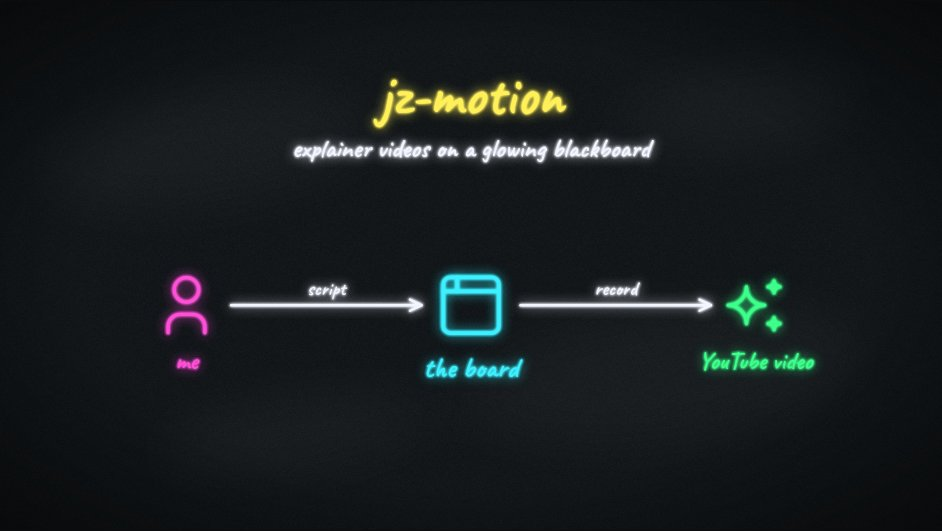

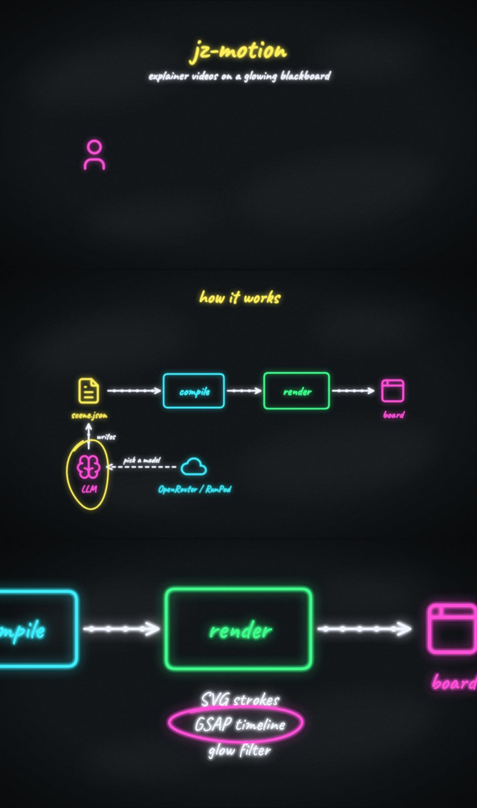

Jakub asked for animated previews; Claude rendered the timeline frame by frame (not a screen recording, so motion is smooth) and encoded APNGs and GIFs:

## Step 5: Feedback round: glow, logos, hardware, 3D

**Ask:** saturated colors but not so much glow that text is unreadable; logos of the main LLM labs (Anthropic, OpenAI, Google, Qwen, DeepSeek); hardware (GPU, Mac, DGX Spark); stretch goal: isometric 3D with three.js in the same style. And: **send screenshots of everything new for approval.**

- **Glow:** tight inner glow + dimmed halo with the crisp stroke on top; bolder handwriting.

  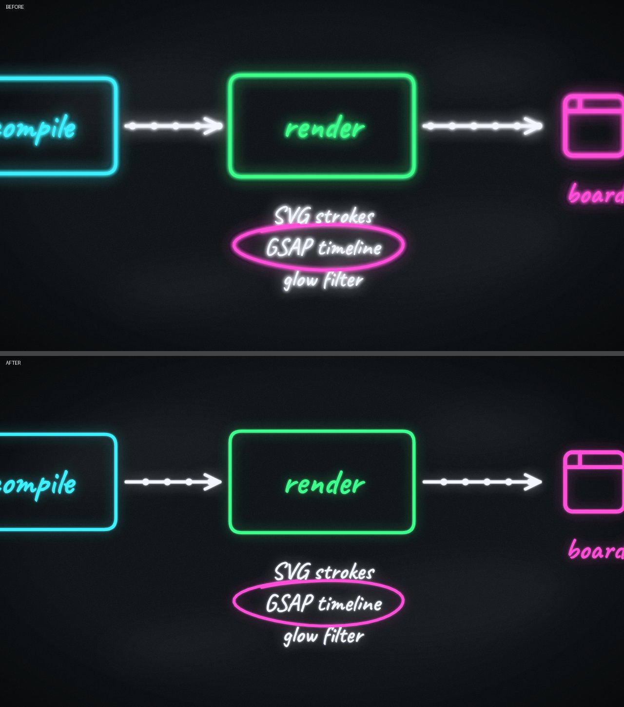

- **Logos:** from Simple Icons (CC0), drawn as a neon outline with a faint fill. OpenAI's logo is not in that set, so Claude drew it: six rounded links rotated around a center, with an over-under weave computed by hiding each link where the next one crosses it. Four variants were rendered; the cyclic weave was picked.

  

- **Hardware:** hand-drawn GPU, Mac Studio, Mac mini and DGX Spark in a slight 3D box style. The first versions were too small next to the other icons and the Spark's foam front clumped into a solid block, so they were redrawn (dot grille for the foam).

  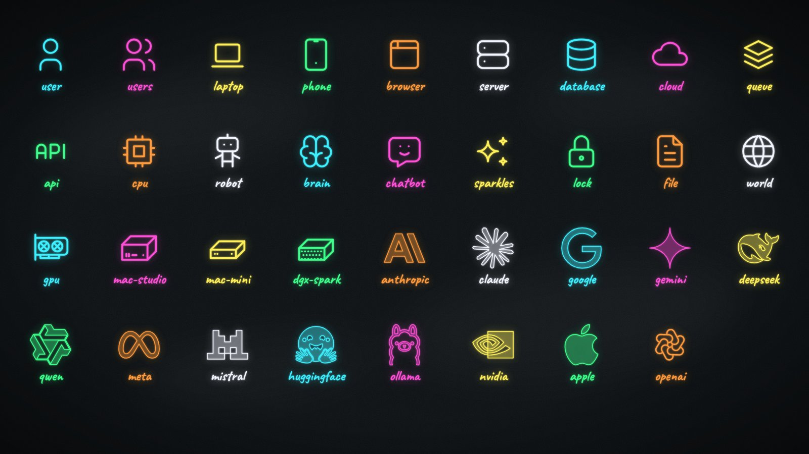

- **Examples:** "Who builds the models" and "Where do models run". A screenshot showed dashed boxes cut off at the top-left (the default SVG mask region was too small), fixed.

  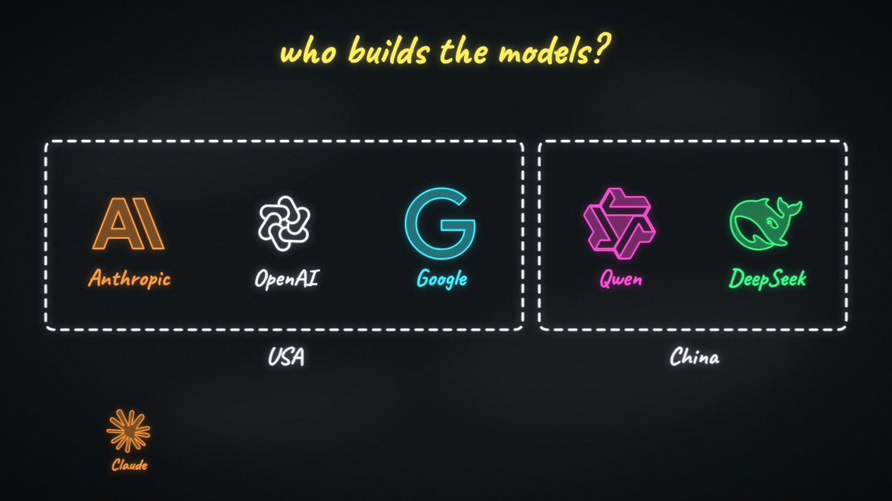
  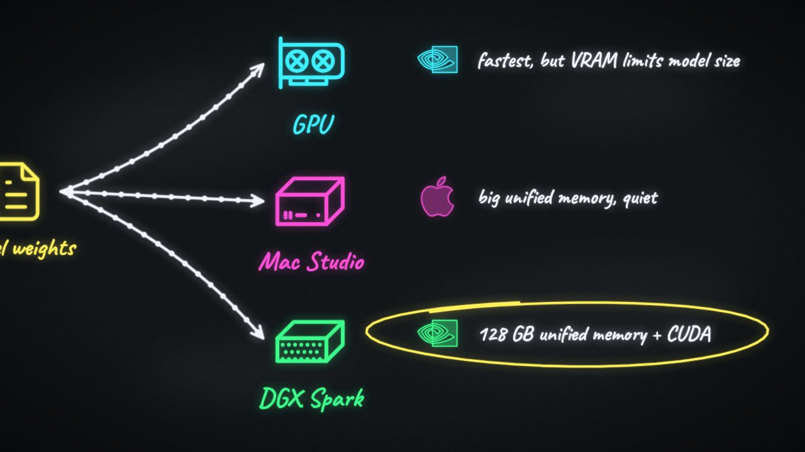

- **3D:** three.js does the 3D math and the isometric projection; the faces are drawn as SVG paths filled with the board color, so 3D objects glow, draw on and zoom exactly like everything else. New actions: rotate, spin, explode. A screenshot of an exploded GPU cluster showed cubes hidden under their base plate (sorting by center depth fails for big flat parts), fixed with a proper isometric paint order and a test for it.

  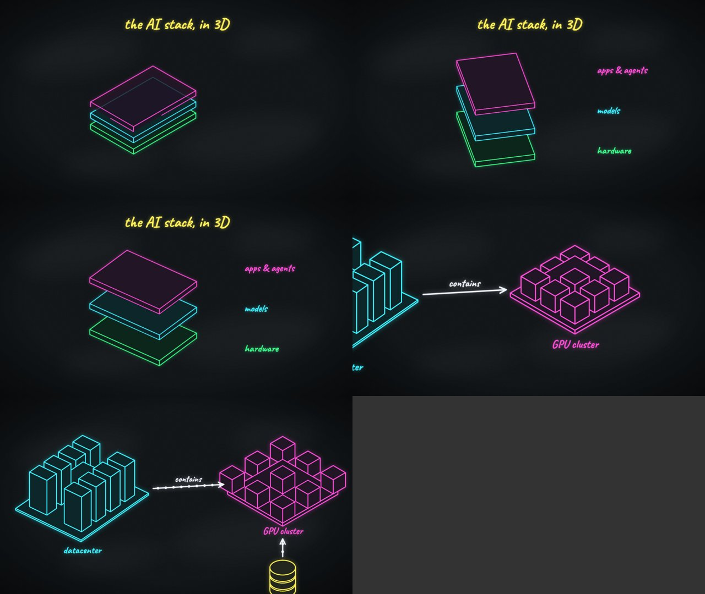
  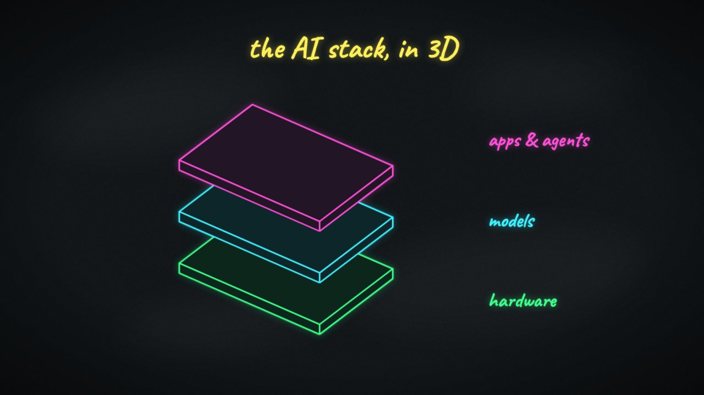
  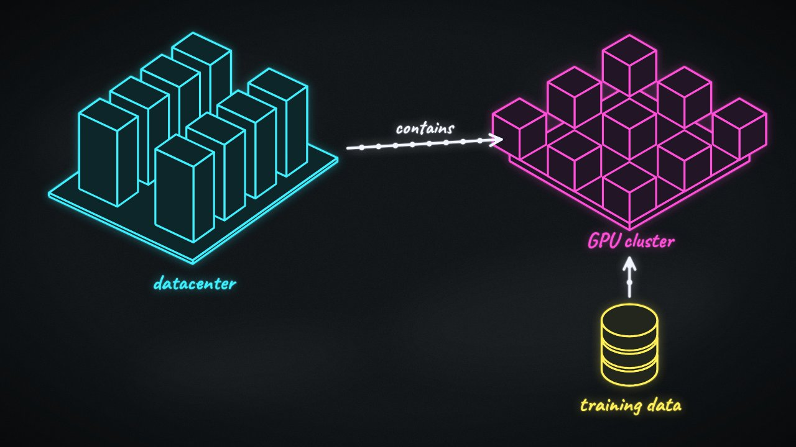

**Approved:** glow level, the hand-drawn OpenAI logo, the hardware drawings, the 3D look.

## Step 6: Into `main`, and this log

Jakub asked to put everything on `main` (pull request #1, merged), to keep this log of the steps, and to build next: (1) a visual editor, (2) LLM generation with switchable models, (3) charts.

## Step 7: The editor

Built an **Edit** mode next to **Play**:
- The board shows every element of a scene fully drawn. Click to select, shift+click for several, drag to move, scroll to zoom, drag the empty board to pan.
- A library palette (searchable icons with previews, text, box, 3D models); "Arrow" connects two selected elements.
- Beats as cards under the board: add, reorder, delete beats and actions; clicking an action highlights its targets on the board.
- A properties panel **generated from the schema** (zod → JSON Schema), so new fields and element types appear in the editor without extra work. Renaming an element updates every reference to it; deleting one also removes its arrows and its mentions in beats.
- Undo/redo for every change. The JSON stays the single source of truth, so the JSON tab and the visual editor are always in sync.

**Checked by:** unit tests for the edit operations (rename, delete, unique ids), and a browser script that selects, drags, adds a GPU, connects it with an arrow, adds a beat, undoes three times and switches to Play. The first screenshot showed an empty, mis-framed board: in development React mounts components twice, and the discarded board finished loading later and stored a bogus camera. Fixed by ignoring results from a board that is no longer current.

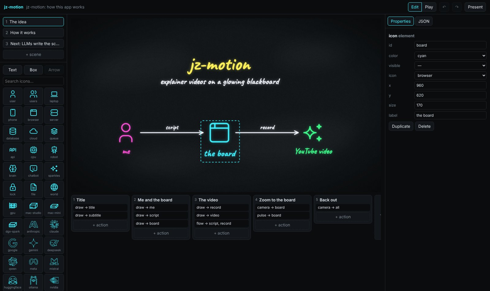
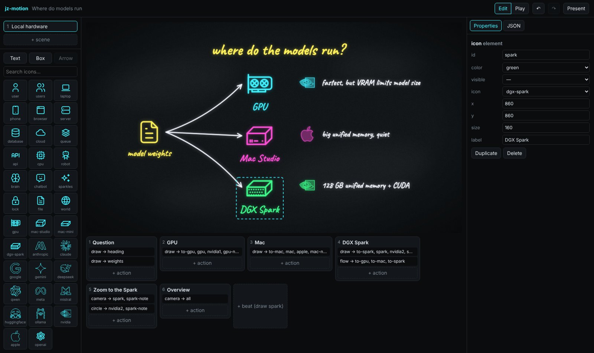

## Step 8: Generating scenes with LLMs

Built an **AI** tab:
- **Models** are any OpenAI-compatible endpoint: presets for OpenRouter and RunPod (vLLM), plus custom. Tick several to compare them on the same request.
- **The prompt is our own docs**: `docs/format.md` and the generated `docs/library.md` go into the system prompt, so keeping the docs accurate is what keeps generation accurate.
- **Repair loop:** the reply is compiled; if it does not load, the compiler's readable errors go back to the model, up to two times.
- **Results** show a live preview, time, tries, tokens and cost (OpenRouter reports cost); "Use this" replaces the presentation, and undo brings the old one back.
- Requests go through a small proxy in the local dev server (browsers can't call most model APIs directly), so API keys stay in the browser and on this machine.

**Checked by:** unit tests with a fake model (repair loop, giving up, edit mode, failures) and an end-to-end browser run against a **mock model server** (`npm run mock-llm`, also useful for trying the flow without keys). The unit tests found a real bug: an arrow pointing at an invalid element made the compiler throw instead of listing the error, which would have sent the model a confusing message. The compiler now never throws.

No real model has been tried yet: there are no API keys in the cloud environment. That is the next thing for Jakub to try.

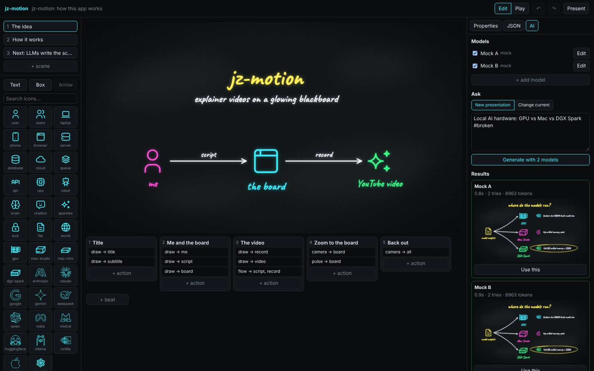
