# How we built jz-motion

A running log of how this project is made: a person (Jakub) and an AI coding agent (Claude Code, in a cloud session) working in a chat. Each step records what was asked, what was decided, what was built, how it was checked, and what was approved. It is kept up to date as we go, as material for the video about making this project.

## How we work

The loop we settled into:

1. **Talk first.** Jakub describes the goal in plain words. Claude proposes an approach and asks only the questions that change what gets built.
2. **Decide.** Jakub answers; decisions go into [design.md](design.md).
3. **Build in small steps** on a branch, with unit tests for the logic.
4. **Look at it.** Claude runs the app in a headless browser and takes screenshots of real frames. Several bugs were caught this way that tests did not catch.
5. **Approve.** Screenshots are sent to Jakub for each visible change; he approves or asks for changes.
6. **Commit and push**, then log the step here.

## Step 1: The idea (planning chat)

**Ask:** a desktop app, maybe Electron, for making technical explainer YouTube videos: blackboard-style animations (chalk or saturated markers) that are easy to edit, camera video of himself and a friend (picture in picture, side by side), and switchable AI models (OpenRouter, RunPod) to generate the animations. The first video should be about this project itself.

**Claude's proposal:**
- The key decision: the AI should write **editable scene data**, not pixels or video, so changing a word is a form field, not a regeneration. A small library of drawable components; scenes as JSON; the model fills in the JSON.
- Record each person as a separate track so layouts can change afterwards; sync tracks by audio.
- Models through OpenAI-compatible endpoints, so OpenRouter, RunPod and a self-hosted gateway are one code path, with a side-by-side compare mode.
- Phases: scene engine first, then AI, then camera and timeline.

## Step 2: Looking at the competition

Jakub pointed to an inspiration video (YouTube was blocked from the cloud environment, so Claude could not watch it), then to **Claude Motion** (Anthropic's animation feature for teams) and **HyperFrames** (HeyGen's open-source HTML-to-video renderer). Claude researched both:

- Both confirm the approach: an AI writes code or data that draws the video; no generated footage.
- HyperFrames uses HTML + GSAP timelines rendered frame by frame with a headless browser and FFmpeg. So we chose **GSAP** for animation, which keeps HyperFrames export open for later.

## Step 3: The pivot to a web app

**Ask:** start instead with a **web app**: a blackboard with **luminous markers**, multiple slides, animated hand-drawn clipart (apps, users, infrastructure, equipment), animated arrows, charts, zoom in and out, camera moves, flow animations. A reusable element library. Good documentation so an LLM can write slides later. Focus: app and AI development topics.

**Claude's plan:** presentation → scenes → elements + camera + **beats** (one beat = one presenter click; in video mode beats play back to back). Arrows and camera targets refer to element **ids**, not coordinates. SVG for sharp zooms, GSAP for seekable timelines, a zod schema as the single source of truth for the format and its docs.

**Decisions** (Jakub's answers):
1. One board per scene, with an option to carry elements over from the previous scene.
2. Marker colors: green, pink, yellow, cyan, orange, white.
3. Clipart made together as needed; no hand drawing for now.
4. Build in the `jz-motion` repo.

## Step 4: Phase 0, the engine

Built: the JSON format, a compiler that validates it and turns beats into a timed plan (with readable errors like `scenes.0.beats.2.actions.1: unknown element "db"`), an SVG + GSAP renderer (stroke-by-stroke drawing, handwriting reveal, neon glow, board texture, dots flowing along arrows, camera framing by id), and a player with a live JSON editor and full-screen present mode. 18 icons imported from Tabler by a script. An example presentation about the project itself.

**Checked by:** unit tests, then screenshots of real frames in a headless browser. The screenshots caught three bugs the tests could not see: arrowheads appearing before the line finished drawing, slanted arrows from labelled icons, and loose highlight circles. Also checked: stepping back to a beat gives a pixel-identical frame to arriving fresh.

Jakub asked for animated previews; Claude rendered the timeline frame by frame (not a screen recording, so motion is smooth) and encoded APNGs and GIFs:

## Step 5: Feedback round: glow, logos, hardware, 3D

**Ask:** saturated colors but not so much glow that text is unreadable; logos of the main LLM labs (Anthropic, OpenAI, Google, Qwen, DeepSeek); hardware (GPU, Mac, DGX Spark); stretch goal: isometric 3D with three.js in the same style. And: **send screenshots of everything new for approval.**

- **Glow:** tight inner glow + dimmed halo with the crisp stroke on top; bolder handwriting.

  

- **Logos:** from Simple Icons (CC0), drawn as a neon outline with a faint fill. OpenAI's logo is not in that set, so Claude drew it: six rounded links rotated around a center, with an over-under weave computed by hiding each link where the next one crosses it. Four variants were rendered; the cyclic weave was picked.

  

- **Hardware:** hand-drawn GPU, Mac Studio, Mac mini and DGX Spark in a slight 3D box style. The first versions were too small next to the other icons and the Spark's foam front clumped into a solid block, so they were redrawn (dot grille for the foam).

  

- **Examples:** "Who builds the models" and "Where do models run". A screenshot showed dashed boxes cut off at the top-left (the default SVG mask region was too small), fixed.

  
  

- **3D:** three.js does the 3D math and the isometric projection; the faces are drawn as SVG paths filled with the board color, so 3D objects glow, draw on and zoom exactly like everything else. New actions: rotate, spin, explode. A screenshot of an exploded GPU cluster showed cubes hidden under their base plate (sorting by center depth fails for big flat parts), fixed with a proper isometric paint order and a test for it.

  
  
  

**Approved:** glow level, the hand-drawn OpenAI logo, the hardware drawings, the 3D look.

## Step 6: Into `main`, and this log

Jakub asked to put everything on `main` (pull request #1, merged), to keep this log of the steps, and to build next: (1) a visual editor, (2) LLM generation with switchable models, (3) charts.

## Step 7: The editor

Built an **Edit** mode next to **Play**:
- The board shows every element of a scene fully drawn. Click to select, shift+click for several, drag to move, scroll to zoom, drag the empty board to pan.
- A library palette (searchable icons with previews, text, box, 3D models); "Arrow" connects two selected elements.
- Beats as cards under the board: add, reorder, delete beats and actions; clicking an action highlights its targets on the board.
- A properties panel **generated from the schema** (zod → JSON Schema), so new fields and element types appear in the editor without extra work. Renaming an element updates every reference to it; deleting one also removes its arrows and its mentions in beats.
- Undo/redo for every change. The JSON stays the single source of truth, so the JSON tab and the visual editor are always in sync.

**Checked by:** unit tests for the edit operations (rename, delete, unique ids), and a browser script that selects, drags, adds a GPU, connects it with an arrow, adds a beat, undoes three times and switches to Play. The first screenshot showed an empty, mis-framed board: in development React mounts components twice, and the discarded board finished loading later and stored a bogus camera. Fixed by ignoring results from a board that is no longer current.

## Step 8: Generating scenes with LLMs

Built an **AI** tab:
- **Models** are any OpenAI-compatible endpoint: presets for OpenRouter and RunPod (vLLM), plus custom. Tick several to compare them on the same request.
- **The prompt is our own docs**: `docs/format.md` and the generated `docs/library.md` go into the system prompt, so keeping the docs accurate is what keeps generation accurate.
- **Repair loop:** the reply is compiled; if it does not load, the compiler's readable errors go back to the model, up to two times.
- **Results** show a live preview, time, tries, tokens and cost (OpenRouter reports cost); "Use this" replaces the presentation, and undo brings the old one back.
- Requests go through a small proxy in the local dev server (browsers can't call most model APIs directly), so API keys stay in the browser and on this machine.

**Checked by:** unit tests with a fake model (repair loop, giving up, edit mode, failures) and an end-to-end browser run against a **mock model server** (`npm run mock-llm`, also useful for trying the flow without keys). The unit tests found a real bug: an arrow pointing at an invalid element made the compiler throw instead of listing the error, which would have sent the model a confusing message. The compiler now never throws.

No real model has been tried yet: there are no API keys in the cloud environment. That is the next thing for Jakub to try.

## Step 9: Charts

Added a `chart` element (bar, line, donut pie) and a `set-values` action:
- `draw` writes the title, draws the axes, then grows the bars, traces the line or sweeps the slices while the values count up.
- `set-values` animates to new numbers, for "before / after" moments. The compiler sizes the value axis to fit every value the chart shows in the scene, so bars never overflow.
- Like the 3D objects, charts are redrawn every frame from a few animated numbers, so scrubbing and stepping back stay exact.
- The editor got a "Chart" button; data is edited in the properties panel (switching bar → line is one dropdown).

**Checked by:** tests for the value animation, axis rounding and errors (wrong number of values, set-values on a non-chart), and screenshots of each chart while drawing and after a change.

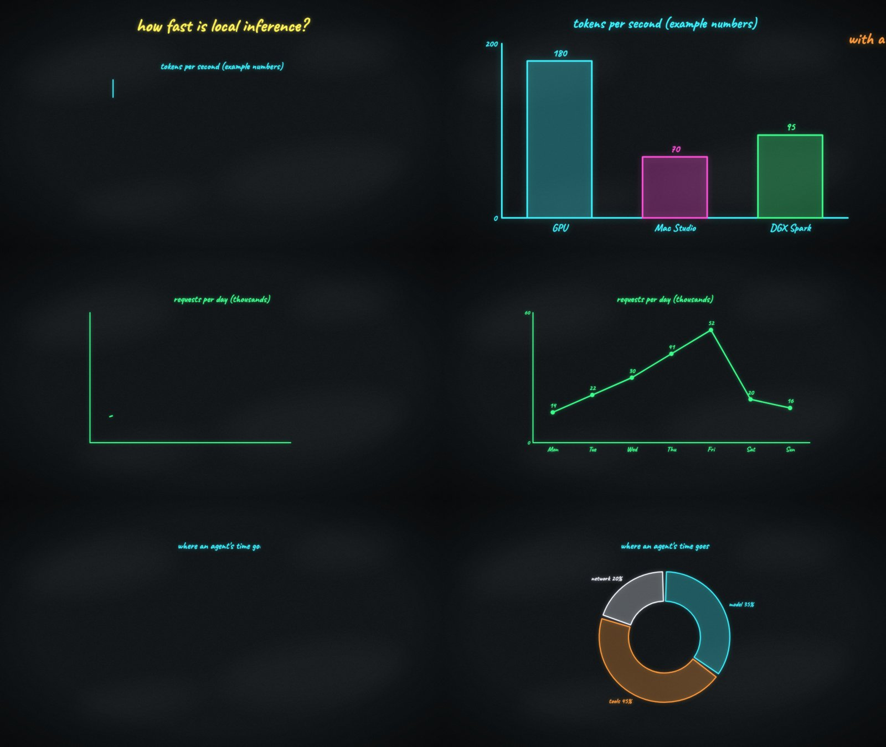

## Step 10: Into `main` again

The editor, LLM generation and charts went to `main` as pull request #2. Next for Jakub: try the AI tab with real models (OpenRouter or RunPod keys), and decide what the first real video covers.

## Step 11: Videos: export, recording, camera layouts

Jakub asked for the three pieces that turn a presentation into a YouTube video.

- **A performance** is the list of moments when a beat started (and what it played), recorded from the presenter's clicks or generated with even pauses. Given one, every frame of the video is fully determined, so exporting is exact and repeatable.
- **Export:** a hidden render page (`/?render`) draws any moment of a presentation. Playwright steps it frame by frame and pipes JPEGs into FFmpeg, which encodes H.264, lays out camera tracks and mixes the audio. There's a button in the new **Video** tab and `npm run export` on the command line.
- **Recording:** **● Record** in Play mode saves microphone, camera and every click as a *take* on disk, with a live camera preview while presenting.
- **Layouts per beat or scene:** board, pip, pip-left, camera (board small), side (two people). A friend's recording is added to a take and lined up by matching the sound of the two tracks.

**Checked by:** tests for timing, layouts over time, the FFmpeg command and the sound matching; a full run in a browser with Chromium's fake camera and microphone (record, add a "friend" track, export, check a frame of each layout); auto-sync found a 2.00 s offset as 1.97 s.

**What the measurements changed:** the first export took 8× real time. Timing it showed that drawing a frame takes 3 ms but taking the screenshot 170 ms, and most of that was the board's static texture (noise and a large blur) being re-filtered every frame. The texture is now painted once into a bitmap (same look, also lighter for live playback), and frames render in parallel browser pages: 34 s of video went from 273 s to 112 s on the 4-core cloud machine.

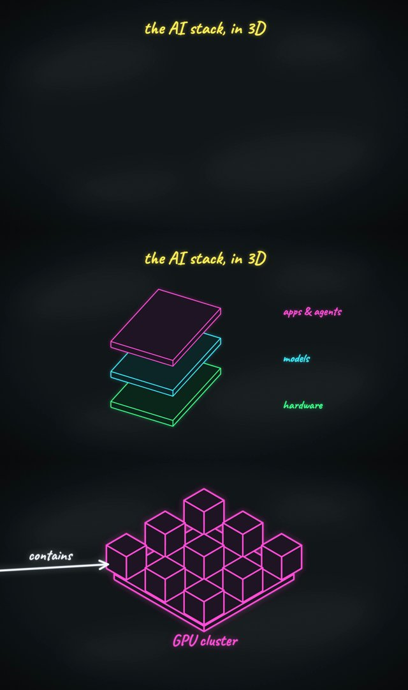
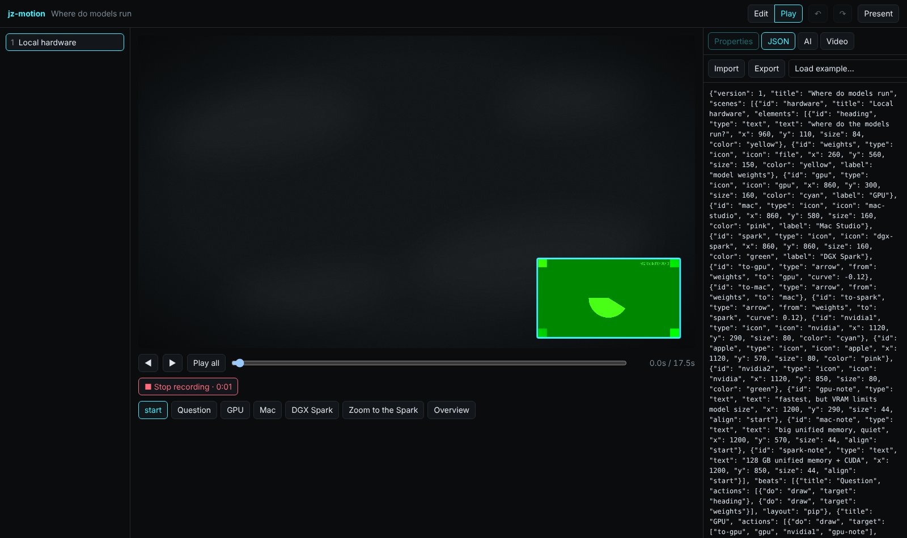
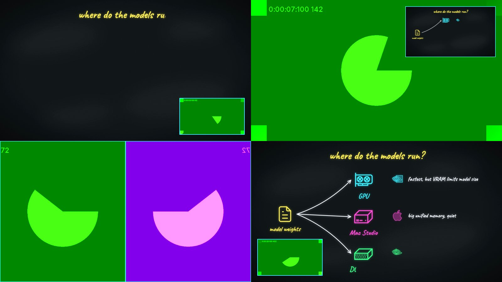

## Step 12: A logo

Jakub asked for a more fun logo. Three design rounds, each a sheet of options rendered in the board's own style:

1. Four directions: JZ with an orbiting swoosh, a hand-drawn play button, a marker drawing a squiggle, JZ as a node diagram.

   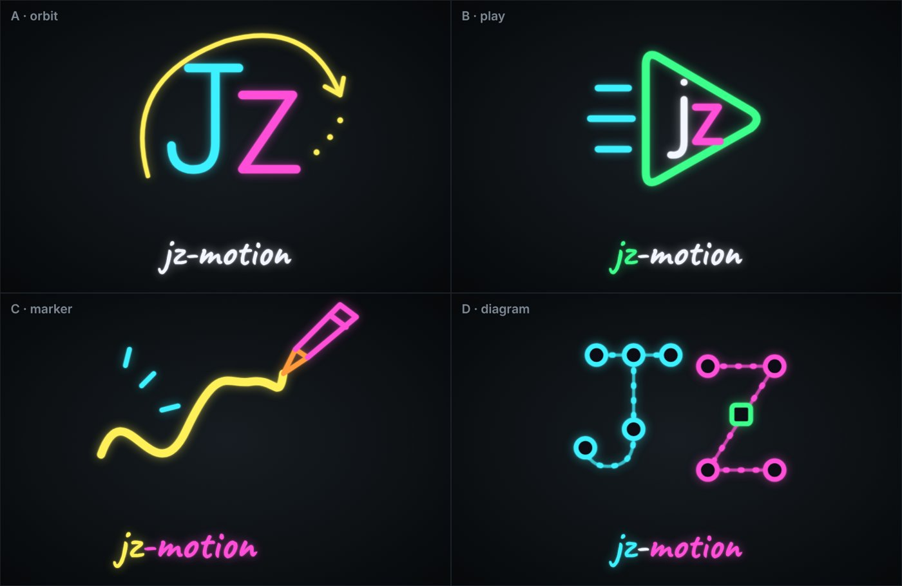

2. Jakub: big outlined JZ with a smaller handwritten "motion". Three placements of "motion": a signature underneath, written across, side by side.

   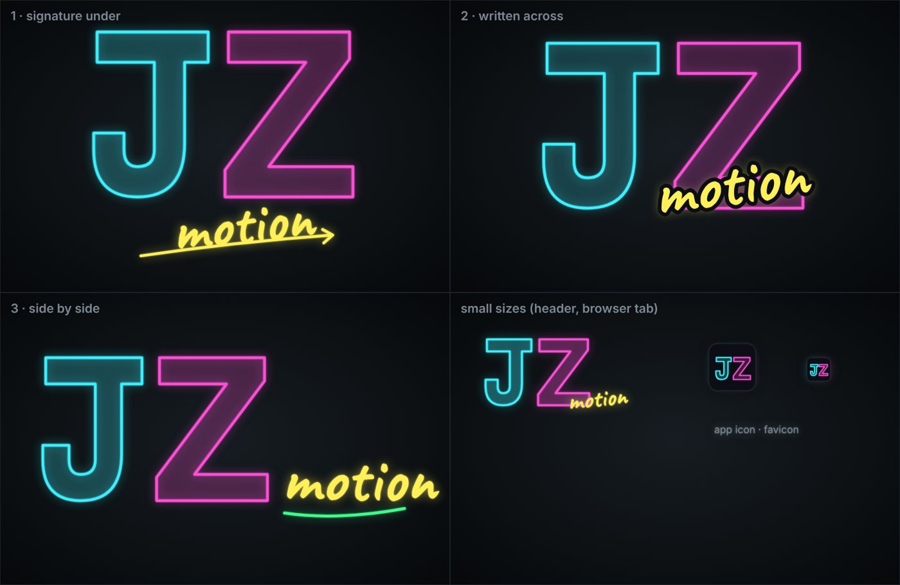

3. Jakub: between the first two placements, letters bolder and closer, "motion" bigger and overlapping. Chunky slanted letters with the J overlapping the Z, in three treatments: neon tube, 3D shadow, both.

   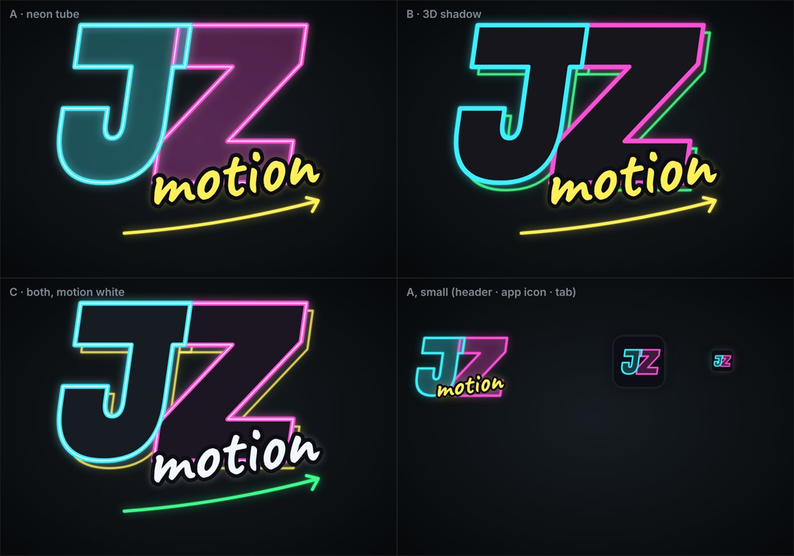

Jakub picked **C** (neon tube + shadow, white "motion", green arrow). `npm run logo` now builds every size from one script: the full logo and JZ mark as SVG ("motion" converted from the Caveat font to outlines, so it needs no fonts), app icons, and favicons that drop the shadow and glow at 16 to 48 px so they stay crisp. The app header and browser tab use it.

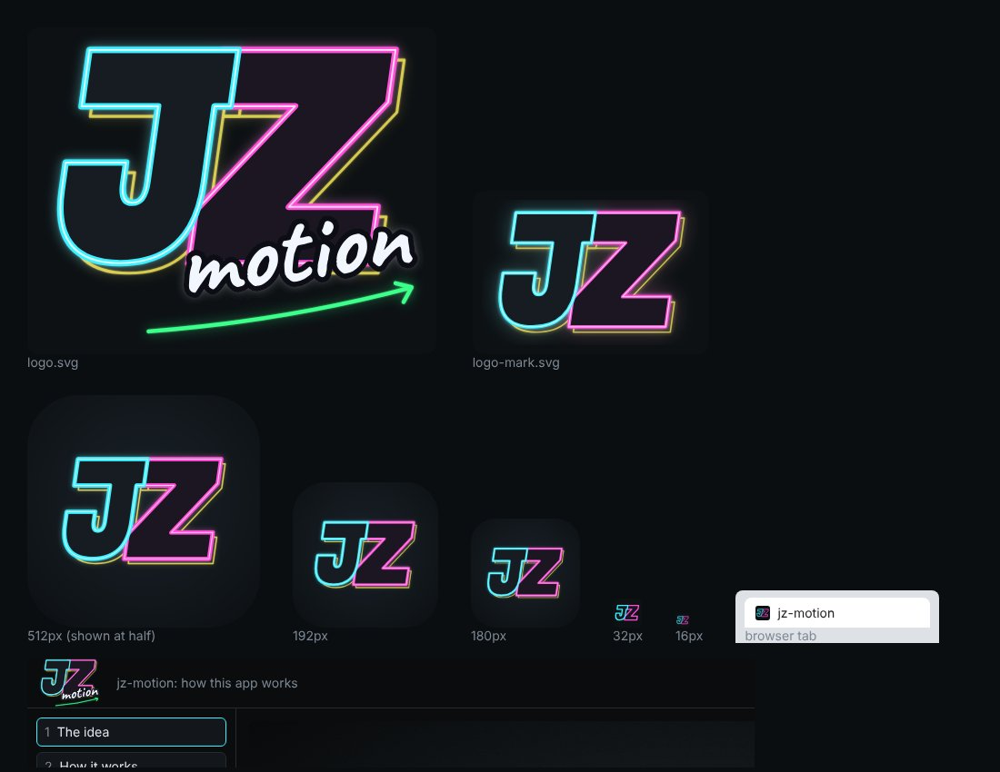

## Step 13: Presentations, and editor fixes from real use

Jakub tried the app and asked for:
- **Presentations as the top level.** A home screen of cards with a live preview of each presentation; new (blank or from an example), open, rename, duplicate, delete. Presentations are JSON files in `presentations/`, saved half a second after each edit (browser storage when there is no local server). The address (`#/p/<id>`) keeps a presentation open across reloads, takes remember which presentation they belong to, and the old single browser draft became the first presentation.
- **Colors as a palette**: swatches instead of a dropdown.
- **"I can't add an arrow."** The button only worked after a hidden shift+click on two elements. It is now a tool: click Arrow, click the start, click the end.
- **Resize handles**: corner handles on the selected element; icons, text and 3D models keep their proportions, boxes and charts stretch (Shift keeps proportions).

**Checked by:** browser scripts for each (resize an icon and a box, pick a swatch, connect two elements, create / rename / duplicate / delete presentations and check the files on disk). The first resize and arrow run failed while the same checks passed afterwards; logging every pointer event showed the code was right and the page had loaded mid-change, so the checks were repeated twice more to rule out flakiness.

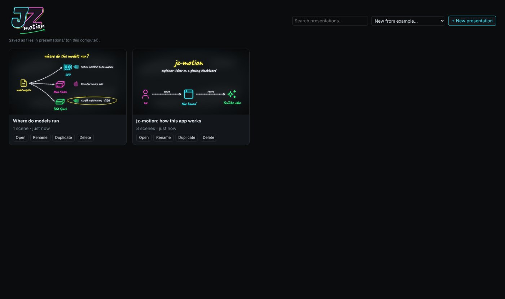
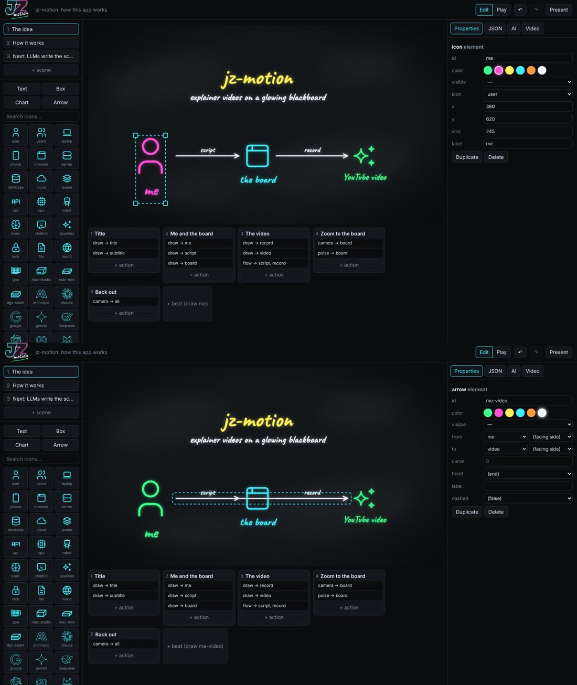

## Step 14: Markers instead of dots

Jakub liked the palette but wanted the actual marker tips instead of circles. Colors are now a tray of markers (chisel tip, collar, a colour band on the body): the chosen one stands up out of the tray and glows in its ink, and a marker lifts halfway when hovered. One detail found by the screenshots: the tray hides the markers' lower halves, and a hidden-overflow box can still be scrolled (the test tool scrolled it while hovering), which shifted every marker; `overflow: clip` can't be scrolled.

## Step 15: JSON editor, clipart, and working with LLMs everywhere

Jakub's next list: a nicer JSON view (full screen, folding, colours, this scene or the whole file), presentations from a script and from a recording, clipart including the jz-motion logo, chart types as icons, creating icons and clipart by describing them to a model (with the rules shown), and chatting with a model inside the editor.

- **JSON editor:** CodeMirror with the board's colours, folding, search and syntax errors marked inline; a switch between the open scene and the whole file (a scene's edits apply as soon as they are valid); full screen.
- **Pictures instead of names** for chart types, camera layouts, text alignment and arrowheads.
- **Clipart:** library items can now be multi-coloured drawings (`parts`, each with its own marker colour, width and fill). The logo build script also writes the jz-motion logo as clipart, so the board version always matches the real logo.
- **Making icons and clipart with AI:** describe it; the rules sent to the model are shown (grid, stroke-only, drawing order, allowed colours); the reply is checked against them and sent back if it breaks them; compare drawings from several models and save one to `library/`. Saved items work on the board, in exports, and are listed to models writing presentations.
- **Chat in the editor:** the AI tab is now a conversation that changes the open presentation (undoable) or answers questions; comparing several models stays as a second mode.
- **From a script / from a recording** on the home screen: a chat that builds a draft presentation with a live preview. Recordings are transcribed through any OpenAI-compatible speech-to-text service; the model gives each beat a `cue` from the timestamps, and the recording becomes the presentation's first take, timed to the speech.
- Every AI feature goes through one loop: ask for JSON, check it, send the problems back.

**Bugs found on the way:**
- Drawing the logo showed two old bugs: a dot at the start of every line before it is drawn (the dash pattern was one unit short), and paths made of several pieces (letters of a word, logos) drawing all their pieces at once (a dash pattern restarts on every piece). Paths are now split into pieces drawn in turn; tested.
- The home dialogs crashed in the browser: `scrollTo()` returns a promise in current Chrome, and a one-line React effect returned it as if it were a cleanup function.

**Checked by:** 45 unit tests, and a browser run of every new flow against an extended mock model (chat, icons, clipart, transcription), including undoing a chat change and checking the files in `library/` and the take's cue timing.

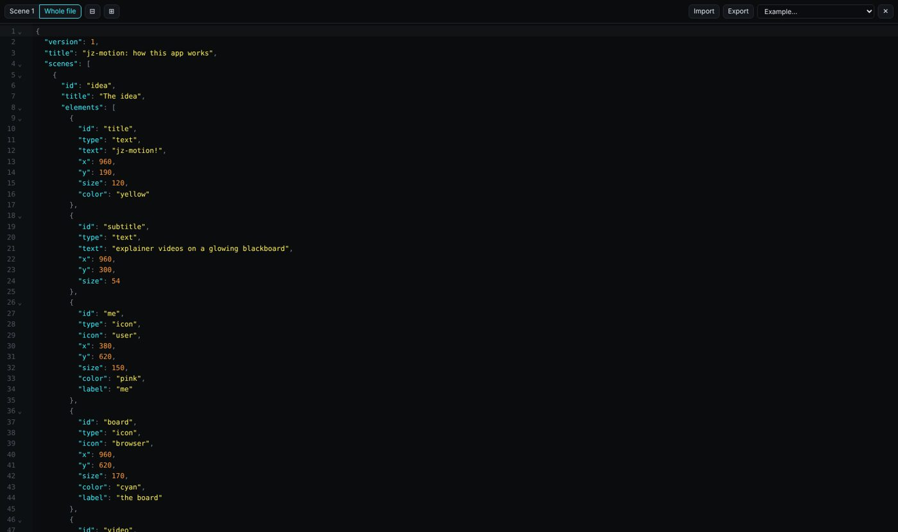
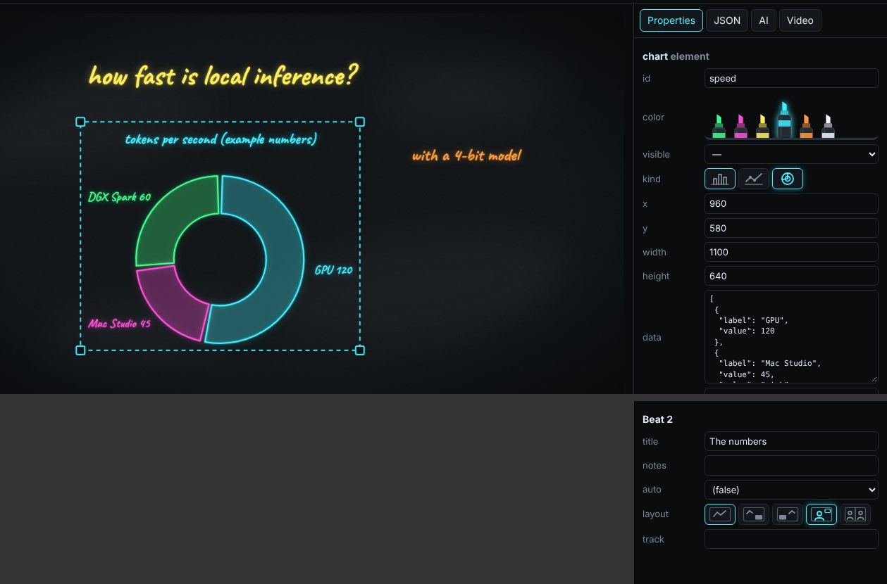
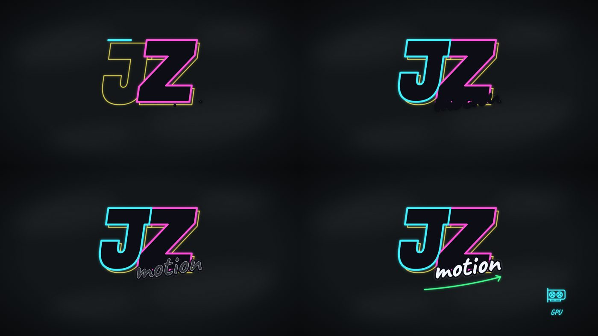
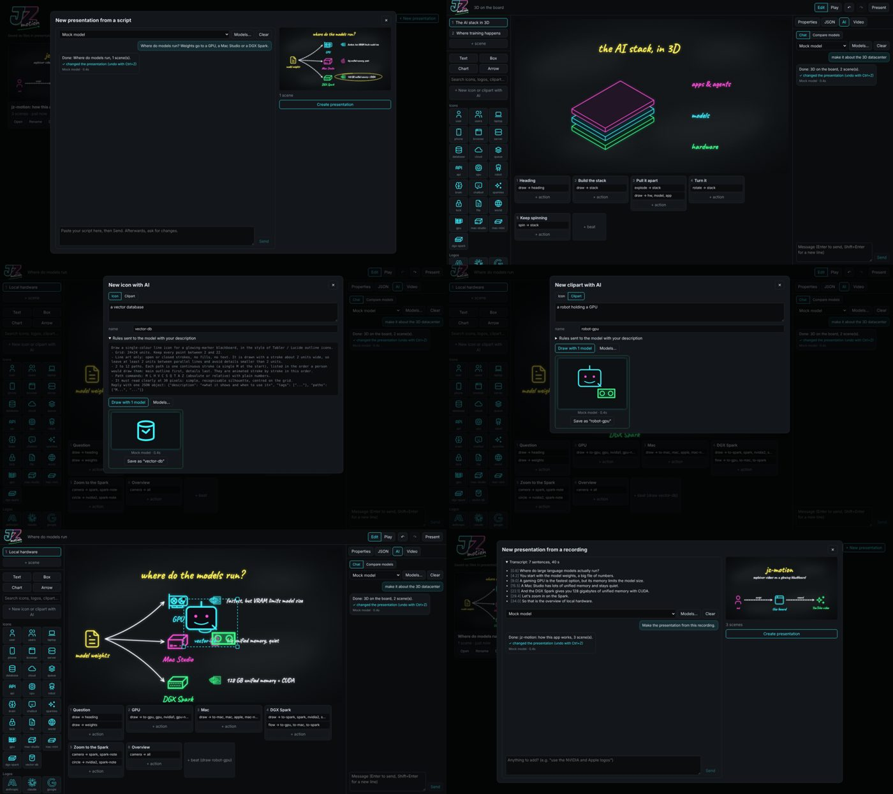

## Step 16: Editing text on the board

Jakub wanted to edit text and labels where they are. Double-clicking a text, a label (icon, box, arrow, 3D) or a chart title (or pressing Enter with the element selected) opens a text box exactly over it, in the same handwriting, colour and size, following the zoom; Enter keeps it, Esc cancels, clicking away keeps it. An element without a label gets one; clearing a label removes it. The renderer now marks which piece of text belongs to which field, so the editor knows where each one is on screen.

**Checked by:** a browser run that edits a title, edits a label while zoomed in, cancels with Esc, removes and re-adds a label with the keyboard, and checks the saved file after each step.

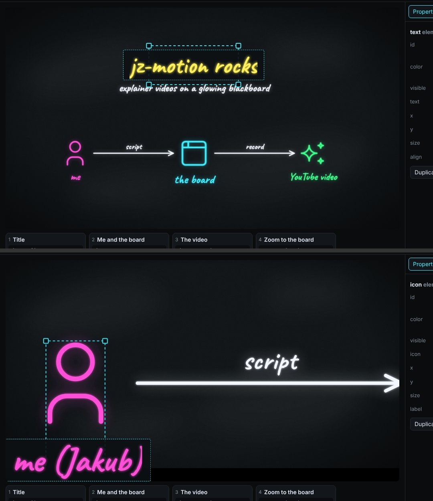

## Step 17: A prompt box home, settings, and AI inside each scene

Jakub's next list: a home screen like Gemini or Lovable (one chat box in the middle that switches between a topic, a script and a recording, with a model chosen per kind), a place for API keys (and the question whether a Claude subscription could be used), a smoother first animation for bar and line charts, clearer scene properties, adding scenes, clipart and 3D models with AI, and asking AI to change the open scene.

- **Home:** "What do you want to explain?" over one prompt box with Topic / Script / Recording chips, an attach button for recordings and a model picker that remembers its choice per kind. Sending opens the draft chat with the request already sent (or the recording already transcribing). Presentations are listed below with a search box.
- **Settings** (gear on home and in the editor): models and their API keys, the default model per kind of start, the speech-to-text service. On the subscription question: a claude.ai subscription can't be used as an API key by another app; use an Anthropic API key or OpenRouter.
- **Chart intro:** the title, axes and labels used to take most of the draw time, so the bars appeared in a rush at the end, one strictly after another. Now the growing gets about 60% of the time, bars overlap and ease out, and the line is traced smoothly with its dots popping in as the line reaches them.
- **Clearer properties:** every field has a plain name and a **?** with help ("continue from previous scene" instead of `inherit`, "start view" with *Use current view* / *Whole board* instead of camera numbers, "play automatically", "speaker notes"); video settings are grouped under *Video export* with a track picker (me / friend / other); ids and rarely needed fields are under *Advanced*.
- **Creating with AI** is now one dialog for a scene, an icon, clipart or a 3D model: the rules are shown, the reply is checked and repaired, previewed, then kept. A new scene goes after the open one (after any scenes that continue from it, so they don't lose their elements) and opens. 3D models are saved to the library like icons and listed to models writing presentations.
- **Ask about this scene:** a bar above the beats sends "change only scene N" with the whole presentation; the change is undoable and the editor stays on the scene.

**Bugs found on the way:** a new scene inserted between a scene and one that continues from it broke the second one ("unknown element"); fixed and tested. After adding a scene the editor reopened the old one; it now opens the new one.

**Checked by:** 47 unit tests and browser runs of every flow against the mock model: home topic/script/recording with the remembered models, settings, *Use current view*, scene ask with undo, a scene and a 3D model made with AI.

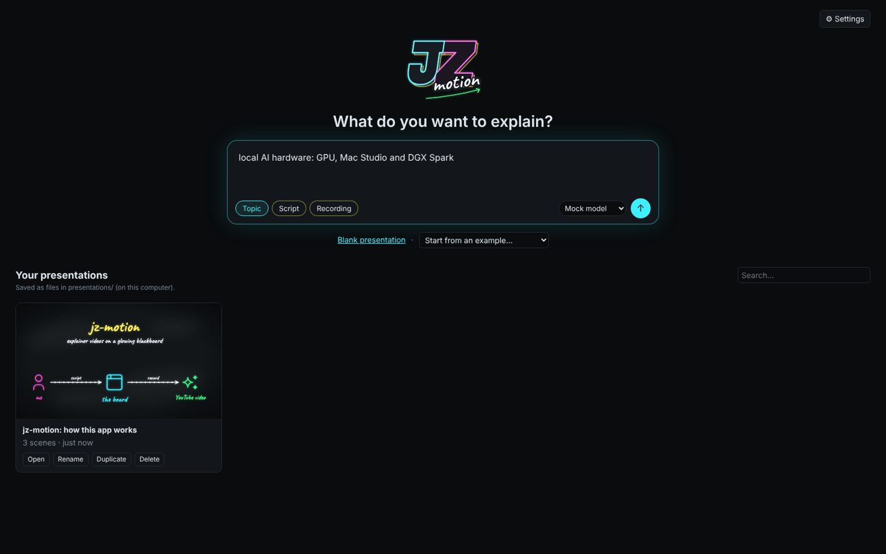
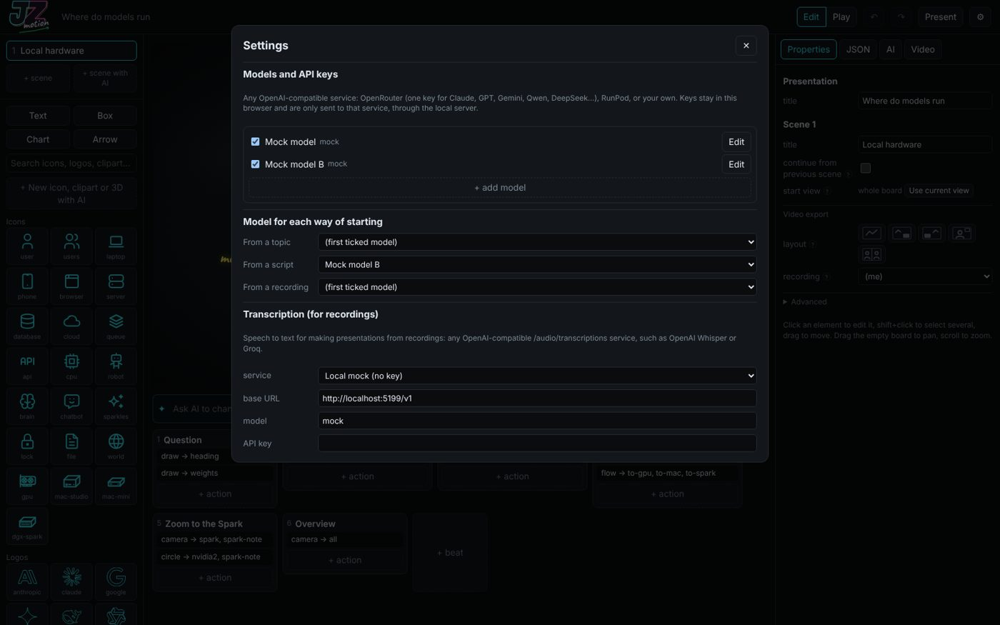
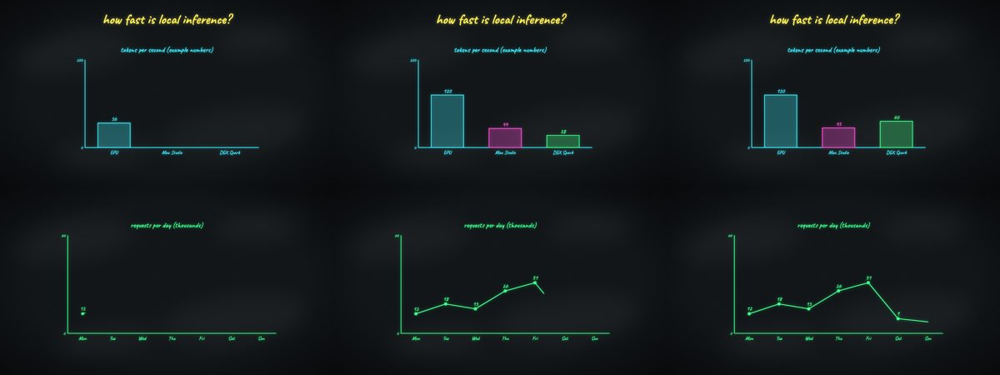
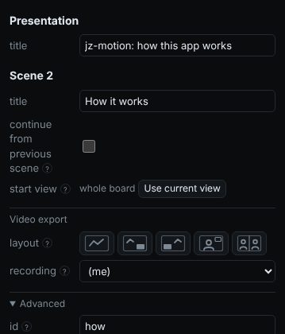
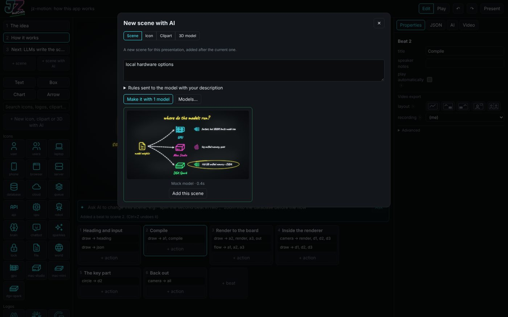
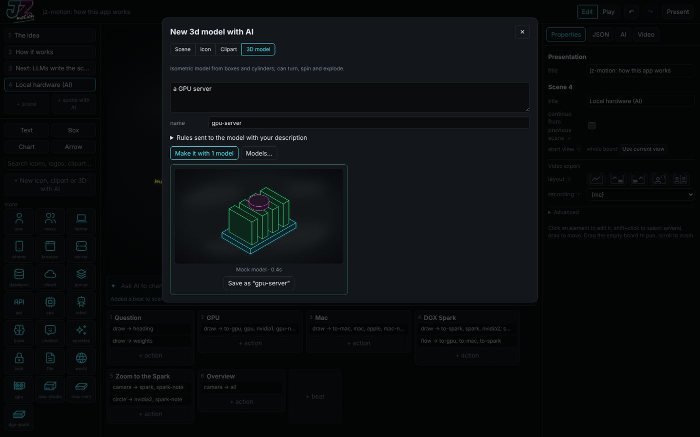
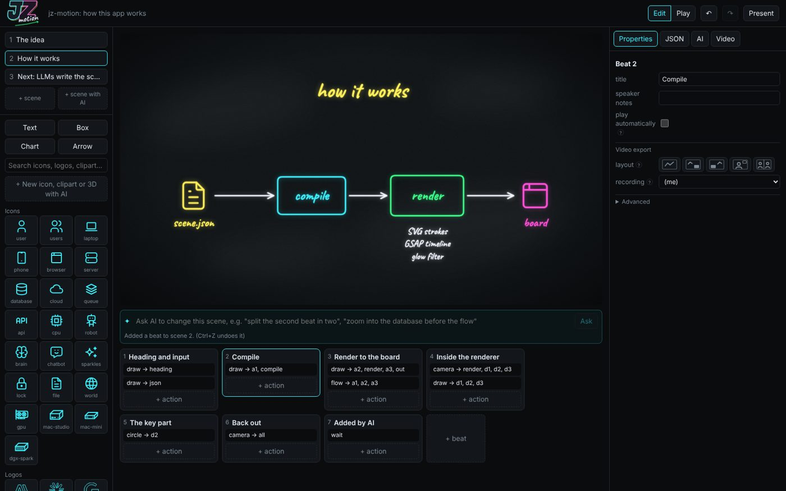

## Step 18: Safer deleting, a beats storyboard, and a library window

Jakub found that deleting the open scene blanked the whole app, that confirmations used the browser's own dialog, that beats and actions were hard to read, and asked for a proper place to manage icons, clipart and 3D models.

- **The blank screen:** after deleting the last scene the editor still pointed at a scene number that no longer existed, and the first panel to read it crashed React. The open scene is now always kept within the scenes that exist, and deleting moves to the scene before.
- **In-app confirmations:** one small dialog (title, what goes with it, Cancel / a red Delete; Enter and Esc work) replaces every browser `confirm()`: scenes, presentations, takes, recordings, replacing with an example, and the library.
- **Beats as a storyboard:** beats run left to right with how each starts (on click or auto) and how long it takes. Each action shows a coloured verb (green reveals, pink hides, yellow draws attention, cyan moves, orange camera), chips for the elements it acts on in their own marker colours, and a small bar showing when it runs inside the beat, so "together with the previous one" is visible at a glance. The compiler now reports each action's start and end for this. **+ action** opens a menu of the common actions for the selected elements, and actions can be dragged to reorder them or to another beat.
- **Library window** (⤢ next to the library search, and **Library** on the home screen): everything by group with counts (icons, logos, clipart, 3D models, made by me), search, large tiles, and a side panel that draws the selected item in on a small board (click to replay, try marker colours), its description and tags, and the JSON to use it. Things you made can be renamed, re-described and deleted there, and "New with AI" makes icons, clipart and 3D models without leaving it.

**Checked by:** 48 unit tests (new: action timing) and browser runs: deleting the open last scene (cancel, delete, undo), adding actions from the menu and dragging one to another beat, and in the library making a 3D model with AI, renaming it, deleting it, and double-clicking a built-in model onto the board.

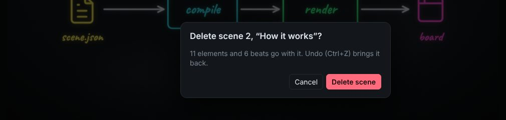
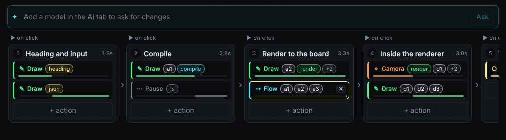
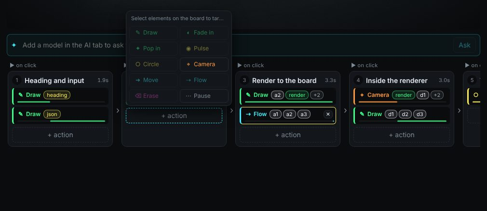
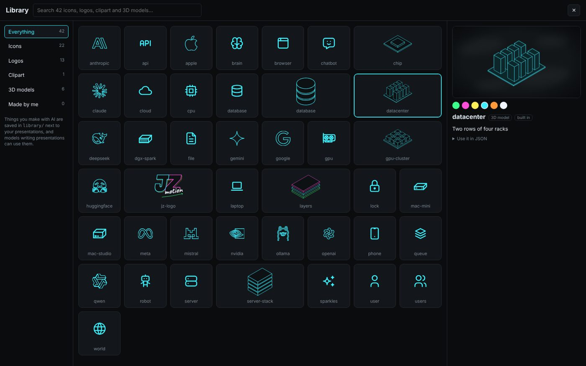
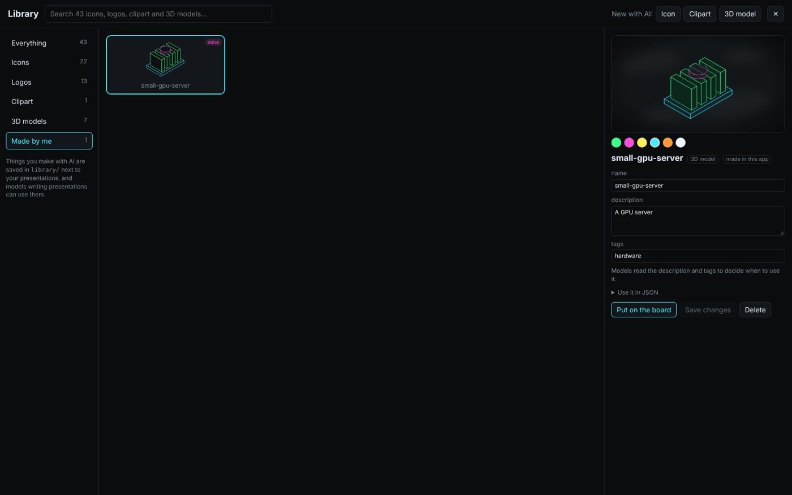

## Step 19: Talking an item over until it's right

Jakub wanted to create items from the library too, and to chat about an element until he's happy with it before it goes into the library.

- **Making something with AI is now a conversation.** Describe it and send; the reply appears as *Version 1* with a preview. Then ask for changes ("make the body pink", "add a fan on top"); each reply is the next version. Click any version to look at it large, and save the one you like under a name. You can switch models between replies, and a reply that breaks the rules even after the automatic repairs says so and you just ask again.
- Under the hood, every follow-up sends the first request, then each version and the change asked of it, and the model replies with the whole item again under the same rules, so every version is checked the same way (tested).
- **From the library window, everywhere:** "New with AI" (icon, clipart, 3D model) now works from the home screen's library too. **Refine with AI** on your own items starts the conversation from the saved version and saves over it; **Make a variation with AI** on a built-in item starts from it and saves a new one (named `my-<original>`).
- Scenes made with AI ("+ scene with AI" in the editor) use the same conversation.

**Checked by:** 49 unit tests and browser runs against the mock model: a clipart made in three versions with a model switch, saving an earlier version; refining it from the library; a variation of a built-in 3D model; a scene refined once and added.

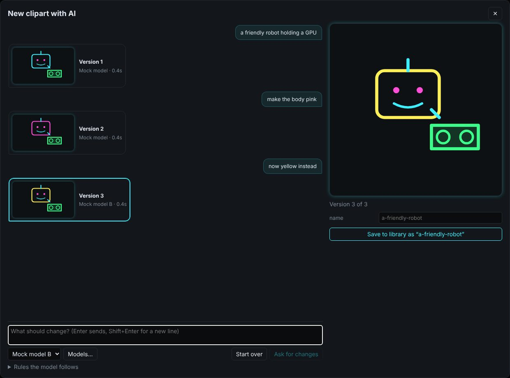
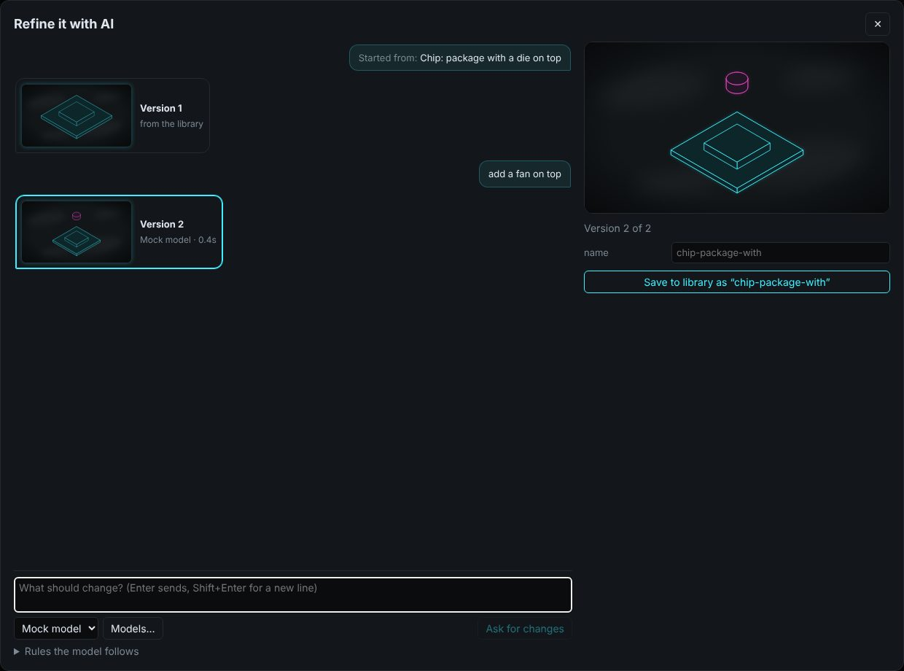
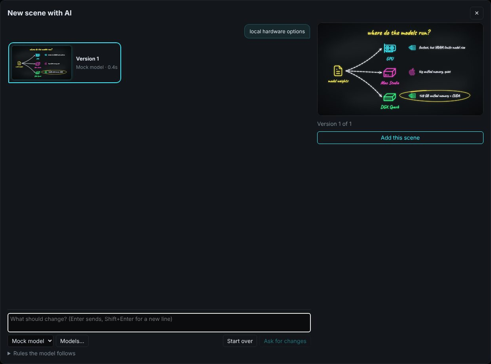

## Step 20: Drawing-program polish

Jakub's notes: scrollbars too big, position and size fields that don't look like a drawing program, text getting selected while moving a box, and a more graphical choice of border and arrow styles (with dotted, and a big arrow).

- **Scrollbars** are thin (6 px) and nearly invisible until hovered, everywhere.
- **Position and size** sit at the top of an element's properties as a compact grid: X, Y, W, H, a size or scale field, rotation and corner radius, each with a small letter or picture inside the field. Dragging a label sideways changes the number (Shift for steps of 10); a drag is one undo step.
- **No more selecting text while dragging:** the board can't start a text selection, and nothing on the page gets selected while something is being moved.
- **Line styles:** boxes and arrows take `line` (solid, dashed, dotted) and `weight` (normal, bold; a bold arrow also gets a bigger head), picked from pictures. Dots are zero-length dashes with round ends, drawn in through the same mask as dashes. Older files with `"dashed": true` still work, and choosing a style tidies that away.

**Checked by:** 49 unit tests and a browser run that drags a box across the board (checking nothing gets selected), sets a box to dotted and bold, drags its W label, and makes an arrow dashed and bold, checking the saved file each time.

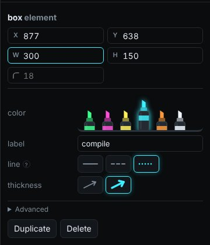
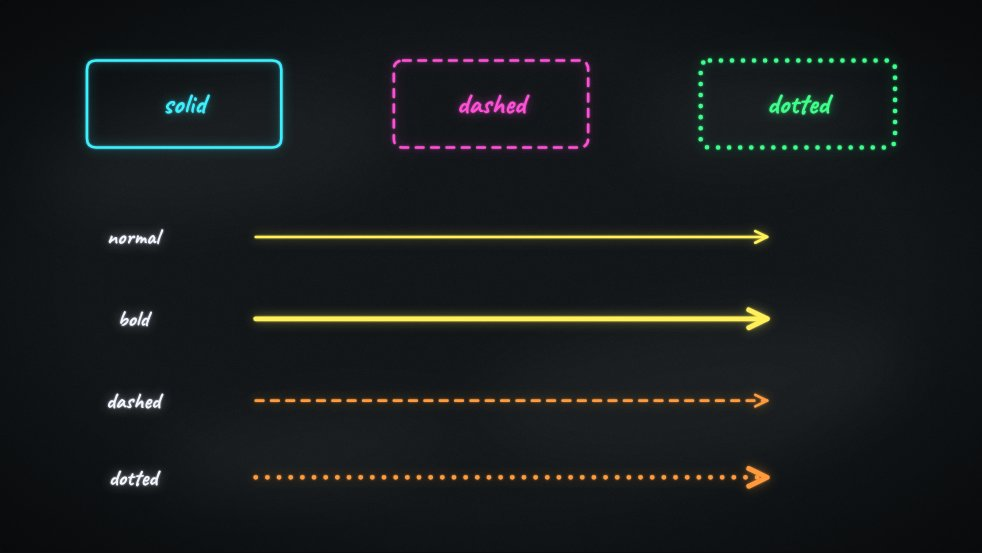

## Step 21: Tidier left panel

"+ New scene" and "✦ New scene with AI" now sit on their own lines under the scenes, and the Icons / Logos / Clipart / 3D headings have a little space above and below so they read as headings over their pictures.

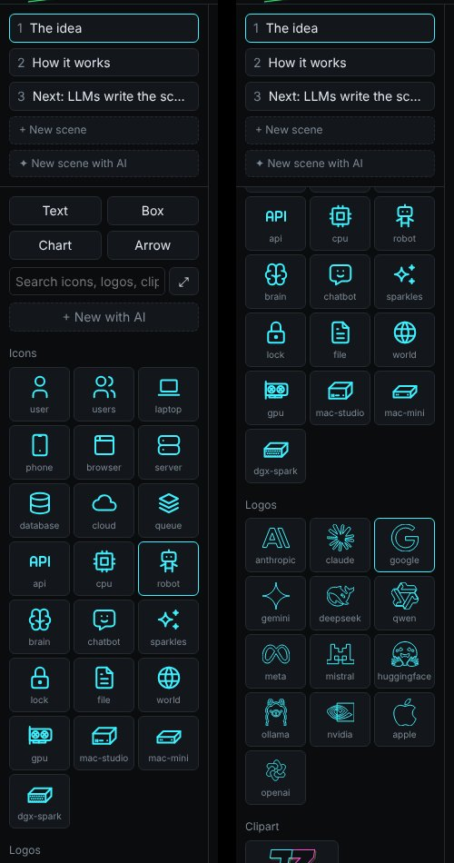
